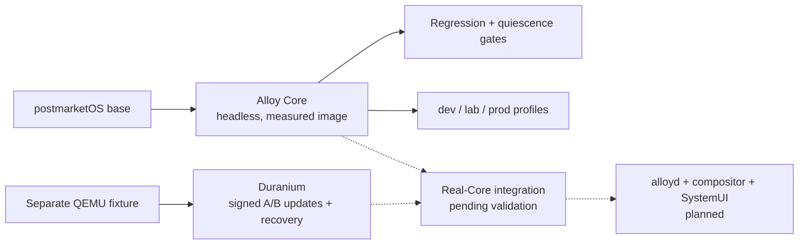

<div align="center">
  
  <h1>Alloy OS</h1>
  <p><strong>A lightweight Linux OS for laptops and tablets, built on postmarketOS.</strong></p>
  <p>
    <a href="INSTALL.md">Build &amp; use</a> ·
    <a href="docs/README.md">Documentation</a> ·
    <a href="#whats-in-the-repo">Components</a> ·
    <a href="#desktop-performance-goals">Performance</a> ·
    <a href="#roadmap">Roadmap</a> ·
    <a href="#project-status">Status</a> ·
    <a href="https://github.com/Pro42good/AlloyOS/issues/new">Report an issue</a>
  </p>
  <p>
    <a href="#project-status"></a>
    <a href="https://postmarketos.org"></a>
    <a href="LICENSE"></a>
  </p>
</div>

---

Alloy is being built for touch and keyboard, with web, native Linux, and
Android apps sharing one desktop. The idea is to start small, bring up app
runtimes when they're needed, and get those resources back when you're done.
The system image has its own signed update and recovery path.

The interesting part is what happens after you close an app: the system should
settle back down. That means accounting for memory, timers, background work,
and the cost of each runtime as the desktop takes shape. Alloy starts with a
measured headless base so every new layer has a cost we can actually see.

**Today, the foundation works in QEMU:** a small postmarketOS Core, automated
functional and idle checks, and Duranium's signed A/B update and recovery
prototype. The compositor, desktop shell, and unified app experience are still
on the [roadmap](#roadmap). This is an OS under active development.

## Build and use

Start with the [installation guide](INSTALL.md). It covers building Alloy Core,
booting it in QEMU, and trying the update and recovery fixture. The same setup
script runs each workflow.

```sh
./scripts/setup.sh --help
```

| Workflow | Command | What you get |
| --- | --- | --- |
| Build Core | `./scripts/setup.sh core-build BASE.qcow2` | A headless image assembled from your postmarketOS base, with regression and idle checks. |
| Boot Core | `./scripts/setup.sh core-run CORE.qcow2` | A serial-console VM using a disposable disk overlay. |
| Test Duranium | `./scripts/setup.sh duranium-test` | Unit tests, a rebuilt update fixture, and the QEMU integration scenarios. |
| Explore Duranium | `./scripts/setup.sh duranium-shell` | An interactive guest shell on a disposable fixture copy. |

The measured Core workflow uses **Apple Silicon macOS, QEMU/HVF, and EDK2**.
Duranium's fixture build also needs **Docker** and a baseline image or explicit
kernel and EFI bootloader inputs. VM images are kept outside Git; cloning the
repo alone does not supply a bootable base. See [prerequisites and setup](INSTALL.md)
before running a build. The Linux Duranium runner supports KVM/TCG; the recorded
results here are from macOS/HVF.

## What's in the repo

- **Alloy Core** is the measured postmarketOS base. The build recipe trims the
  image, configures ZRAM and disk swap, and checks that the result boots and
  settles at idle. The lab also has dev, lab, and prod profile recipes.
  [Core build tools](devices/kukui-krane/alloy/README.md)
- **Duranium** verifies a signed OS image, stages it in the inactive A/B slot,
  then confirms the new boot or falls back. A separate `STATE` partition holds
  declared persistent data, and the recovery environment can repair or
  reinstall a slot. [Duranium architecture](pkgs/duranium/docs/00-ARCHITECTURE.md)
- **The device lab** keeps the QEMU build and measurement tooling together.
  The Lenovo IdeaPad Duet (Krane) is an early test device. Its boot chain and
  drivers differ from QEMU's virtual hardware.
  [Krane lab](devices/kukui-krane/README.md) · [QEMU vs. Krane](devices/kukui-krane/docs/QEMU_VS_KRANE.md)
- **Branding and earlier prototypes** include the logo, wallpaper, and an
  older desktop conversion script. The Plymouth theme, Fastfetch, memory,
  Android, and Plasma configuration files are mostly empty placeholders;
  they are not an integrated desktop.
  [Boot theme](boot/plymouth/) · [Configuration files](configs/) · [Artwork](assets/)

APK is a build input for the host image. The app layer will use **MAI** for
installs and dependencies and **MAC** to build and trim packages. Installing
existing `.apk` packages into an isolated app environment is an option under
consideration. [Host package policy](pkgs/duranium/docs/09-APK-POLICY.md)

### How the foundation fits together



Core and the Duranium fixture are separate test environments today. The fixture
proves update and recovery behavior; integrating that mechanism with the real
Core userland is the current next step. The [architecture guide](docs/02-architecture.md)
traces the build tools, boot paths, and runtime boundaries in detail.

### Updates with a way back

Duranium writes a verified image to the **inactive system slot** while keeping
the working slot intact. The new slot boots with a bounded number of attempts
and becomes `GOOD` only after explicit confirmation and health checks. If it
cannot boot, the system falls back. A separate `STATE` partition keeps declared
persistent data across updates, and an independent CLI recovery environment
can reinstall a system slot.

The recorded V1 suite includes **9 passing unit scripts** and **6 passing QEMU
scenarios**, with **176 guest assertions across 23 real VM boots**. Those
scenarios include tampered artifacts, interrupted updates, a corrupted kernel,
and recovery with both system slots destroyed.
[Test results and acceptance evidence](pkgs/duranium/docs/11-TEST-RESULTS.md)

V1 verifies Ed25519-signed artifacts and SHA-256 hashes. Secure Boot, signed boot
metadata, encrypted STATE, and production key management remain future work.
[Security model and trust boundaries](docs/11-security-model.md)

## Desktop performance goals

The headless Alloy 1001 QEMU image recorded **113 MiB of RAM at boot** and
**8.67 idle wakeups per second**. [Baseline measurements](devices/kukui-krane/docs/ALLOY-BASELINE-1000-1001.md)

The longer measurement record shows how the base evolved:

| Recorded metric | Original Phosh base | Stripped Core 0007 | Newer Core 1001 |
| --- | ---: | ---: | ---: |
| Boot RAM | 183 MiB | 96–105 MiB | 106–113 MiB |
| Running services at idle | 27 | 12 | 13 |
| Idle interrupts per second | 114.9 | 6.9–7.1 | 8.7–10.5 |
| qcow2 artifact size | 2,208 MiB | 698 MiB | 435 MiB compressed |

These are **recorded QEMU/HVF measurements with 4 GiB of guest RAM**, not
finished-desktop or physical-device benchmarks. Core is headless; removing
Phosh accounts for much of the reduction. The 1001 image uses a newer base and
compressed packaging, so its artifact size is not a direct comparison with
0007. Interrupt rate is measured separately from CPU use.
[Methodology, history, and raw evidence](docs/10-measurements-and-performance.md)

The finished desktop has its own budget:

| Metric | Goal for the finished desktop |
| --- | --- |
| Running services at idle | 25 or fewer |
| Interrupts at idle | Under 100 per second |
| CPU at idle | Low sustained use, measured separately from interrupts |
| RAM at idle | Around 200 MiB as a stretch goal, counting the RAM used by ZRAM |

The test is to use the desktop, close the apps, and measure where CPU and memory
settle. The planned native diagnostic shell gives us a baseline before Chromium
enters the picture. Stock ChromeOS and postmarketOS on the same Duet are
planned comparison points.

Two gates keep the floor accountable: **regression** checks functionality,
configuration, services, listeners, modules, and input classification;
**quiescence** checks boot time, RAM, processes, interrupts, CPU, and idle disk
writes. [Testing and gate thresholds](docs/09-testing-and-gates.md)

## Roadmap

The order follows dependencies: establish identity and resource accounting,
bring up hardware services, define apps, then build the compositor and a native
diagnostic desktop. App runtimes and packaging follow that foundation.
Chromium enters only after Alloy is already a usable graphical OS, and tuning
starts against the actual SystemUI workload.

The [full nine-phase roadmap](docs/13-roadmap-and-glossary.md) includes exit
conditions and hardware checkpoints. The checklist below keeps the public
milestones in view; the completed Duranium item covers the QEMU prototype,
with real-Core integration and physical-device validation still open.

<details>
<summary><strong>Expand the implementation roadmap</strong></summary>

### System foundation

1. [x] **Duranium V1 prototype.** Exercise signed images, A/B slots, boot confirmation, rollback, migrations, and recovery in QEMU.
2. [ ] **`alloyd`.** Build the daemon, versioned IPC, events, and service registry.
3. [ ] **Identity and permissions.** Define users, sessions, caller identity, and secrets.
4. [ ] **Resource and lifecycle management.** Track foreground and background work, apply cgroup policies, and support freezing and discarding apps.
5. [ ] **Telemetry.** Attribute CPU, memory, I/O, and wakeups to apps or services, and measure time to idle.
6. [ ] **Memory-pressure policy.** Coordinate ZRAM, swap, reclaim, and foreground protection.
7. [ ] **System health.** Handle crash loops, restart budgets, degraded operation, and recovery hooks.

### Hardware and services

8. [ ] **Device and input.** Bring up hotplug, keyboards, touchpads, and touchscreens.
9. [ ] **Power and display.** Add brightness, suspend, wake, inhibitors, battery state, and thermal hooks.
10. [ ] **Storage.** Manage mounts, removable devices, persistent app data, caches, and disk pressure.
11. [ ] **Networking.** Expose connection state, Wi-Fi, Ethernet, DNS, and airplane mode.
12. [ ] **Audio.** Integrate PipeWire and WirePlumber, including per-app streams and idle suspension.
13. [ ] **Bluetooth.** Support pairing, trust, audio, and on-demand activation.
14. [ ] **Duranium update service.** Integrate staging, reboot, and health reporting with Alloy Core. Validate updates and basic hardware on a physical device.

### Apps and graphics

15. [ ] **Unified app model.** Define app identity, permissions, storage, and how windows attach to apps.
16. [ ] **App lifecycle service.** Discover, launch, freeze, resume, and stop apps by identity.
17. [ ] **Notifications.** Add ownership, actions, history, and Do Not Disturb.
18. [ ] **Compositor.** Build display, input, focus, window management, and idle-aware frame scheduling.
19. [ ] **Window and app integration.** Connect visibility and focus to app identity and resource policy.
20. [ ] **Motion and gestures.** Share animation state and stop scheduling frames when idle.
21. [ ] **Native diagnostic desktop.** Bring up basic desktop controls and validate display, touch, suspend, and frame pacing on hardware.

### Compatibility, packaging, and tuning

22. [ ] **ACR.** Define the compatibility environment for native Linux apps.
23. [ ] **Legacy app compatibility.** Bring up optional runtime support on demand.
24. [ ] **Android runtime.** Connect app discovery, launch, windows, audio, and lifecycle.
25. [ ] **MAI.** Install apps, track dependencies, and reclaim unused packages.
26. [ ] **MAC.** Build packages with the features and dependencies Alloy needs.
27. [ ] **ASHT.** Benchmark on real hardware, choose device policies, and support reverting tuning changes.

### SystemUI and finishing work

28. [ ] **Stock Chromium.** Integrate browser windows and web apps with Alloy's lifecycle and accounting.
29. [ ] **SystemUI prototype.** Build the launcher, shelf, overview, and quick settings on stock Chromium.
30. [ ] **Chromium tuning.** Measure the actual shell workload, then tune memory, timers, and graphics.
31. [ ] **SystemUI.** Finish the touch and keyboard desktop, settings, login, lock screen, and accessibility.
32. [ ] **Android desktop integration.** Fit Android apps into Alloy's notifications, permissions, and settings.
33. [ ] **Wallpaper and media.** Add power-aware animation and stop work when the display is off.
34. [ ] **Local AI.** Add optional, on-demand tools to the launcher, settings, and diagnostics.
35. [ ] **Software store.** Present web, native, and Android apps through one install experience.
36. [ ] **Release hardening.** Finish verified boot, recovery, key rotation, factory reset, and production profiles.

</details>

## Project status

| Component | Status | What works in this checkout |
| --- | --- | --- |
| Alloy Core | Measured in QEMU | Headless image, SSH, ZRAM with disk swap, and functional and idle checks. [Core notes](devices/kukui-krane/alloy/README.md) |
| Duranium | QEMU prototype | Signed installs, boot confirmation, fallback, and recovery in a minimal fixture. Core integration and physical hardware tests are open. [Recorded results](pkgs/duranium/docs/11-TEST-RESULTS.md) |
| Device lab | Available | ARM VM runners, image tooling, and the Krane hardware comparison. [Lab guide](devices/kukui-krane/README.md) |
| Branding and configs | Assets + placeholders | Logo and wallpaper are present; most theme and configuration files are empty placeholders. [Assets](assets/) · [Configs](configs/) |
| `alloyd`, compositor, and SystemUI | Planned | The native diagnostic desktop comes before the Chromium shell. |
| ACR, MAI, MAC, Android integration, and ASHT | Planned | These are later app compatibility, packaging, and device tuning milestones. |

The early hardware target is the **Lenovo IdeaPad Duet Chromebook (Krane)**,
with MediaTek MT8183 and Mali-G72 graphics. QEMU's `virt` machine exercises the
aarch64 software stack with virtual devices; it does not emulate the Duet's
SoC, boot chain, or drivers. Hardware validation is a separate milestone.
[Device overview](docs/01-project-overview.md#target-hardware)

## Explore the engineering

| Start with… | For… |
| --- | --- |
| [Documentation index](docs/README.md) | The full engineering guide and suggested reading paths. |
| [Architecture](docs/02-architecture.md) · [Repository map](docs/03-repository-map.md) | How the pieces connect and where the implementation lives. |
| [Core image](docs/05-alloy-core-image.md) · [Build tooling](docs/04-build-and-tooling.md) | The keep-list, image stages, profiles, and build decisions. |
| [Duranium](docs/06-duranium-update-system.md) · [Boot flows](docs/07-boot-flows.md) · [Data flows](docs/08-data-flows.md) | Update transactions, boot selection, STATE migrations, and recovery. |
| [Performance](docs/10-measurements-and-performance.md) · [Testing](docs/09-testing-and-gates.md) | Recorded measurements, methodology, and acceptance checks. |
| [Security model](docs/11-security-model.md) · [Operations runbook](docs/12-operations-runbook.md) | Trust boundaries, known limits, debugging, and recovery procedures. |
| [Visual atlas](docs/14-visual-atlas.md) | Architecture diagrams, measurement charts, and roadmap maps. |

## Contributing

Useful contributions start with something we can reproduce: a gate failure,
a build fix, a measurement with its environment and logs, or a documentation
correction. Read the [repository map](docs/03-repository-map.md) and the relevant
subsystem guide before changing a build or runtime path.

For [bug reports](https://github.com/Pro42good/AlloyOS/issues/new), include the
host OS and architecture, image or profile, command, expected behavior, and
relevant gate output or serial logs. For performance changes, include before
and after measurements under the same VM geometry. For larger features, open
an [issue](https://github.com/Pro42good/AlloyOS/issues) to connect the proposal
to the roadmap and its dependencies.

---

## Duranium (immutable A/B updates)

Duranium V1 is the immutable system-image and A/B update foundation for Alloy
OS. It lives in [`pkgs/duranium/`](pkgs/duranium/) and includes signed offline
updates, explicit pending-slot confirmation, automatic rollback, separate
persistent STATE, and an independent CLI recovery environment. See
[`pkgs/duranium/README.md`](pkgs/duranium/README.md) for build and test
instructions.

---

[Project license](LICENSE) · [Artwork licenses](assets/LICENSES/)
