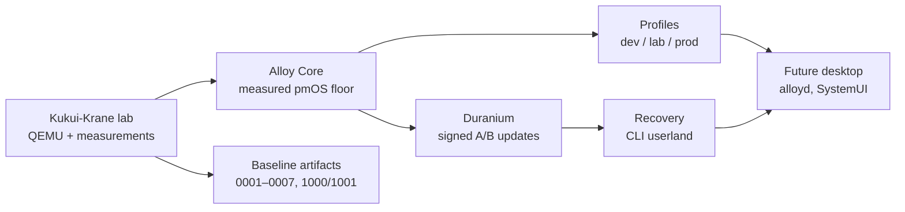

# 01 — Project overview

[Back to docs index](README.md)

## What Alloy OS is

Alloy OS is an early-stage Linux operating system for **laptops and tablets**,
built on **postmarketOS** (Alpine Linux userland, aarch64, systemd). Its stated
design goal is a unified desktop where:

- web apps,
- native Linux apps,
- and Android apps (later),

share one desktop, with app runtimes started on demand and their resources
returned when idle. The system image has its own **verified update and
recovery path**.

The repository is organized around proving that foundation on QEMU before it
is brought to physical hardware.

## Target hardware

The named early test device is the **Lenovo IdeaPad Duet Chromebook**:

| Attribute | Value |
| --- | --- |
| Board codename | **Krane** (Google Kukui baseboard family) |
| SoC | MediaTek **MT8183** / Kompanio 500 (4× Cortex-A73 + 4× Cortex-A53) |
| GPU | ARM Mali-G72 MP3 (Panfrost) |
| RAM / storage | 4 GB LPDDR4X / 64–128 GB eMMC |
| Display | 10.1" 1920×1200 touch, USI stylus |
| Boot chain | Coreboot → Depthcharge → `vmlinuz.kpart` |
| postmarketOS port | `google-kukui` (community) |

QEMU has **no MT8183 machine model**, so the project keeps two hardware
tracks:

1. **Real hardware track** — the official `google-kukui` image, kept for
   analysis and eventual flashing.
2. **Experiment track** — a QEMU `virt` VM that preserves architecture,
   distro, UI stack, and workflows, using virtio devices instead of the
   MediaTek silicon.

Everything above the kernel-driver line transfers between the two tracks;
kernel, bootloader, GPU, WiFi, audio, and touch drivers do not.

## The five programs in this repository



### 1. Alloy Core — the measured floor

A postmarketOS image reduced, step by measured step, to a headless base that
keeps only:

kernel + firmware + Mesa/Panfrost + systemd + networking/audio/input +
SSH.

The floor is defined by two automated gates:

- **regression** — functional integrity (packages, config surface, services,
  listeners, module footprint, input classification);
- **quiescence** — idle behavior (boot time, service/process counts, RAM,
  interrupt rate, CPU, disk writes, listener set).

### 2. Duranium — the update and recovery foundation

A POSIX-shell implementation of immutable A/B system updates that proves one
property:

> **The currently working Alloy system is never sacrificed to perform an
> update.**

It implements GPT slot layout, strict dual-copy metadata, systemd-boot boot
counting, Ed25519-signed offline artifacts, a separate persistent STATE
partition with schema migrations, explicit boot confirmation, crash
evidence, and an independent CLI recovery environment.

### 3. The Kukui-Krane lab — the build and measurement bench

QEMU runners, pmbootstrap-in-Docker image construction, the official Krane
image downloader, measurement harnesses, and the complete provenance of every
baseline number.

### 4. Profiles — named deltas above the floor

`dev`, `lab`, and `prod` images built from the frozen Core and gated with
profile-specific thresholds.

### 5. Branding and earlier prototypes — mostly placeholders

The Plymouth theme, Fastfetch config, KSM config, Waydroid settings, Plasma
look-and-feel package, and `alloy-core` APKBUILD exist as **empty files** in
this checkout. The wallpaper, logo, and asset licenses are real.

## What "working" means here

The repository is deliberately strict about evidence:

| Claim | Evidence |
| --- | --- |
| The floor boots | QEMU boot to SSH and serial logs |
| The floor is small | Measured image size, RAM, services, processes, IRQ rate |
| The floor is still functional | `regression-test.sh` ALL PASS |
| The floor is idle | `quiescence-test.sh` ALL PASS |
| Updates are safe | 9/9 unit scripts, 6/6 QEMU scenarios, 176 assertions |
| Recovery works | Scenarios that destroy both slots and reinstall from a signed artifact |
| STATE survives | Seed files checked across update, rollback, reinstall, migration |

Everything else — the desktop, `alloyd`, packaging tools, Android runtime,
local AI, the software store — is roadmap, not code.

## Status at a glance

```mermaid
flowchart LR
    subgraph Done["Implemented and tested"]
        Core["Alloy Core floor"]
        Gates["Regression + quiescence gates"]
        Dur["Duranium V1"]
        Test["Unit + QEMU suites"]
        Lab["QEMU device lab"]
    end
    subgraph Partial["Partial / reference only"]
        Adapter["Duranium Core adapter<br/>documented, not smoke-tested"]
        Install["legacy scripts/install.sh"]
        Profiles["profiles work; no desktop"]
    end
    subgraph Planned["Planned"]
        Alloyd["alloyd"]
        Comp["Compositor"]
        UI["SystemUI"]
        Apps["MAI / MAC / ACR / Android / ASHT"]
        Brand["Plymouth / theme / configs"]
    end
    Done --> Partial --> Planned
```



## The two product lineages

| Lineage | Base | Kernel | Purpose |
| --- | --- | --- | --- |
| **ALLOY-GUI-0000** | Phosh, edge, systemd | 7.2.4 | Frozen graphical ancestor; future UI work branches here |
| **ALLOY-CORE (0007)** | GUI-0000 stripped in 7 steps | 7.2.4 | Headless reference floor |
| **ALLOY-1000/1001** | New console base (Nura edge) | 7.3.4 | Recipe reapplied to a newer upstream base |
| **Duranium fixture** | Minimal Alpine/BusyBox | baseline kernel | Deterministic A/B update proof |

Important lineage rule: **do not re-add Phosh onto the stripped Core.** UI
experiments branch from GUI-0000; Core stays headless. The reproducible
Core build (`build-core.sh`) derives behaviorally equivalent Core images from
a pristine base, but it does not restore graphics.

## Design principles that shaped the repo

1. **Measure before and after every change.** Baselines are artifacts, not
   anecdotes.
2. **Keep every parent artifact.** Each step is an overlay of the previous
   one; the source image is never modified.
3. **Stay upstream.** No kernel patches, no forked packages, no custom
   cryptography. Changes are packages, sysctls, boot parameters, systemd
   drop-ins, file cuts, and regenerated databases.
4. **The running system is never updated in place.** APK builds images; it
   does not mutate a production root filesystem.
5. **Fail closed.** Metadata parsing, update verification, STATE handling,
   and recovery all reject ambiguous states rather than guessing.
6. **Record failures.** Negative experiments are kept with the same detail as
   wins because they define the floor.

## The user-facing promise vs. the current code

The README describes the finished desktop: touch and keyboard, three app
runtimes, on-demand lifecycle, a Chromium-based SystemUI, a software store.
This checkout contains the **substrate** for that promise:

- a measured base OS,
- a trustworthy update/recovery mechanism,
- reproducible build and measurement tooling.

The desktop shell, daemon, app model, compositor, package manager, and
compatibility layers are not present yet. That gap is documented explicitly in
[Roadmap and glossary](13-roadmap-and-glossary.md) rather than implied away.

### Roadmap sequencing

The revised nine-phase roadmap (2026-11-18) orders the work by dependency,
not by feature visibility:

```text
Core → Duranium → alloyd → identity/resources/health
     → hardware services → app model → compositor
     → native diagnostic desktop → app runtimes → MAI/MAC
     → ASHT → stock Chromium → SystemUI MVP
     → Alloy Chromium → final SystemUI → Android polish / wallpaper / AI
```

Two rules define the sequencing:

- **No Chromium until Alloy is already a usable graphical OS** with a native
  diagnostic shell. This creates a clean measurement boundary between Alloy's
  own cost and Chromium's cost.
- **No ASHT until telemetry and hardware-facing subsystems exist.** Tuning
  needs trustworthy data and real knobs.

Duranium V1 is the current program step: its mechanism and QEMU fixture suite
are working, while real-Core integration and hardware validation remain open.
See [Roadmap and glossary](13-roadmap-and-glossary.md) for the full phase
breakdown and [Visual atlas](14-visual-atlas.md#9-roadmap-phases) for the
dependency charts.

## Reading the rest of this tree

- New to the project: continue with [Architecture](02-architecture.md).
- Looking for code: [Repository map](03-repository-map.md) explains every
  directory, including which files are empty.
- Trying to build: [Build and tooling](04-build-and-tooling.md).
- Auditing safety: [Duranium](06-duranium-update-system.md) and
  [Security model](11-security-model.md).
