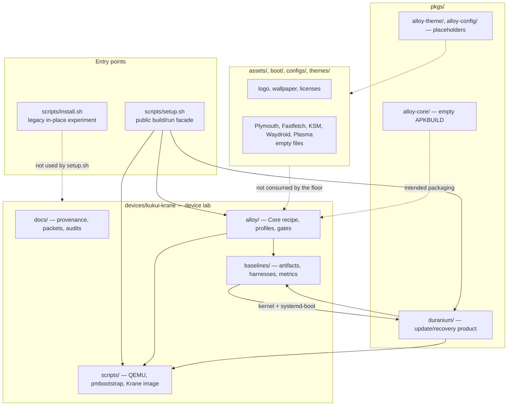
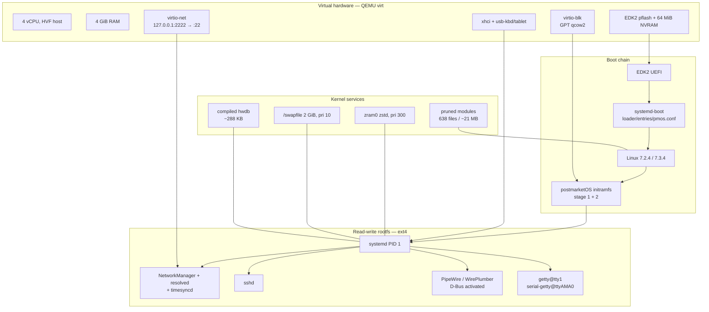
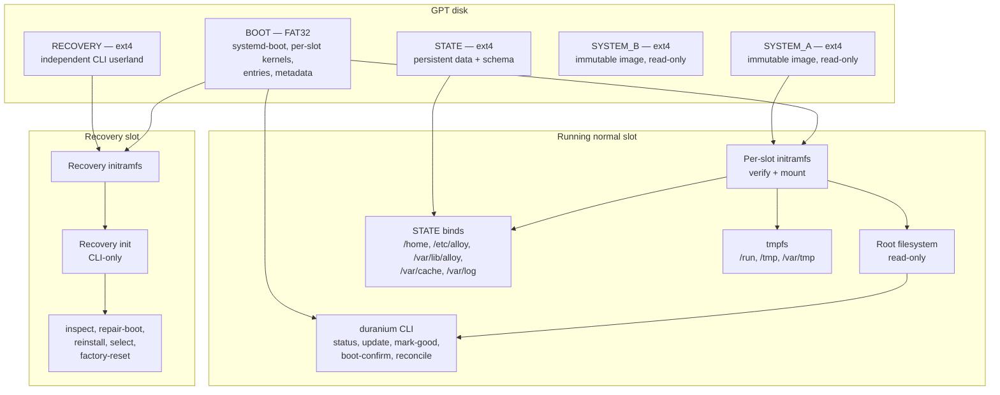
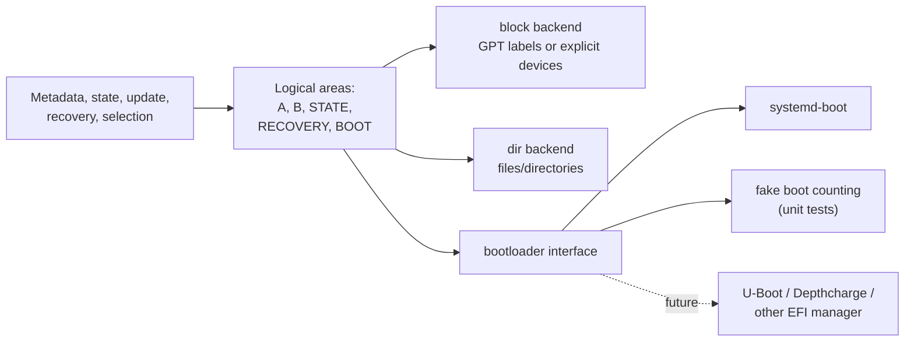
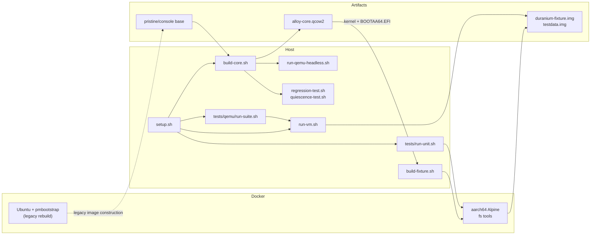
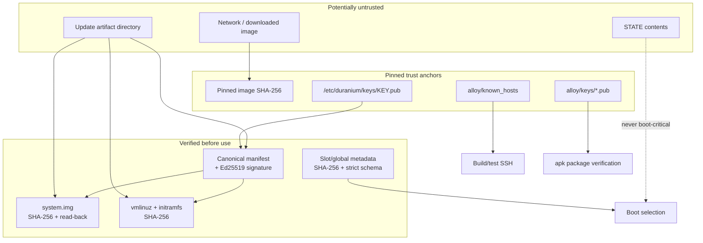
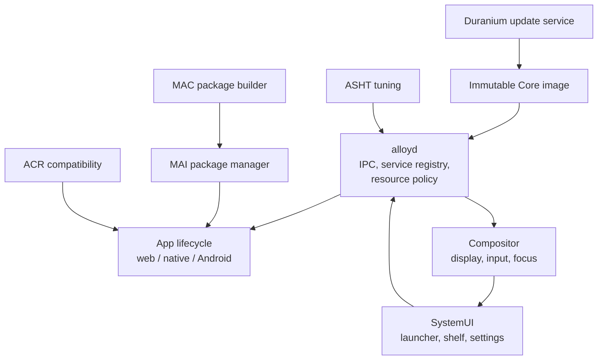

# 02 — Architecture

[Back to docs index](README.md)

This document describes the system at three scales:

1. the **repository architecture** (what depends on what),
2. the **runtime architecture** of a booted Alloy image,
3. the **wiring** between build tools, artifacts, tests, and QEMU.

For step-by-step flows see [Boot flows](07-boot-flows.md) and
[Data flows](08-data-flows.md). For subsystem detail see
[Alloy Core](05-alloy-core-image.md) and
[Duranium](06-duranium-update-system.md).

---

## 1. Repository architecture

The repository is best understood as two products sharing one lab.



### Dependency rules visible in the code

- `scripts/setup.sh` is the only top-level orchestrator. It shells out to:
  - `devices/kukui-krane/alloy/build-core.sh` (`core-build`),
  - `devices/kukui-krane/scripts/run-pmos-vm.sh` (`core-run`),
  - `pkgs/duranium/tests/run-unit.sh` and `tests/qemu/run-suite.sh`
    (`duranium-test`),
  - `pkgs/duranium/qemu/build-fixture.sh` and `qemu/run-vm.sh`
    (`duranium-shell`).
- The Core build depends on the lab's QEMU runner and measurement helpers.
- Duranium's fixture builder reads **only the kernel and systemd-boot EFI
  binary** from the Core baseline image. It does not modify or embed Core.
- The Core build does **not** depend on Duranium. The two products are
  deliberately decoupled; only the documented adapter would integrate them.

### What is not wired

- `pkgs/alloy-core/APKBUILD` is empty; Core is built by shell assembly, not
  by APK packaging.
- Brand assets are not copied into any image builder.
- `configs/*` are empty placeholders.
- No CI workflow exists (`.github/` contains only `.gitkeep`).

---

## 2. Runtime architecture — Alloy Core

A booted Core image is a conventional postmarketOS system with a deliberately
small service set.



### Core's architectural characteristics

- **One mutable root filesystem.** Core is not itself an A/B system; it is
  the artifact Duranium is meant to eventually wrap.
- **No graphics stack.** Phosh, greetd, Plymouth, GNOME apps, Firefox, and
  Flatpak are removed. Console login is the interface.
- **Immutable-ish only by convention.** The root is writable; updates happen
  by rebuilding images, not by `apk upgrade` on a production system.
- **Zram first, disk swap second.** Compression is the primary memory
  extension; the swapfile is overflow insurance.
- **Frozen artifacts are protected with macOS `uchg`.** They cannot be opened
  read-write by QEMU; every boot derives a qcow2 overlay.

---

## 3. Runtime architecture — Duranium

Duranium replaces "one mutable root" with five logical areas and a strict
state machine.



### Component responsibilities

| Component | File(s) | Responsibility |
| --- | --- | --- |
| CLI | `src/bin/duranium` | Single entry point for normal, initramfs, recovery, tests |
| Common | `src/lib/common.sh` | Token validation, hashing, atomic writes, mount helpers, boot ID |
| Config | `src/lib/config.sh` | Loads image-owned config; validates attempts; exposes paths |
| Backend | `src/lib/backend.sh` | Maps logical areas to block devices or test directories |
| Metadata | `src/lib/metadata.sh` | Canonical slot/global records, checksums, dual copies, locking |
| Bootloader | `src/lib/bootloader.sh` | systemd-boot entries, boot counting, fake backend |
| Slot control | `src/lib/slot.sh` | Boot recording, reconciliation, mark-good/bad, selection |
| Manifest | `src/lib/manifest.sh` | Canonical manifest, Ed25519 verify/sign, payload hashing |
| Updater | `src/lib/update.sh` | Inactive-slot write, verification, transaction, locks |
| STATE | `src/lib/state.sh` | Allowlist parsing, bind mounts, schema, migrations |
| Health | `src/lib/health.sh` | Root/STATE/core/service gates for mark-good |
| Recovery | `src/lib/recovery.sh` | Inspect, repair, select, reinstall, reset |
| Initramfs | `src/lib/initramfs.sh` | Per-slot mount and `switch_root` |

### Backend abstraction

Core logic never hardcodes `/dev/vdaN`.



This is why the same shell code runs in the normal system, initramfs,
recovery, and test fixture.

---

## 4. Build and test wiring



### Fixed QEMU geometry

All measured Core runs use the same geometry so numbers are comparable:

```
-M virt,highmem=on
-accel hvf -cpu host          # macOS/Apple Silicon
-smp 4
-m 4096
EDK2 pflash code + per-run 64 MiB NVRAM vars
virtio-blk (qcow2, discard=unmap)
virtio-net usermode NAT, hostfwd tcp:127.0.0.1:2222-:22
qemu-xhci + usb-kbd + usb-tablet
no display device (headless), serial to socket/logfile
```

The Duranium fixture uses a narrower variant:

```
-M virt,highmem=on
2 vCPU, 1024 MiB default
raw GPT disk + optional read-only test-data disk
fresh NVRAM per boot
-no-reboot
serial to logfile or stdio
HVF → KVM → TCG fallback
```

---

## 5. Trust architecture



Key boundaries:

- **BOOT is trusted boot-critical storage.** Metadata checksums are integrity
  checks, not signatures; root on a running system can alter them.
- **STATE is not boot-critical.** Corrupt or missing STATE cannot change slot
  selection, but it can fail `mark-good`.
- **Recovery does not depend on A/B or STATE.** It needs BOOT and RECOVERY
  only.
- **systemd-boot is a single point of failure** in V1; it is not A/B
  duplicated.

See [Security model](11-security-model.md) for the complete threat and audit
record.

---

## 6. Architectural invariants

These are the rules the code is built to preserve. Violating one is a bug.

### Alloy Core

1. The pristine source image is never written.
2. Every measured state is an overlay; delivered artifacts are flattened
   copies.
3. No forks or patches; every reduction is reversible configuration or a
   documented file cut.
4. Artifacts above the floor must pass both gates.

### Duranium

1. The running slot's filesystem is read-only and never written by an update.
2. Every update writes only the inactive slot.
3. The target is marked `UNKNOWN` before the first destructive write.
4. A slot becomes `PENDING` only after signature, payload, boot-artifact, and
   read-back verification.
5. A pending slot is preferred until its attempts run out.
6. `GOOD` requires explicit `mark-good` passing health checks.
7. Failed or unconfirmed slots become `BAD` and are not retried
   automatically.
8. Boot-critical metadata lives on BOOT, not STATE.
9. STATE is separate and survives updates, rollbacks, and reinstalls.
10. Only declared STATE paths persist.
11. A pending update must not make an irreversible STATE change while
    rollback is expected.
12. Recovery does not depend on either normal slot.

---

## 7. How the pieces would eventually connect

The documented target architecture (not implemented) is:



Today, only the lower-left path — Core image plus Duranium — exists and is
tested. The rest is roadmap in [13-roadmap-and-glossary.md](13-roadmap-and-glossary.md).
