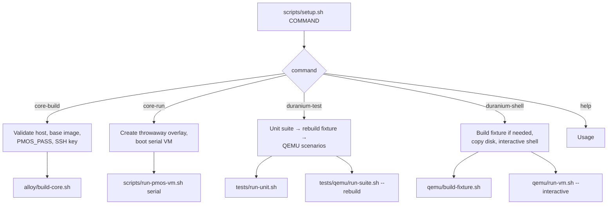
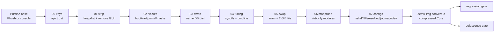
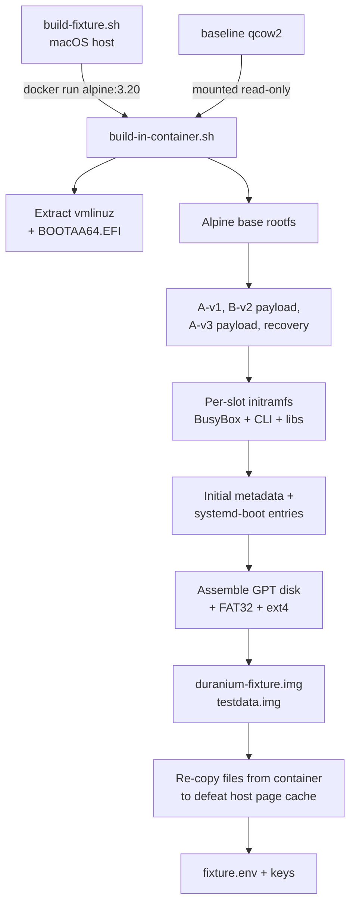

# 04 — Build and tooling

[Back to docs index](README.md)

Everything a developer runs: the `setup.sh` facade, the Core build pipeline,
profile builds, QEMU runners, the Duranium fixture builder, and the legacy
pmbootstrap path.

---

## 1. The public facade: `scripts/setup.sh`



### Commands

| Command | What it does | Host requirements |
| --- | --- | --- |
| `core-build BASE.qcow2 [OUT.qcow2]` | Applies the Core recipe and runs both gates | macOS arm64, HVF QEMU, EDK2, Python 3, Expect, OpenSSH, Ed25519 key, `PMOS_PASS`, ports 2222/4445 |
| `core-run [CORE.qcow2]` | Boots Core in a disposable overlay with a serial console | Same Core host requirements (not Docker) |
| `duranium-test` | Unit tests, fixture rebuild, all QEMU scenarios | Docker, aarch64 QEMU, EDK2, baseline image or explicit kernel/EFI |
| `duranium-shell` | Interactive copy of the fixture | Docker (first build), aarch64 QEMU, EDK2 |
| `help` | Usage text | — |

### Environment selection for `core-build`

| Variable | Default | Meaning |
| --- | --- | --- |
| `BASE` | `phosh` | `phosh` uses `01-strip.sh` and profile `core`; `console` uses `01-strip-nura.sh` and profile `core-nura` |
| `PMOS_PASS` | required | Guest `user` password used only for the first SSH bootstrap |
| `VARS` | `baselines/0007/vars.fd` if present | EDK2 NVRAM seed |
| Output path | `devices/kukui-krane/alloy/core/alloy-core.qcow2` | Must not already exist |

### Why the build is macOS-specific

The Core build path hard-requires:

- `Darwin-arm64`
- `qemu-system-aarch64` with `-accel hvf`
- `/opt/homebrew/share/qemu/edk2-aarch64-code.fd`

The Duranium suite is less restrictive: it selects KVM on Linux if
`/dev/kvm` is writable, otherwise TCG, and searches common EDK2 paths.

---

## 2. Core build: pristine image → gated floor

`devices/kukui-krane/alloy/build-core.sh` performs eight stages. Each stage:

1. creates a qcow2 overlay backed by the previous stage,
2. boots it headless,
3. waits for key-only root SSH,
4. pipes one `steps/NN-*.sh` script into `sh -s` as root,
5. powers off,
6. **flattens that stage to its own qcow2** (to prevent chained-overlay
   residue from leaking into the final image).



### Stage detail

| Stage | Script | What it changes | Why |
| --- | --- | --- | --- |
| 00 | `00-keys.sh` | Runs `apk update`, prints package stats | Keys were copied in by the driver before this stage; ensures trust ring works |
| 01 | `01-strip.sh` (Phosh) or `01-strip-nura.sh` (console) | Adds Mesa, PipeWire, ALSA, libinput, NM, SSH, bluez, wpa_supplicant, polkit, dbus-broker; removes GUI world; adds `agetty` / `kbd-bkeymaps` | Pin keep-list before cascading GUI removal |
| 02 | `02-filecuts.sh` | Removes `/boot/dtbs`, `System.map`, GUI var dirs/users, caches; caps journal at 10 MB; masks oomd + coredump | Largest safe file-level cuts |
| 03 | `03-hwdb.sh` | Deletes 11 vendor-name hwdb databases, regenerates trie | 13.5 MB → ~288 KB without losing functional quirks |
| 04 | `04-tuning.sh` | Writes sysctls; rewrites boot options; disables wpa_supplicant + rtkit | Removes vmstat, PSI, THP, and compaction timers |
| 05 | `05-swap.sh` | Creates zeroed 2 GiB `/swapfile`, `mkswap`, fstab priority 10 | Disk overflow behind zram (priority 300) |
| 06 | `06-modprune.sh` | Deletes non-virtio/non-USB/non-needed modules; `depmod`; proves resolution | 2176 files/72.8 MB → ~638 files/~21 MB |
| 07 | `07-configs.sh` | sshd forwarding policy, NM probes/logging, LLMNR off, journal caps, 5 s stop timeout, udev `children_max=2`, `noatime`, bluetooth off, keymap | Final hygiene and attack-surface reduction |

### Exact knobs applied by the recipe

| Area | Value |
| --- | --- |
| `vm.stat_interval` | `10` |
| `vm.dirty_writeback_centisecs` | `6000` |
| `vm.compaction_proactiveness` | `0` |
| `vm.watermark_boost_factor` | `0` |
| Kernel cmdline | `psi=0 transparent_hugepage=madvise` plus console args |
| journald | `SystemMaxUse=10M`, `RuntimeMaxUse=10M` |
| PID 1 stop timeout | `5s` |
| udev | `children_max=2` |
| fstab | `noatime` |
| sshd | forwarding off in core/prod; 30 s login grace; keepalive 60×3 |
| NetworkManager | connectivity off, log level WARN |
| resolved | LLMNR off |
| bluetooth | disabled |
| swap | zram zstd pri 300 + `/swapfile` pri 10 |

### The per-stage flattening gotcha

A qcow2 overlay that deletes files does not overwrite the deleted LBAs; reads
fall through to the backing image. Flattening a chain can therefore carry
hundreds of megabytes of "deleted" data into the result.

`build-core.sh` avoids this with one `qemu-img convert` per stage. The earlier
naive approach produced a 1506 MiB Core from a ~700 MiB ancestry.

---

## 3. Profile builds

`build-profile.sh <dev|prod|lab>` derives from the **frozen 0007 Core**, applies
one profile script, trims filesystems, flattens, and runs both gates.

| Profile | Adds | Gate thresholds |
| --- | --- | --- |
| `dev` | `git`, `build-base`, `vim`, `tmux`, `htop`, `strace`, `python3`, `mandoc`, man pages; SSH forwarding on | services ≤16, procs ≤150, RAM ≤500 MiB, IRQ ≤15, CPU ≤1%, writes ≤2 MB/60 s |
| `prod` | key-only SSH, volatile journal, nftables firewall unit; forwarding stays off | services exactly 12, procs ≤115, RAM ≤140 MiB, IRQ ≤12 |
| `lab` | `python3`, `git`, `tmux`, `htop`; measurement scripts copied to `/opt/alloy`; forwarding on | services ≤16, procs ≤150, RAM ≤350 MiB, IRQ ≤15 |

Note: `build-profile.sh` hardcodes the Core at
`baselines/0007/alloy-baseline-0007.qcow2`, which is not shipped in this
checkout. Rebuilding profiles requires restoring that artifact.

---

## 4. QEMU runners

| Runner | Used by | Key properties |
| --- | --- | --- |
| `run-qemu-headless.sh` | Core build, gates, measurement | Daemonized, serial socket + logfile, pidfile, SSH 127.0.0.1:2222, fixed geometry |
| `run-pmos-vm.sh` | Phosh lineage, `core-run` | `gui`/`headless`/`serial`; cocoa window or serial; loopback SSH |
| `run-alloy-gui.sh` | Visual floor inspection | cocoa + virtio-gpu; creates sandbox overlay if missing |
| `run-qemu-arm.sh` | Legacy reference | Deprecated banner; hardened loopback defaults |
| Duranium `run-vm.sh` | Fixture tests | Raw disk, fresh NVRAM, `-no-reboot`, HVF/KVM/TCG, test-data disk |

### Ports

- **2222** — guest SSH forwarded to host loopback.
- **4445** — QEMU serial socket in headless/GUI modes.
- Duranium fixture has no forwarded SSH port; it is driven by serial only.

### Serial access

```sh
nc 127.0.0.1 4445                 # interactive serial
tail -f /tmp/pmos-serial.log      # headless log
```

---

## 5. Duranium fixture build



Artifacts produced in `pkgs/duranium/qemu/out/`:

| File | Purpose |
| --- | --- |
| `duranium-fixture.img` | 660 MiB raw GPT disk |
| `testdata.img` | 1.5 GiB ext4 read-only artifact/scenario disk |
| `fixture.env` | Partition offsets for host-side corruption |
| `keys/` | Ephemeral test signing keys (test-key, wrong-key) |

The test-data disk contains:

- `artifacts/b-v2` — valid signed B update (schema 2),
- `artifacts/a-v3` — valid signed A update (schema 2),
- `artifacts/bad-manifest`, `bad-payload`, `bad-key`,
  `wrong-profile`, `wrong-arch`, `wrong-hardware` — rejection variants,
- `scenarios/*.sh` — the six integration scenarios,
- `.duranium-test` marker.

---

## 6. Unit tests

```sh
cd pkgs/duranium
./tests/run-unit.sh
```

- On Linux with `sha256sum` + `openssl`: runs directly.
- Elsewhere: runs inside `alpine:3.20` arm64 via Docker.
- Discovers `tests/unit/[0-9]*.sh` in order.
- Uses the **dir backend** and temporary roots; no QEMU needed.

`Makefile` targets:

| Target | Action |
| --- | --- |
| `make unit` | Unit suite |
| `make fixture` | Build QEMU fixture |
| `make qemu` | Fixture + QEMU suite |
| `make test` | Both |
| `make syntax` | `sh -n` every shell file |
| `make clean` | Remove `qemu/out`, `tests/.tmp` |
| `make install` | Install runtime, config, docs under `PREFIX` |

---

## 7. Legacy build path (not used by `setup.sh`)

`devices/kukui-krane/scripts/pmbootstrap-docker.sh` documents how the
original Phosh image was made:

1. Docker container `pmb-kukui-lab` (Ubuntu 24.04, `SYS_ADMIN`, loop devices,
   pmbootstrap pinned to v3.11.1).
2. `pmbootstrap init` for `qemu-aarch64`, UI `phosh`, user `user`.
3. `pmbootstrap install --password …` builds the rootfs, then **fails** at
   partitioning because Docker cannot expose loop partitions
   (`loop/max_part=0`, no udev events in container).
4. `fixup` manually assembles a 4200 MiB GPT disk:
   - `mkfs.ext4 -d <rootfs>` for the root,
   - `e2fsck` + `resize2fs`,
   - FAT32 ESP with kernel, initramfs, systemd-boot, loader entry,
   - **inject real `/etc/fstab` with `debugfs`** (the fresh rootfs ships a
     placeholder that sends every boot to the debug shell),
   - `parted` GPT with `pmOS_boot` / `pmOS_root` labels,
   - `dd` filesystems into the raw disk.
5. Convert raw → qcow2 on the host.

This path is kept for provenance and native pmbootstrap rebuilds. It requires
broader container privileges than the reproducible Core build, which uses no
Docker.

---

## 8. How long things take

Approximate wall-clock on the documented Apple Silicon host:

| Task | Time |
| --- | --- |
| Core build, 8 stages + gates | ~20 minutes |
| Core boot to SSH | ~12–16 s |
| Quiescence gate | ~3–5 minutes (120 s settle + 60 s window) |
| Unit suite | seconds |
| Full Duranium QEMU suite | tens of minutes (23+ boots) |
| Fixture build | a few minutes |

These are scale estimates from the recorded runs, not promises.

---

## 9. Common build failures

| Symptom | Cause | Fix |
| --- | --- | --- |
| `output already exists` | Core build refuses to overwrite | Choose a new output path or remove the file deliberately |
| `set PMOS_PASS` | Required credential not set | Export it for the build |
| `the Core VM scripts currently use Apple Silicon macOS and HVF` | Host check | Run on the documented host, or adapt the runner |
| `cannot read …edk2-aarch64-code.fd` | Homebrew QEMU/firmware missing | `brew install qemu` |
| Stage SSH never comes up | Guest boot failure or port conflict | Read the stage serial log; free ports 2222/4445 |
| Gate fails `modules regrew` | Kernel/module changes | Re-run `steps/06-modprune.sh`; check the keep rules |
| Duranium `baseline … not found` | Missing `alloy-1001-floor.qcow2` | Set `DURANIUM_BASELINE`, or `DURANIUM_KERNEL` + `DURANIUM_EFI_BOOT` |
| Fixture guest sees garbage partitions | macOS page cache after container writes | The builder's settle step exists for this; re-run the build |
| `Docker is required` | Docker not running | Start Docker/Colima and verify `docker info` |

See [Operations runbook](12-operations-runbook.md) for runtime troubleshooting.
