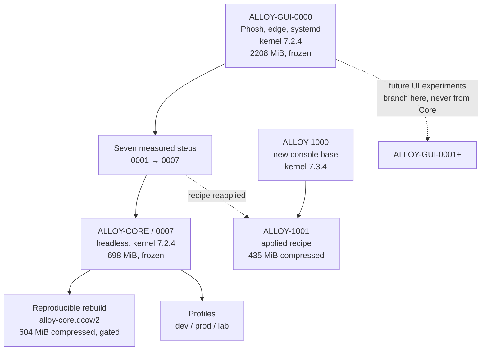
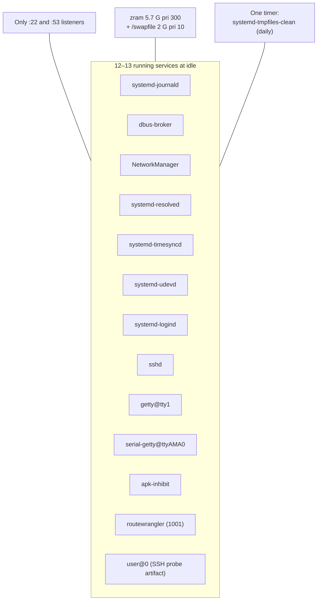

# 05 — Alloy Core image

[Back to docs index](README.md)

Alloy Core is the headless, measured postmarketOS base that everything above
the floor is built on. This document explains what it contains, how it is
produced, what was removed, and which variants exist.

---

## 1. What "Core" means

Core is not a desktop. It is the substrate a desktop would run on:

- the kernel and firmware,
- the graphics **userland** needed later (Mesa, including the Panfrost DRI
  driver), but no compositor,
- systemd and basic system services,
- networking, audio, and input plumbing,
- SSH and console login,
- a compressed swap hierarchy.

Everything graphical was removed: Phosh, greetd, Plymouth, squeekboard, the
GNOME mobile app set, Firefox, Flatpak, GStreamer, and their dependency
cascade.

Core is also **not immutable at runtime**. It is a normal read-write ext4
postmarketOS system. Immutability is Duranium's job; Core is the image that
would eventually be wrapped in A/B slots.

---

## 2. Lineages



### GUI-0000 — the frozen ancestor

| Property | Value |
| --- | --- |
| Build | pmbootstrap 3.11.1 in Docker, `qemu-aarch64`, edge, Phosh, systemd |
| Artifact | `images/pmos-qemu-aarch64.qcow2`, 2208 MiB |
| SHA-256 | `34d36a93efb3400ab95bd66d259e5340f7a9ff9d195bfd38a8d46c8924b20ca4` |
| Kernel | linux-stable 7.2.4 |
| Contents | Full UI stack, 1187 packages, 27 services |
| Boot | EDK2 → systemd-boot → pmOS initramfs → systemd → greetd → Phosh |
| Credentials | `user` / `147147` |

The image is macOS-immutable (`uchg`) and is not shipped in this checkout.

### 0007 — the frozen floor

| Property | Value |
| --- | --- |
| Artifact | `baselines/0007/alloy-baseline-0007.qcow2`, 698 MiB |
| SHA-256 | `03966db2f8caff03517c667ded9fb38f715248dee540812472ee07ce1abac702` |
| Packages | 267 |
| Kernel | 7.2.4 |
| State | Frozen, macOS immutable |
| Boot | Console login, SSH on 2222 |

This artifact is referenced by `build-profile.sh` but is not present in the
checkout.

### Reproducible rebuild

`build-core.sh` produces `alloy/core/alloy-core.qcow2` at roughly 604 MiB
compressed. It is behaviorally equivalent to 0007 under both gates; size
differs because of packaging (compressed `-c` convert) and clean per-stage
flattening.

### 1001 — the newer floor

| Property | Value |
| --- | --- |
| Source | Brand-new upstream base: pmbootstrap 3.12.1, pmaports 2026-11-17, "Nura edge" |
| Device / UI | `qemu-aarch64` / `console` |
| Kernel | 7.3.4 |
| systemd | 262 |
| Packages | 361 on the console base before stripping; the floor's final package count is not separately recorded (same keep-list recipe) |
| Artifact | `baselines/1000/alloy-1001-floor.qcow2`, 435 MiB compressed, 456,327,168 bytes |
| SHA-256 | `0586afc5…a7cc` (full value in `FROZEN-1000-1001.sha256`) |
| Gates | Regression + quiescence ALL PASS (`out/gates-1001.txt`) |

This is the only large runtime image shipped in the repository, and the one
Duranium's fixture builder uses to extract a kernel and systemd-boot binary.

---

## 3. The keep-list

The floor intentionally retains:

| Area | Packages / components |
| --- | --- |
| Kernel | `device-qemu-aarch64-kernel-stable`, `postmarketos-mkinitfs` |
| Firmware | `linux-firmware-none` (virt needs no blobs) |
| Graphics userland | `mesa`, `mesa-dri-gallium`, `mesa-egl`, `mesa-gbm`; **`panfrost_dri.so` present** |
| Init and bus | `systemd`, `dbus-broker`, `polkit` |
| Networking | `networkmanager`, `wpa_supplicant`, `systemd-resolved`, `systemd-timesyncd` |
| Audio | `pipewire`, `wireplumber`, `alsa-lib`, `alsa-utils`, `alsa-ucm-conf`, `alsa-plugins-pulse`, `rtkit` (D-Bus activated) |
| Input | `libinput`, kernel `evdev`, `systemd-udevd` |
| Remote / console | `openssh`, `sudo-rs`, `agetty`, `getty@tty1`, `serial-getty@ttyAMA0` |
| Mobile plumbing | `hkdm` (hardware keys), `routewrangler` (routing policy), `apk-inhibit` |
| Console font | `font-terminus` (kept where base requires it) |
| Memory | zram zstd 5.7 GiB pri 300 + 2 GiB `/swapfile` pri 10 |

Why Panfrost is kept on a headless image: the floor is the Krane-relevant
substrate. Real Krane uses Mali-G72 with Panfrost; keeping the driver in the
image preserves the intended userspace lineage even though the QEMU VM renders
via llvmpipe/virtio-gpu.

---

## 4. What was removed

### Package cascade (0001)

One `apk del` removes GUI world entries and their orphans:

```
calls chatty decibels firefox-esr flatpak font-droid font-droid-nonlatin
font-twemoji fprintd g4music gnome-calculator gnome-calendar gnome-clocks
gnome-console gnome-contacts gnome-maps gnome-text-editor gnome-user-share
gnome-weather gst-libav gst-plugins-bad gst-plugins-good
gst-plugins-rs-dav1d gvfs-full lang loupe lpa-gtk mobile-config-firefox
nautilus papers phosh-mobile-settings phosh-tour
postmarketos-tweaks-setting-definitions postmarketos-ui-phosh rygel showtime
snapshot ttyescape tuned-ppd vvmplayer cups
```

Orphaned with it: ModemManager, avahi, udisks2, upower, tuned, gnome-keyring,
python3, presage, chrony, locale packs, Plymouth, greetd/phrog, and the
squeekboard keyboard.

### File-level cuts (0002)

| Removed | Size | Rationale |
| --- | --- | --- |
| `/boot/dtbs` | ~117 MB | `-M virt` supplies its own DTB; loader entry has no `devicetree` line |
| `/boot/System.map` | ~11.6 MB | Debug symbols, unused at boot |
| `/var/lib/swcatalog` | ~11.3 MB | AppStream data for removed GNOME Software |
| `/var/lib/greetd` and friends | ~10.5 MB | Stale homes and caches |
| caches and journal | ~7–11 MB | Recreated on demand / capped |
| users `greetd`, `geoclue`, `avahi`, `pulse` | — | No services remain |

Also masked: `systemd-oomd` (service + socket), `systemd-coredump`
(socket/service/register). Kernel OOM killing still works.

### hwdb diet (0003)

Deleted 11 name-lookup databases (PCI/USB/OUI/ACPI/Bluetooth/DMI/SDIO
vendor-model names, FireWire, IMDS, fingerprint, TPM). Kept all functional
quirks, including `autosuspend-chromiumos`. Regenerated
`/etc/udev/hwdb.bin` from 13.5 MB to ~288 KB.

### Module diet (0006)

Deleted kernel modules that QEMU `virt` can never request: wireless,
ethernet, vendor DRM, media, Bluetooth/NFC/CAN/WWAN, SoC platform, MD, most
filesystems, RAID, vsock, and others. Kept virtio, USB, HID/input, DRM
core+virtio, sound core/HDA/USB/virtio, netfilter, fuse/overlay/nls, crypto,
and root SCSI modules.

Result: 2176 module files / 72.8 MB → ~625–638 files / ~21–23 MB.

---

## 5. What cannot be removed (apk-level blocked)

Verified with `apk del --simulate`; these are hard dependencies, not
oversights:

| Item | Blocked by | Consequence |
| --- | --- | --- |
| `llvm22-libs` (~168 MB) | `libdril_dri.so` links LLVM (llvmpipe inside libgallium) | Only a pmaports rebuild (Panfrost-only Mesa) can drop it |
| `spirv-tools` | `mesa` | Stays |
| `nss`, `nspr` | `networkmanager` | Stays |
| X11 client stack + `xkeyboard-config` | mesa / pipewire / ALSA / base | Stays |
| `cracklib`, `libpwquality` | `postmarketos-base` PAM policy | Stays |
| `tpm2-tss-*` | bluez/libinput/NM chain | Stays |
| `xfsprogs-extra`, `font-terminus`, `util-linux-misc` | base/device packages | Stays |

This is the central trade-off: **weight kept to keep upstream compatibility**.
The project refuses to fork pmaports for size.

---

## 6. Runtime shape



Kernel modules loaded at idle are in the single digits to low teens,
depending on lineage (7 on 0007, 17 on 1001 including the nftables stack
loaded by pmOS plumbing).

---

## 7. The two gates that define "Core works"

### Regression gate

`alloy/regression-test.sh  [profile]`

Boots a throwaway overlay and checks:

| Category | Checks |
| --- | --- |
| Packages | 20 keep-list packages installed (`device-qemu-aarch64-kernel-stable`, firmware, Mesa, PipeWire, ALSA, libinput, NM, SSH, bluez, wpa_supplicant, polkit, dbus-broker, systemd, base, mkinitfs, sudo-rs, agetty) |
| Files | `panfrost_dri.so` exists |
| Config surface | sshd forwarding policy per profile, `psi=0`, THP=madvise, `compaction_proactiveness=0`, `stat_interval=10`, journald cap |
| Runtime | zero failed units; eight critical services active |
| Swap | zram + swapfile both present |
| Modules | ≤700 files and ≤30 MB |
| Listeners | exactly 22 and 53, no 5355 |
| Input | udev classifies at least one input device |
| Profile extras | prod key-only SSH + volatile journal + nftables; dev toolchain; lab `/opt/alloy` |

### Quiescence gate

`alloy/quiescence-test.sh  [profile]`

Boots, waits 120 s, then measures a 60 s window.

| Profile | Services | Processes | RAM | IRQ/s | CPU | Writes |
| --- | --- | --- | --- | --- | --- | --- |
| `core` / `prod` | exactly 12 | ≤115 | ≤140 MiB | ≤12 | ≤1% | ≤2 MB/60 s |
| `core-nura` | ≤14 | ≤120 | ≤140 MiB | ≤12 | ≤1% | ≤2 MB/60 s |
| `dev` | ≤16 | ≤150 | ≤500 MiB | ≤15 | ≤1% | ≤2 MB/60 s |
| `lab` | ≤16 | ≤150 | ≤350 MiB | ≤15 | ≤1% | ≤2 MB/60 s |

Plus: boot to SSH ≤35 s, zero failed units, and exactly four TCP listeners
(`:22` v4+v6 and `:53` ×2).

---

## 8. Recorded validation

From `alloy/README.md` and `baselines/1000/out/gates-1001.txt`:

| Artifact | Regression | Quiescence | Notable numbers |
| --- | --- | --- | --- |
| Rebuilt Core | ALL PASS | ALL PASS | boot 10.4 s, 12 services, 98 procs, 101 MiB RAM, 7.6 IRQ/s, 0.0% CPU, 0 writes |
| dev profile | ALL PASS | ALL PASS | — |
| prod profile | ALL PASS | ALL PASS | forwarding off |
| lab profile | ALL PASS | ALL PASS | — |
| 1001 floor | ALL PASS | ALL PASS | boot 15.9 s, 13 services, 102 procs, 105 MiB RAM, 8.42 IRQ/s, 0.01% CPU, 0.2 MB writes |

The 1001 boot number in the gate (15.9 s) is a single run; the formal
performance record reports a median of 12.5 s. Both are recorded; see
[Measurements](10-measurements-and-performance.md).

---

## 9. Why the floor looks over-stripped if you only want a VM

The purpose is not "smallest possible QEMU appliance". The purpose is a
faithful, Krane-relevant substrate:

- keep the same architecture, init system, networking, audio, input, and
  graphics **userspace** as Krane;
- remove everything that belongs to a desktop shell that Alloy intends to
  replace;
- measure the result so regressions are visible.

That is why Panfrost, PipeWire, BlueZ, and wpa_supplicant stay even though
the headless QEMU VM does not use real Mali, audio codecs, or WiFi.

---

## 10. Known limitations of Core

- It is mutable. No A/B, no verified boot, no rollback.
- It is QEMU-specific in its module and boot configuration.
- The 0007 and profile artifacts are not shipped here, so several documented
  commands require restoring external images.
- It has no desktop, no compositor, and no app model.
- It does not run on real Krane hardware as-is.
- It is not packaged by `pkgs/alloy-core/APKBUILD`; that file is empty.

Duranium is the intended next layer. Its integration with a real Core
systemd userland is documented but not part of the green test suite; see
[Duranium](06-duranium-update-system.md) and
[Testing](09-testing-and-gates.md).
