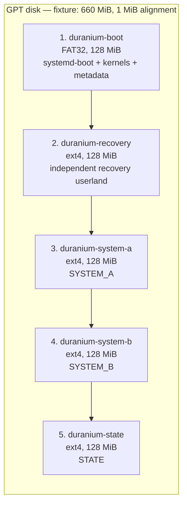
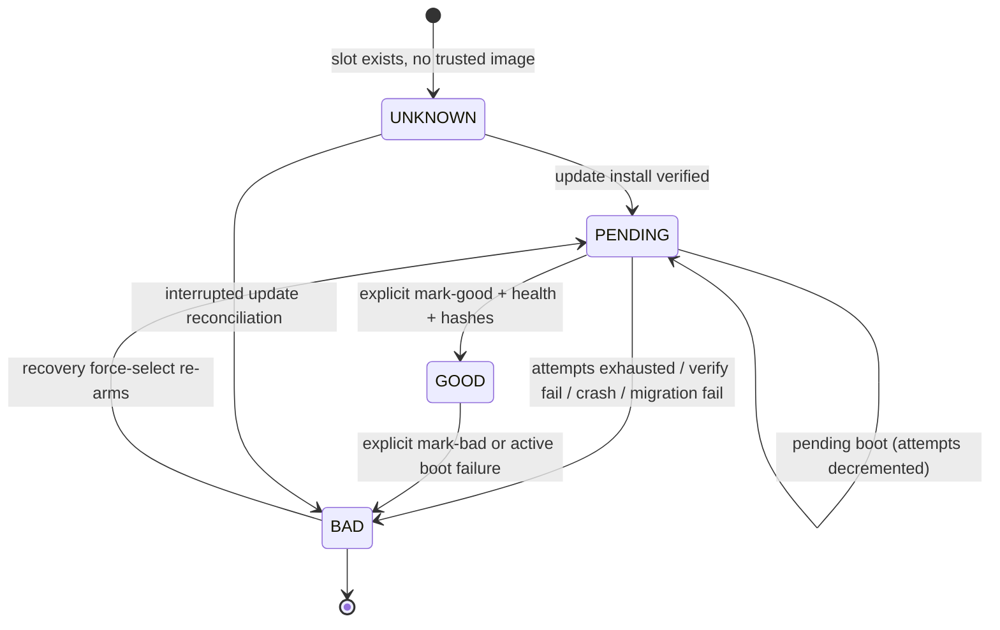
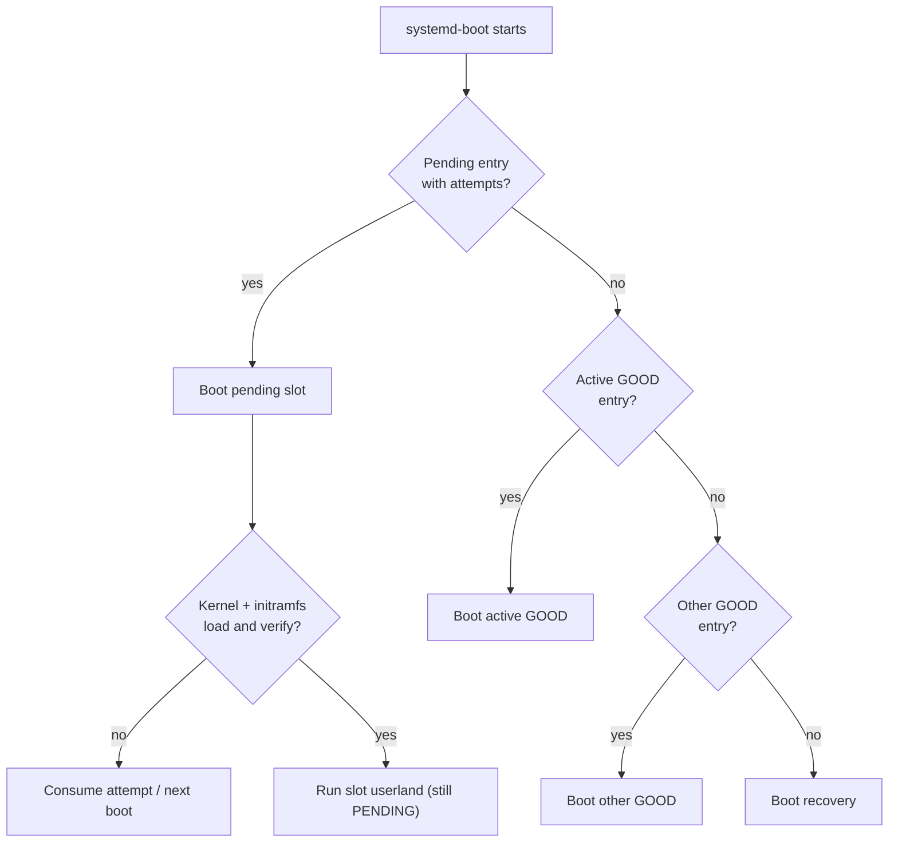
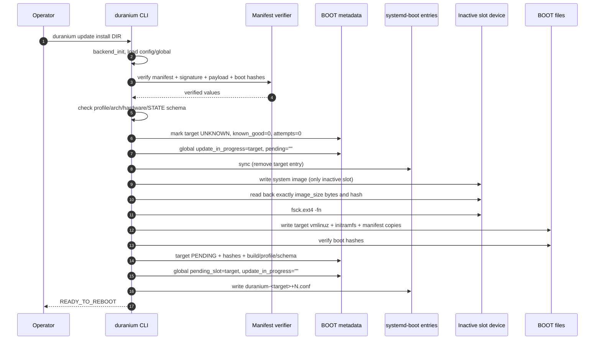
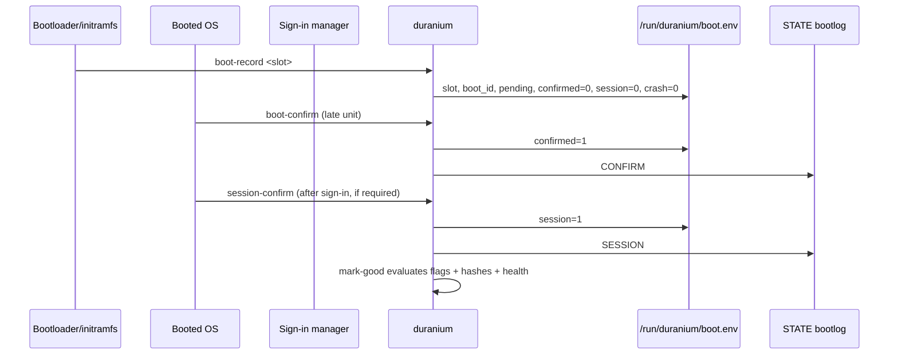
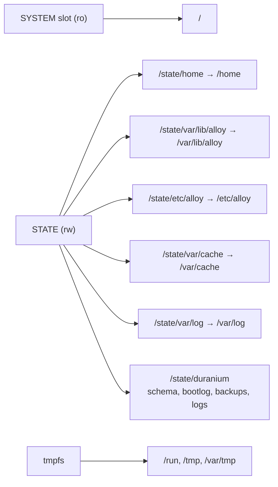
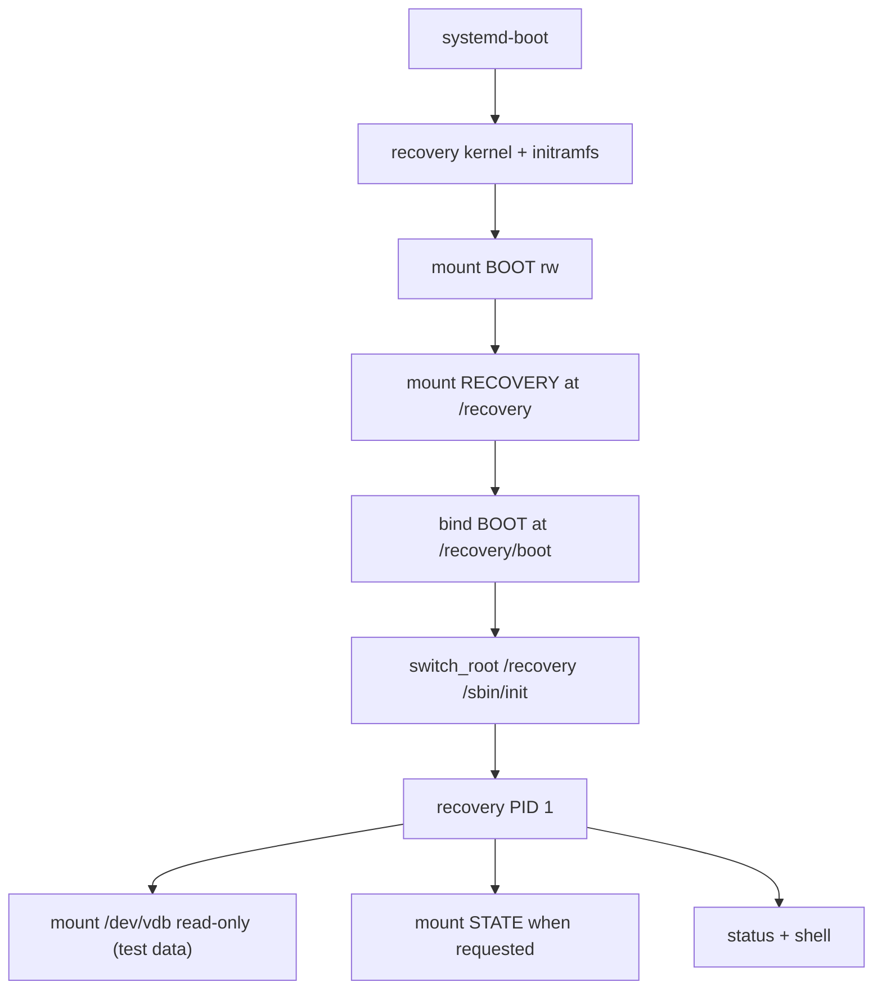

# 06 — Duranium update system

[Back to docs index](README.md)

Duranium is Alloy's immutable system-image and A/B update foundation. V1 is a
POSIX-shell implementation that proves one property:

> **The currently working Alloy system is never sacrificed to perform an
> update.**

It is the most complete product in the repository. This document describes
its layout, formats, state machine, transaction protocol, persistent state,
recovery, and test coverage.

Authoritative detail lives in `pkgs/duranium/docs/`; this is the consolidated
engineering guide.

---

## 1. Scope of V1

### Implemented

- GPT layout: `BOOT`, `RECOVERY`, `SYSTEM_A`, `SYSTEM_B`, `STATE`.
- Per-slot kernel and initramfs, written only to the inactive slot.
- systemd-boot native boot counting as the fallback mechanism.
- Canonical dual-copy slot/global metadata with checksums.
- Explicit `mark-good`; booting a pending slot is not confirmation.
- Offline signed artifacts: SHA-256 + Ed25519.
- Separate persistent STATE with an explicit allowlist.
- Versioned STATE schema with rollback-safe migrations.
- Independent CLI recovery environment.
- Dev/lab/prod identity checks.
- Unit and QEMU integration suites.

### Deliberately out of scope

- Network downloads or streaming updates.
- Delta updates or a tar/container artifact format.
- Slot resize / filesystem grow.
- Secure Boot, signed boot metadata, or bootloader A/B duplication.
- STATE encryption.
- GUI update or GUI recovery.
- `apk upgrade` on a live production root.
- Chromium, SystemUI, Waydroid, ASHT.

---

## 2. Disk layout



Fixture offsets: BOOT 1 MiB, RECOVERY 129 MiB, A 257 MiB, B 385 MiB,
STATE 513 MiB.

### Filesystem rationale

| Partition | FS | Why |
| --- | --- | --- |
| BOOT | FAT32 | UEFI firmware and systemd-boot can read it directly |
| SYSTEM_A/B | ext4 (V1) | Updater treats a slot as an opaque image blob; EROFS/squashfs could replace it |
| RECOVERY | ext4 | Simple independent userland; its kernel/initramfs must live on BOOT |
| STATE | ext4 rw | The only general writable persistent filesystem |

### Mount contract while running

```
/          selected SYSTEM slot, read-only
/boot      BOOT FAT, read-write (metadata + updates)
/state     STATE, read-write
/home, /var/lib/alloy, /etc/alloy, /var/cache, /var/log
           bind mounts from /state
/run, /tmp, /var/tmp
           tmpfs
```

The running slot's block device is never opened for writing by a normal
update.

### No swap partition

The expected memory hierarchy is:

```
RAM → ZRAM → optional swapfile in STATE
```

A swapfile must live in STATE, never in a system slot. Duranium does not
create or manage swap.

---

## 3. BOOT contents

```
/boot/
  EFI/BOOT/BOOTAA64.EFI          systemd-boot
  loader/loader.conf             timeout and selection policy
  loader/entries/
    duranium-a.conf              GOOD active/inactive A
    duranium-b+3.conf            PENDING B, three attempts
    duranium-recovery.conf       recovery
  duranium/
    global.meta (+ .bak)         authoritative global state
    slots/A.meta (+ .bak)        authoritative A metadata
    slots/B.meta (+ .bak)        authoritative B metadata
    boot/
      A/vmlinuz, A/initramfs
      B/vmlinuz, B/initramfs
      recovery/vmlinuz, recovery/initramfs
      <slot>/manifest.txt, manifest.sig   diagnostic copies only
```

The diagnostic manifest copies are for inspection. Activation decisions use
the verified in-memory artifact values, never the BOOT copy.

---

## 4. Metadata format

### Slot record

Fixed field order, one `checksum=<sha256>` line last:

```
duranium_meta=1
kind=slot
slot=A
alloy_version=1.0
build_id=A-v1
image_sha256=<64 hex>
image_size=<bytes>
boot_kernel_sha256=<64 hex>
boot_initramfs_sha256=<64 hex>
profile=prod
architecture=aarch64
hardware_target=qemu-aarch64-virt
state_schema=1
status=GOOD
boot_attempts_remaining=0
max_boot_attempts=3
known_good=1
pending_boot_id=
generation=1
updated_at=2026-11-17T00:00:00Z
checksum=<64 hex>
```

### Global record

```
duranium_meta=1
kind=global
active_slot=A
pending_slot=
fallback_slot=A
last_known_good_slot=A
update_in_progress=
generation=1
updated_at=2026-11-17T00:00:00Z
checksum=<64 hex>
```

### Parsing rules

The parser rejects:

- missing mandatory fields, unknown fields, duplicates;
- non-canonical order;
- a checksum line that is not last;
- invalid checksum;
- invalid slot names, statuses, profiles;
- non-numeric generation/schema/attempt fields;
- attempts greater than max, or max outside 1–20;
- `GOOD` without `known_good=1` and valid hashes;
- `PENDING` with `known_good=1`;
- `UNKNOWN`/`BAD` with non-zero attempts;
- global `active_slot == pending_slot` when both are set;
- spaces, `=`, CR/LF, or non-schema characters in values.

### Redundancy

- Writes are temp file → `sync` → rename → `sync`.
- Before replacing a valid primary, the old primary is copied atomically to
  `.bak`.
- A corrupt primary never overwrites a valid backup.
- Reads try primary then backup.
- If both are invalid, that slot is unusable; the other slot is unaffected
  and selection falls back.

### Locking

Every mutating entry point takes `$DURANIUM_RUN/meta.lock`:

- `mkdir` is the atomic acquisition primitive;
- the holder writes its PID;
- stale locks are stolen with an atomic rename;
- re-entrant within a process.

The updater uses a separate `update.lock` with the same pattern.

### `image_size` semantics

`image_sha256` covers exactly `image_size` bytes, not the whole partition.
Partitions are provisioned with headroom and their tails contain whatever was
there before. `mark-good` hashes exactly the recorded length. Metadata that
predates `image_size` falls back to hashing the full device, which only
matches when the image fills the partition.

Hashing is done in 1 MiB chunks because large sequential reads on the
QEMU/HVF stack were observed returning stale bytes.

---

## 5. Slot state machine



### Status meanings

| Status | Meaning | Automatically booted? |
| --- | --- | --- |
| `UNKNOWN` | No trusted image, or interrupted update | No |
| `PENDING` | Installed and verified, not confirmed | Yes, while attempts remain |
| `GOOD` | Explicitly confirmed healthy | Yes |
| `BAD` | Known broken or exhausted | No |

### Transition rules

| Event | Transition |
| --- | --- |
| Install | `UNKNOWN → PENDING` (attempts = max, known_good = 0) |
| Pending boot | decrement attempts in entry filename |
| `mark-good` | `PENDING → GOOD` (known_good = 1, attempts = 0) |
| Attempts reach zero | `PENDING → BAD`, pending cleared |
| `mark-bad` | any → `BAD` |
| Update start | inactive → `UNKNOWN` before destructive write |
| Update failure | target → `BAD`; active selection unchanged |

A `GOOD` slot can be active/fallback. A `BAD` slot is never selected
automatically.

---

## 6. Boot selection

V1 uses **systemd-boot native boot counting**. The entry filename encodes
priority and remaining attempts.

```
duranium-b+3.conf    pending B, three attempts
duranium-a.conf      GOOD A, unlimited
duranium-recovery.conf
```

On each boot systemd-boot rewrites the suffix:

```
+3 → +2-1 → +1-2 → +0-3 → skipped
```

The slot initramfs copies the filename counter into metadata and records the
kernel boot ID used by `mark-good`.

### Sort keys

| Entry | Sort key |
| --- | --- |
| pending slot | `10-duranium-<slot>` |
| active GOOD slot | `20-duranium-<slot>` |
| inactive GOOD slot | `30-duranium-<slot>` |
| recovery | `90-duranium-recovery` |



`loader.conf` sets `timeout 1` and no fixed default. Sort keys alone define
the desired order.

---

## 7. Update artifact format

```
artifact/
  manifest.txt        canonical key=value manifest (the signed bytes)
  manifest.sig        base64 Ed25519 signature over manifest.txt
  system.img          root filesystem image
  boot/vmlinuz        slot kernel
  boot/initramfs      slot initramfs
```

### Manifest fields

Fixed order, all required:

```
duranium_manifest=1
format_version=1
alloy_version=1.0
build_id=A-v1
architecture=aarch64
profile=prod
hardware_target=qemu-aarch64-virt
system_image=system.img
system_image_size=134217728
system_image_sha256=<64 hex>
system_image_compression=none
boot_kernel=boot/vmlinuz
boot_kernel_sha256=<64 hex>
boot_initramfs=boot/initramfs
boot_initramfs_sha256=<64 hex>
state_schema_required=2
state_schema_backward_compatible=1
rollback_compatible=1
key_id=test-key
created_at=2026-11-17T00:00:00Z
```

`system.img` may be gzip-compressed if
`system_image_compression=gzip`; the hash is over the uncompressed image.

### Verification order

1. Manifest files exist and are regular files, not symlinks.
2. Manifest is canonical and all fields are valid.
3. Ed25519 signature verifies with the pinned key named by `key_id`.
4. Payload size and SHA-256 match.
5. Kernel and initramfs hashes match.
6. Profile, architecture, hardware target, and STATE schema are compatible.

### Compatibility rules

| Check | Rule |
| --- | --- |
| Profile | Exact match; mismatch only if running profile is `dev`, `/etc/duranium` sets `DURANIUM_DEV_OVERRIDE=1`, and `--allow-profile-mismatch` is passed |
| Architecture | Exact equality with `uname -m`; no override |
| Hardware target | Exact equality with `/etc/duranium/hardware-target`; no override |
| STATE schema higher than current | Allowed only if manifest declares `state_schema_backward_compatible=1` and `rollback_compatible=1` |
| STATE schema lower than current | Rejected for normal update; allowed with a warning for recovery reinstall |

Production never silently inherits development conveniences. The dev
override requires both an image configuration opt-in and a CLI flag.

---

## 8. Update transaction



### Phase breakdown

| Phase | Action | Failure behavior |
| --- | --- | --- |
| 0 | Verify artifact and compatibility | Nothing written |
| 1 | Mark target `UNKNOWN`, record `update_in_progress`, remove old entry | Abort, target `BAD`, selection unchanged |
| 2 | Write image, read back, hash, fsck | Abort, target `BAD` |
| 3 | Write and verify kernel/initramfs on BOOT | Abort, target `BAD` |
| 4 | Commit `PENDING`, set pending pointer, write entry | Abort, target `BAD` |

Any failure before `PENDING` leaves the active/fallback selection unchanged.
A crash leaves `update_in_progress` set; the next boot marks the target `BAD`.

### Safety guards

- Refuses to write the active slot.
- Refuses if the target device is mounted.
- Refuses if the image does not fit.
- Refuses if the target device resolves to BOOT, RECOVERY, or STATE.
- Refuses a second pending update or an unreconciled interrupted update.
- Refuses if the running slot is not the active GOOD slot.

### Pending transaction has exactly one pending slot

A recovery reinstall invalidates any other stale `PENDING` slot before
installing, because its `+N` entry would outrank the newly installed slot
after confirmation and hijack every boot.

---

## 9. mark-good: proving a boot is usable

A pending slot does **not** become `GOOD` because PID 1 started.

### Required conditions

1. The named slot is the currently booted slot.
2. `global.pending_slot` names that slot.
3. Slot status is `PENDING`.
4. `pending_boot_id` matches the current kernel boot ID.
5. `duranium boot-confirm` recorded `confirmed=1` for this boot.
6. If `DURANIUM_REQUIRE_SESSION=1`, `session-confirm` recorded `session=1`.
7. No `session-crash` was reported this boot.
8. The root image still hashes to `image_sha256` over `image_size` bytes.
9. Health checks pass.

### Health checks

| Check | Meaning |
| --- | --- |
| Root read-only | `/` is `ro`, or for overlay root the lower SYSTEM mount is `ro` |
| STATE mounted | The STATE partition is present |
| Core ready | `/run/alloy/core-ready` exists, or systemd is `running` with no failed units; `starting` is refused |
| Expected services | `/etc/duranium/core-services` entries active, or fixture markers exist |
| Extensions | `/etc/duranium/health.d/*.sh` all pass |

On success:

- slot becomes `GOOD`, `known_good=1`, attempts cleared;
- entry loses its `+N` suffix;
- global `active_slot` and `fallback_slot` update;
- the previous active slot becomes fallback when possible.

### Two-stage boot confirmation



- `boot-confirm` proves the OS finished booting.
- `session-confirm` proves the user environment came up.
- V1 ships the sign-in gate as a **stub**: the API exists and is unit-tested,
  but nothing in the fixture calls it; `DURANIUM_REQUIRE_SESSION=1` enables
  enforcement for a real desktop.
- In the fixture, PID 1 *is* the whole userland, so it confirms at its "OS is
  up" point. A real Core image must use a late systemd unit.

### Crash evidence

| Event | Effect |
| --- | --- |
| `duranium session-crash [reason]` | Sets per-boot `crash=1`; refuses mark-good. On a PENDING slot, marks it `BAD` and clears pending. On a GOOD slot, records only. |
| Unclean shutdown detected at next `boot-confirm` | Previous boot reached userland but never called `boot-clean`; logs `DETECTED`. Never changes selection. |
| `duranium boot-clean` | Writes a clean-shutdown record; suppresses detection next boot. |

Evidence lives in `/state/duranium/bootlog` and
`/state/duranium/boot/<slot>.state`. It gates `mark-good` but never influences
which slot is selected.

---

## 10. Reconciliation

`duranium boot-reconcile` is idempotent and runs at boot. It:

- marks an interrupted `update_in_progress` target `BAD`;
- reads pending entry suffixes and syncs attempts;
- marks a pending slot `BAD` when attempts reach zero or its entry vanished;
- marks a `PENDING` slot with a counterless (GOOD) entry `BAD` unless metadata
  still records attempts (then it restores the counter);
- marks a `PENDING` slot that is not named by the pending pointer as a stale
  orphan `BAD`;
- completes a partially committed `mark-good`;
- clears a pending pointer that does not name a `PENDING` slot;
- repairs active/fallback pointers to GOOD slots only;
- rewrites entries when needed.

The orphan rule matters: a `PENDING` slot with a `+N` entry outranks the GOOD
active slot and would hijack every boot forever.

---

## 11. Persistent STATE

### Principle

Do not persist all of `/etc` or `/var`. Only explicitly declared paths
survive. Image-owned defaults stay in the immutable system slot.

### Allowlist

`/etc/duranium/state.conf`:

```
schema=1
path=/home persistent
path=/var/lib/alloy persistent
path=/etc/alloy persistent
path=/var/cache recreatable
path=/var/log recreatable
path=/run ephemeral
path=/tmp ephemeral
path=/var/tmp ephemeral
```

| Class | Backing | Survives reboot | Survives update/rollback |
| --- | --- | --- | --- |
| persistent | STATE | yes | yes |
| recreatable | STATE | yes | yes |
| ephemeral | tmpfs | no | no |

### Layout



Because `/etc/alloy` is overlaid by STATE, image defaults under it are
intentionally overridden. Image version markers must live elsewhere, for
example `/etc/alloy-version`.

### STATE-owned metadata

```
/state/duranium/schema
/state/duranium/bootlog
/state/duranium/boot/<slot>.state
/state/duranium/backups/
/state/duranium/updates.log
/state/duranium/duranium.log
/state/duranium/migrations.log
```

### Failure semantics

- A non-numeric schema file is corrupt: installs and migrations fail closed.
- A missing schema marker with a non-empty STATE tree is treated as a lost
  marker and refuses fast-forward.
- A missing or corrupt STATE cannot change slot selection; it fails
  `mark-good` instead.

---

## 12. STATE schema migrations

### Schema marker

`/state/duranium/schema` holds one integer.

### Migration pair

```
/usr/lib/duranium/migrations/N-to-N+1.conf
/usr/lib/duranium/migrations/N-to-N+1.sh
```

Example config:

```
from=1
to=2
kind=backward-compatible
```

### Allowed kinds

| Kind | Allowed while rollback expected? | Rule |
| --- | --- | --- |
| `backward-compatible` | yes | old slot still works on new state |
| `reversible` | yes | reverse path exists |
| `duplicated` | yes | old data retained, new data added |
| `irreversible` | **no** | rejected while a GOOD fallback exists |

### Execution

On first boot of a pending slot:

1. `boot-record` and reconciliation complete.
2. The root init calls `duranium state migrate <slot>`.
3. Required schema comes from slot metadata.
4. Each missing step runs in order; each step is backed up to a tar under
   `/state/duranium/backups/`.
5. The marker advances only after a step succeeds.
6. Old backups are pruned (default keep 3).

Failure: pending slot becomes `BAD`, pending pointer clears, reboot to the
GOOD fallback, old STATE remains readable.

### Rollback rule

A pending update must not irreversibly modify state in a way that prevents
returning to the last GOOD slot. V1 accepts only additive migrations while a
fallback is expected.

The example migration copies `settings.conf` to a `v2/` namespace and leaves
the old path intact, so schema-1 and schema-2 slots can both read their
expected paths.

---

## 13. Recovery

### Independence

Recovery uses:

- a recovery kernel + initramfs on BOOT (UEFI can only read the FAT ESP);
- an independent ext4 userland on RECOVERY;
- direct access to BOOT metadata and the other partitions.

It does not mount or execute SYSTEM_A or SYSTEM_B to run recovery.

### Boot path



### Commands

| Command | Purpose |
| --- | --- |
| `duranium recovery status` | Metadata, entries, STATE mount |
| `duranium recovery inspect` | Slot/device hashes, boot artifacts, entry state |
| `duranium recovery select A\|B [--force]` | Change active/fallback; force re-arms a PENDING slot |
| `duranium recovery mark-good A\|B` | Explicit repair transition |
| `duranium recovery mark-bad A\|B` | Mark unusable |
| `duranium recovery reinstall --slot A\|B --artifact DIR` | Verified reinstall |
| `duranium recovery repair-boot` | Restore metadata backups, rebuild entries |
| `duranium recovery mount-state` / `umount-state` | Explicit STATE access |
| `duranium recovery factory-reset --mode os\|state\|full --yes` | Explicit reset |

### Force rules

`--force` only exists in recovery and re-arms a `PENDING` slot as a fresh
pending transaction (attempts restored, pending pointer set, new `+N` entry).
The upstream recovery specification describes "PENDING or BAD", but the
implementation in `slot_select` accepts **PENDING only**: `BAD` and `UNKNOWN`
slots get no boot entry from `bootloader_sync`, so force-selecting them would
silently change nothing. A `BAD` slot must be reinstalled instead.

### Reinstall rules

- Same signed-manifest and read-back verification as a normal update.
- Preserves STATE by default.
- May target an artifact whose `state_schema_required` is older than the
  current STATE schema; the runtime tolerates a newer STATE on rollback.
- Invalidates stale `PENDING` slots so exactly one pending transaction exists.

### Repair behavior

`repair-boot`:

- restores a primary metadata file from `.bak` when invalid;
- creates conservative `UNKNOWN` records when neither copy is valid;
- reconstructs a missing global record from GOOD slot metadata;
- clears a pending pointer that is not `PENDING`;
- chooses a GOOD active/fallback pair;
- rewrites loader entries.

It never invents `GOOD` for a slot whose metadata is missing.

### Factory reset semantics

| Mode | OS slots | STATE |
| --- | --- | --- |
| `os` | invalidated, boot artifacts removed | preserved |
| `state` | untouched | wiped and recreated |
| `full` | both | both |

All require `--yes`.

---

## 14. Profiles

The running profile is `/etc/duranium/profile`; the artifact profile comes
from the signed manifest.

| Running | Artifact | Result |
| --- | --- | --- |
| prod | prod | accepted |
| prod | lab/dev | rejected |
| lab | lab | accepted |
| lab | dev/prod | rejected |
| dev | dev | accepted |
| dev | lab/prod with override config + flag | accepted |

The dev override is not a signed attestation; it is a config flag plus CLI
flag. Architecture and hardware-target checks have no override at all.

Hardware target examples:

- `qemu-aarch64-virt` — fixture,
- `generic-aarch64` — generic image,
- `krane-mt8183` — real Duet.

---

## 15. Test coverage

### Unit suite

9 scripts, 167 assertions:

| Test | Area | Checks |
| --- | --- | --- |
| `01-metadata` | strict metadata, persistence, redundancy, corruption | 17 |
| `02-boot-selection` | GOOD/pending/BAD/fallback behavior | 17 |
| `03-manifest` | SHA-256, Ed25519, tampering, compatibility | 14 |
| `04-mark-good` | explicit confirmation, boot ID, health gate | 18 |
| `05-update` | inactive-only writes, read-back, failure, power loss | 35 |
| `06-state` | schema, migration, rollback, irreversible rejection | 27 |
| `07-recovery` | inspect/repair/reinstall/factory reset | 24 |
| `08-profiles` | dev/lab/prod, arch, hardware | 12 |
| `09-policy` | no live APK/network mutation, crypto usage | 3 |

### QEMU suite

6 scenarios, 176 assertions, 23 real UEFI boots:

| Scenario | Purpose | Boots | Assertions |
| --- | --- | --- | --- |
| `acceptance` | clean A, install B, boot pending, mark good, update A, corrupt B, fall back | 9 | 72 |
| `failures` | tampered payload/manifest, untrusted key, wrong profile/arch/hardware, injected write/read-back failures, power loss | 2 | 29 |
| `recovery-both` | A and B destroyed; recovery reinstall + STATE preservation | 2 | 19 |
| `recovery-a` | A destroyed, B unbootable | 2 | 19 |
| `recovery-mixed` | B broken, A boots, A destroyed, recovery | 3 | 21 |
| `corrupt-boot` | B kernel destroyed; systemd-boot counting falls back | 5 | 16 |

Final recorded run: 2026-11-17, 9/9 unit scripts and 6/6 QEMU scenarios,
zero failures. See `pkgs/duranium/docs/11-TEST-RESULTS.md` and
`11-QEMU-MARKERS.txt`.

---

## 16. Real Core adapter (reference, not green)

`pkgs/duranium/contrib/alloy-core/` contains:

- `duranium-boot-reconcile.service`
- `duranium-state-migrate.service`
- `duranium-boot-confirm.service`
- `duranium-mark-good.service` (disabled by default; manual confirmation is
  V1 policy)
- `duranium-session-confirm.service` (sign-in gate, desktop images)
- `duranium-health-core.sh` (systemd health adapter)
- a README with the required overlay-root and STATE bind setup

### What a real Core image needs

1. Two system images in SYSTEM_A/B.
2. Per-slot kernel + initramfs on BOOT.
3. A writable runtime view: read-only SYSTEM lower layer, tmpfs overlay
   upper/work, STATE binds on top.
4. STATE binds at least `/home`, `/var/lib/alloy`, `/etc/alloy`.
5. BOOT bound at `/boot`.
6. Duranium units enabled as appropriate.
7. Health checks adjusted to the real service list.

The adapter is documented but the real-Core systemd smoke test is **not part
of the green suite**. This is the main integration gap between the two
products.

---

## 17. Known limitations

| Area | Limitation |
| --- | --- |
| Boot chain | One systemd-boot binary, not A/B duplicated; one shared FAT ESP |
| Bootloader | Only systemd-boot is implemented; core logic is behind an interface |
| Fixture | Minimal Alpine/BusyBox, not full Alloy Core systemd |
| Confirmation | Fixture PID 1 confirms; real Core needs a late unit |
| Sign-in gate | Stub, default off; no GUI caller |
| Crash detection | Journal/evidence based; no watchdog or core-dump integration |
| STATE | Not encrypted; minimal allowlist; full tar backups |
| Updates | Local directories, no network/delta/streaming; fixed slot sizes; full payload every time |
| Security | No Secure Boot or signed boot metadata; root on BOOT can change selection |
| Recovery | CLI only; depends on BOOT being readable; force-select accepts PENDING only, so BAD slots need reinstall |
| Profiles | Simple config flag, not attestation |
| Testing | QEMU/HVF oriented; Linux KVM/TCG implemented but not in recorded results |

These are deliberate V1 boundaries, not accidental omissions. See
`pkgs/duranium/docs/12-LIMITATIONS.md` for the authoritative list.
