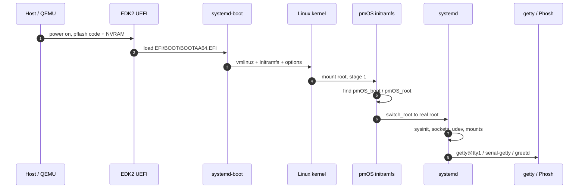
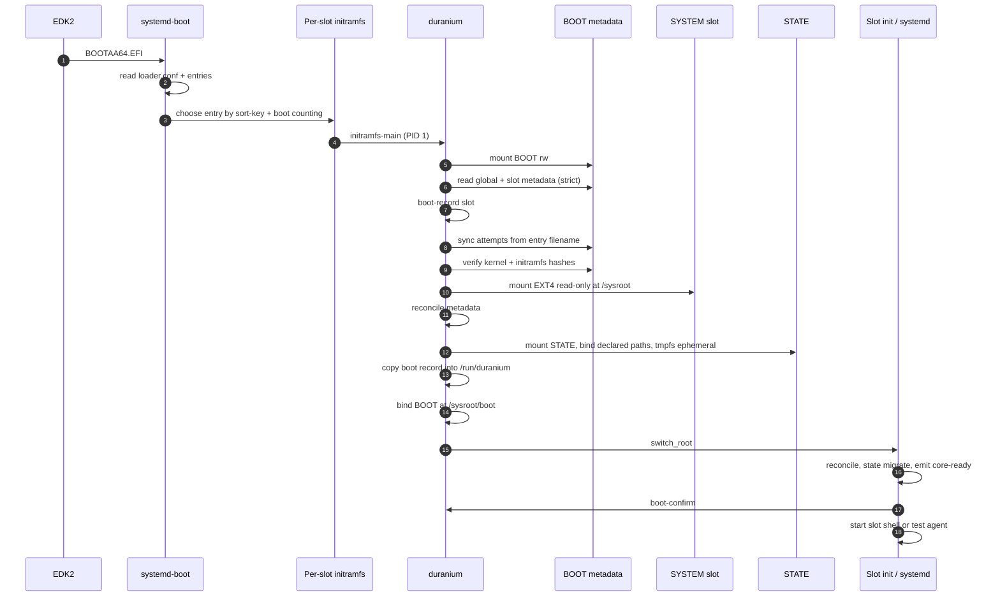
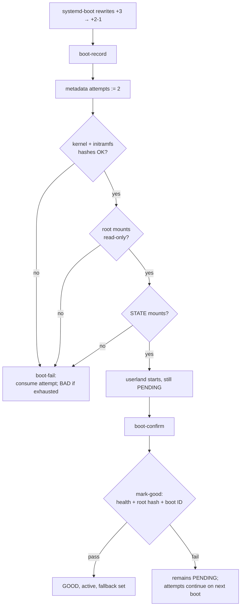
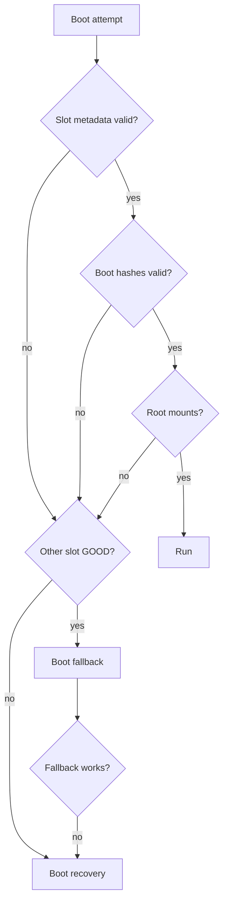

# 07 — Boot flows

[Back to docs index](README.md)

How a machine gets from firmware to a shell, for every boot path in the repo.

| Path | Used by |
| --- | --- |
| Core / Phosh boot | Lab VM, Core artifact |
| Duranium normal boot | Fixture and future Core adapter |
| Duranium pending boot | Update validation |
| Duranium failure/fallback boot | Bad kernel, bad root, exhausted attempts |
| Recovery boot | No usable normal slot, or explicit entry |
| Real Krane boot (reference only) | Not runnable in QEMU |

---

## 1. Core and Phosh boot chain



### Boot menu entry

`/boot/loader/entries/pmos.conf`:

```
title postmarketOS
linux vmlinuz
initrd initramfs
options console=tty1 console=ttyAMA0,115200 psi=0 transparent_hugepage=madvise
```

`quiet splash plymouth.*` are deliberately removed so serial output is
visible. `pmos.force-partition-resize` is removed because a non-fsck'd
filesystem makes the forced resize fail and drops to the debug shell.

### Disk layout of the Phosh/Core image

```
4200 MiB GPT
┌────┬────────────┬───────────┬────────┬────────────────────────────┐
│ #  │ Name       │ Range     │ FS     │ Contents                   │
├────┼────────────┼───────────┼────────┼────────────────────────────┤
│ 1  │ pmOS_boot  │ 1–513 MiB │ FAT32  │ systemd-boot, vmlinuz,     │
│    │ (esp)      │           │        │ initramfs, dtbs/           │
│ 2  │ pmOS_root  │ 513–4199  │ ext4   │ postmarketOS root          │
└────┴────────────┴───────────┴────────┴────────────────────────────┘
```

### Timings (1001 line, median)

| Stage | Time |
| --- | --- |
| EDK2 firmware | ~5.5 s |
| systemd-boot loader | ~0.19 s |
| Kernel | ~1.25 s |
| Userspace to target | ~2.57 s |
| Total in guest | ~9.5 s |
| Host spawn → SSH auth | ~12.5 s |

Firmware dominates. A direct `-kernel` boot exists as a lab-only mode and is
explicitly not comparable to measured boot.

### Console vs Phosh

| | Phosh (GUI-0000) | Core (0007/rebuild) | 1001 (console base) |
| --- | --- | --- | --- |
| Init | systemd | systemd | systemd |
| Display manager | greetd | none | none |
| Shell | Phosh | getty console | getty console |
| Console login | `user` / `147147` | `user` / `147147` | `user` / `147147` |
| SSH | yes | yes | yes |
| Plymouth | present | removed | removed |

---

## 2. Duranium normal boot



### Initramfs verification order

1. Mount BOOT read-write.
2. Resolve mode: `duranium.mode=recovery` or `/etc/duranium/mode`.
3. Read `duranium.slot=` from the kernel command line.
4. Compare with the initramfs's embedded `/etc/duranium/slot` marker.
5. `duranium boot-record <slot>`:
   - reconcile an interrupted update;
   - load global and slot metadata;
   - if pending, read the entry counter; mark `BAD` on exhaustion;
   - write `/run/duranium/boot.env`.
6. Verify kernel and initramfs hashes.
7. Mount the slot root read-only.
8. Reconcile metadata.
9. Prepare STATE mounts; if a pending slot cannot reach STATE, fail it.
10. Bind BOOT, move `/proc`, `/sys`, `/dev`, `switch_root`.

### Entry selection in practice

| State | Entry | Sort key |
| --- | --- | --- |
| B pending, 3 attempts | `duranium-b+3.conf` | 10 |
| A active GOOD | `duranium-a.conf` | 20 |
| A GOOD but inactive | `duranium-a.conf` | 30 |
| Recovery | `duranium-recovery.conf` | 90 |

A pending slot always outranks GOOD slots. Recovery is last.

---

## 3. Duranium pending boot

Booting a pending slot is **not** confirmation.



### Repeated pending boots

| Boot | Entry before | Entry after | Metadata |
| --- | --- | --- | --- |
| 1 | `+3` | `+2-1` | attempts 2 |
| 2 | `+2-1` | `+1-2` | attempts 1 |
| 3 | `+1-2` | `+0-3` | attempts 0 |
| 4 | exhausted | skipped | reconciliation marks `BAD` |

If `mark-good` runs on boot 2, the entry becomes `duranium-b.conf` and the
counters disappear.

---

## 4. Failure and fallback boot

### Case A — pending kernel cannot load

systemd-boot consumes an attempt before loading the kernel. After the
configured attempts, it skips the entry and boots the next one.

This is tested by destroying B's kernel after a valid update (`corrupt-boot`).

### Case B — pending root cannot mount or verify

The initramfs calls `slot_boot_fail`, which:

- decrements/consumes the attempt;
- marks the slot `BAD` when exhausted;
- reboots;
- systemd-boot picks the next entry.

This is tested by destroying B's root filesystem superblock.

### Case C — active GOOD slot fails

The initramfs marks it `BAD`, selects the fallback if GOOD, syncs entries,
and reboots. Recovery is booted only if no normal slot remains.

### Case D — metadata corruption

- Primary invalid → backup used.
- Both invalid for one slot → that slot unusable; the other slot is
  unaffected.
- Both global copies invalid → the fixture's recovery path and
  `repair-boot` reconstruct from GOOD slot metadata.



---

## 5. Recovery boot

Recovery is entered by:

- the `Alloy Recovery` systemd-boot entry (sort key 90);
- automatic selection when no normal slot has a bootable entry;
- initramfs redirect when a GOOD slot fails to mount;
- `duranium.mode=recovery` on the kernel command line.

```mermaid
sequenceDiagram
    participant SB as systemd-boot
    participant IR as Recovery initramfs
    participant R as RECOVERY partition
    participant PID1 as Recovery init
    participant CLI as duranium recovery

    SB->>IR: recovery kernel + initramfs
    IR->>IR: initramfs-main sees mode=recovery
    IR->>R: mount ext4 at /recovery
    IR->>IR: mount BOOT; bind at /recovery/boot
    IR->>IR: move /proc /sys /dev; tmpfs /run
    IR->>PID1: switch_root /recovery /sbin/init
    PID1->>PID1: write /run/duranium/recovery marker
    PID1->>CLI: mount-state; print status
    PID1->>PID1: mount /dev/vdb read-only (test data)
    PID1->>PID1: run test agent or shell
```

Recovery does not need SYSTEM_A or SYSTEM_B. It does need BOOT to be
readable, because the recovery kernel and initramfs live there.

---

## 6. Real Krane boot chain (reference)

This path is documented for completeness and is **not executable in QEMU**.


The official Krane image layout:

```
1  4–36 MiB     pmOS_kernel   chromeos_kernel flag   Depthcharge kpart
2  36–548 MiB   pmOS_boot     ext2                   vmlinuz, initramfs, dtbs
3  548–2710 MiB pmOS_root     ext4                   postmarketOS v25.12
```

Kernel: MediaTek MT8183 6.12.87 with the Krane device tree. QEMU has no
MT8183 machine, so this chain cannot run in the lab. Userspace experiments
transfer; boot and driver work do not.

---

## 7. Boot-time signals a developer can rely on

| Signal | Where | Meaning |
| --- | --- | --- |
| `DURANIUM_RECOVERY_READY` | serial | Recovery userland reached PID 1 |
| `DURANIUM_TEST:BOOT` | serial | Fixture agent started a scenario phase |
| `DURANIUM_TEST:PASS/FAIL` | serial | One assertion |
| `DURANIUM_TEST:DONE` | serial | Scenario complete |
| `DURANIUM_TEST:REQUEST_CORRUPT_*` | serial | Guest asks host to destroy a slot |
| `DURANIUM_BOOT_RECORD_FAILED` | serial | Slot could not be recorded; boot halts |
| `DURANIUM_SLOT_MISMATCH` | serial | Root image slot marker disagrees with cmdline |
| `/run/alloy/core-ready` | guest | Core readiness signal used by health |
| `/run/duranium/boot.env` | guest tmpfs | Per-boot flags: slot, boot_id, pending, confirmed, session, crash, clean |
| `/run/duranium/recovery` | recovery guest | Recovery context marker |
| `/pmOS_init.log` | pmOS initramfs shell | Detailed init failure log |

---

## 8. Boot-time failure checklist

| Symptom | Likely cause | Where to look |
| --- | --- | --- |
| UEFI shell instead of boot | Corrupt/stale NVRAM | Delete vars file; QEMU recreates it |
| postmarketOS debug shell | initramfs mount failure | `/pmOS_init.log`; partition labels; fstab |
| `DURANIUM_SLOT_MISMATCH` | Wrong kernel/initramfs paired with image | BOOT files vs `/etc/duranium/slot` |
| `DURANIUM_BOOT_RECORD_FAILED` | Metadata invalid or missing | BOOT `duranium/` files |
| Boots fallback after update | Pending verification or health failed | Serial log; `duranium status`; STATE logs |
| Recovery loops | RECOVERY partition missing/corrupt | BOOT entry + RECOVERY filesystem |
| No SSH | Guest not up, wrong port, or forward disabled | Serial log; `nc -z 127.0.0.1 2222` |

See [Operations runbook](12-operations-runbook.md) for commands.
