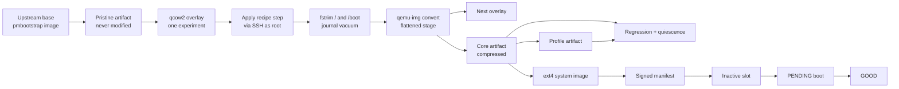
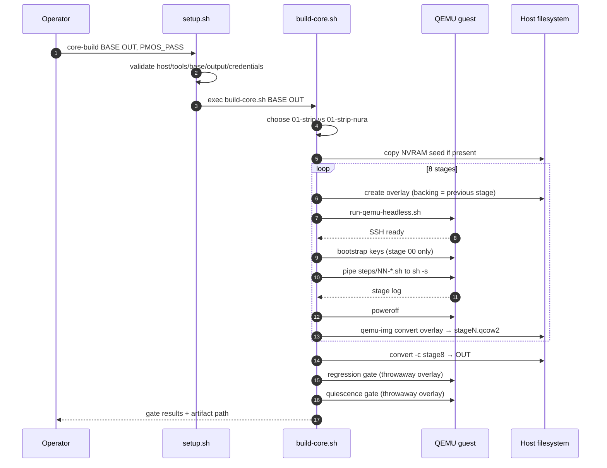
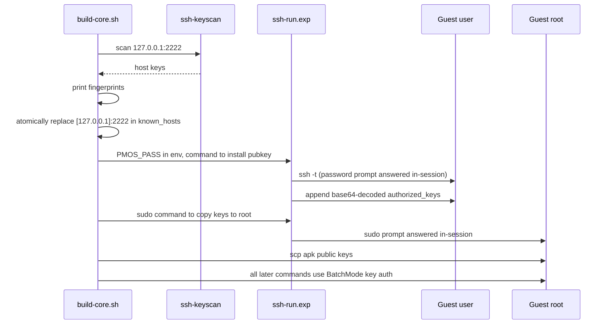
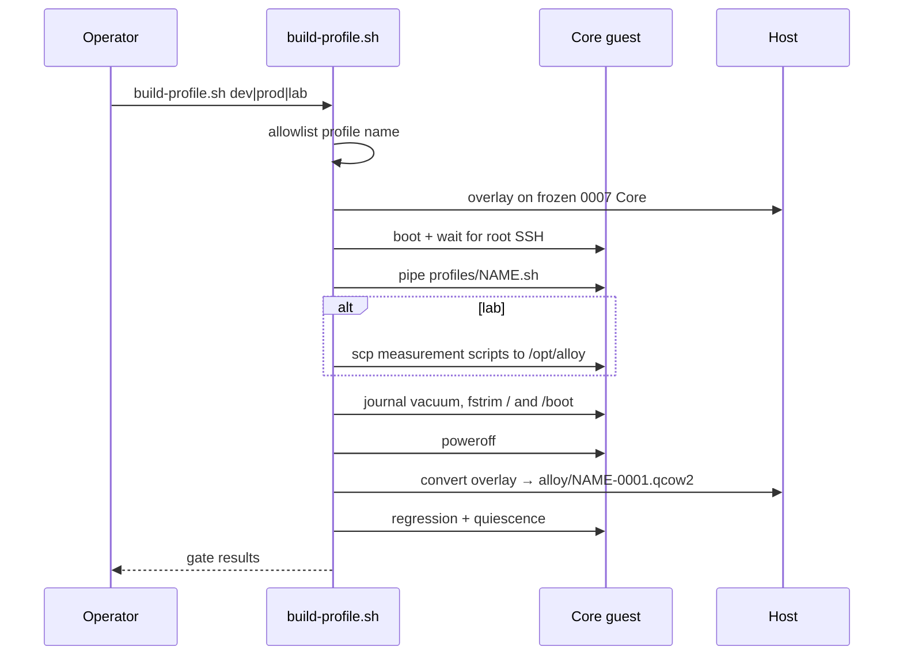
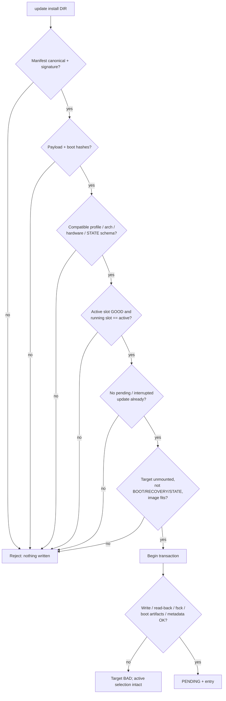
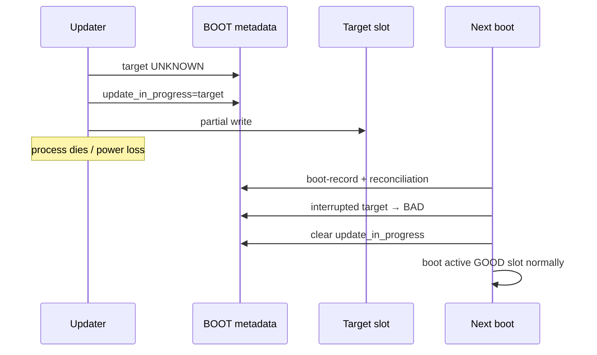
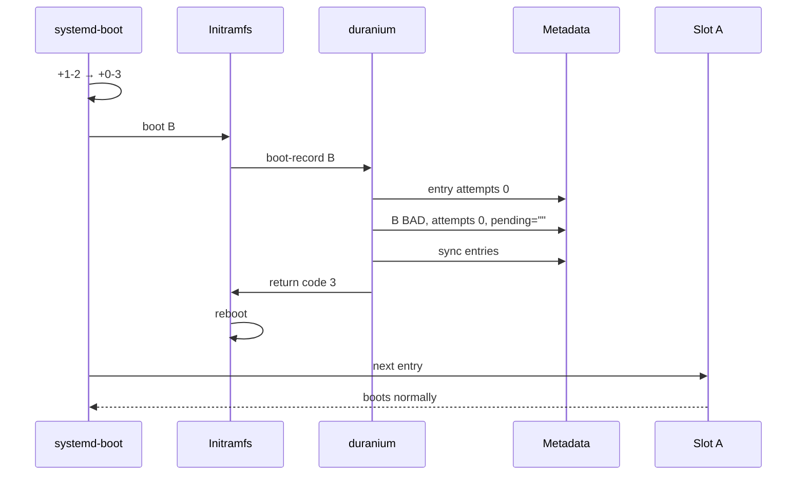
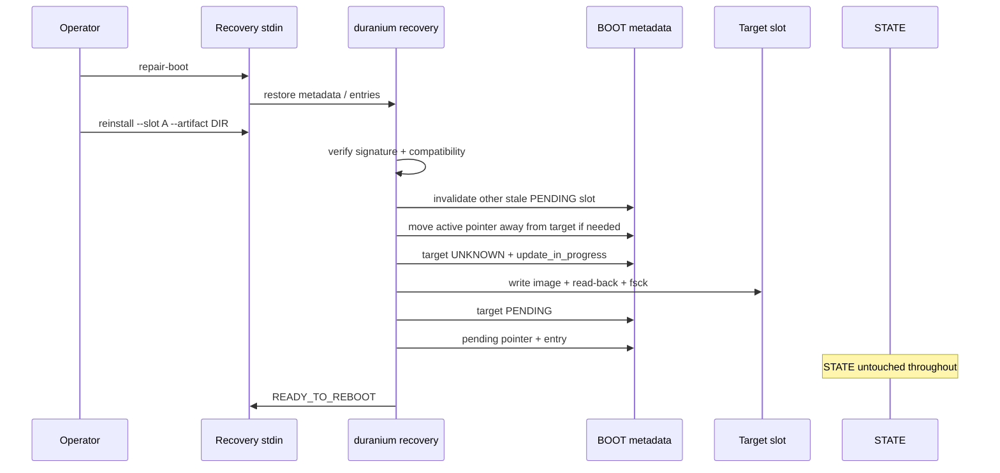
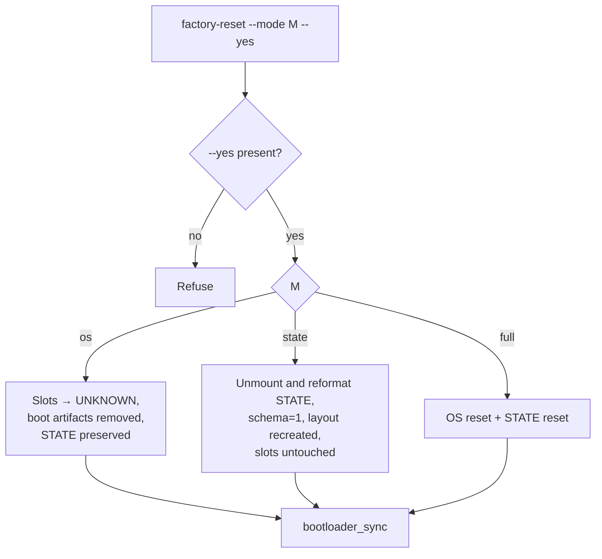

# 08 — Data flows

[Back to docs index](README.md)

Sequence-level views of every major operation, emphasizing **what data moves
where** and **what is written**. Boot-time behavior is in
[Boot flows](07-boot-flows.md); this document covers builds, updates,
measurements, migrations, and tests.

---

## 1. Artifact lifecycle



Two artifact families exist:

| Family | Built by | Consumed by |
| --- | --- | --- |
| qcow2 VM images | Lab scripts | QEMU runners, gates, measurement |
| ext4 system images + manifests | Image build (not fully implemented here) | Duranium updater |

The repository implements the qcow2 pipeline end to end. The
ext4-image-plus-manifest pipeline exists in the Duranium fixture builder and
unit tests; a production image build is roadmap.

---

## 2. Core build flow



### Data written per stage

| Item | Location |
| --- | --- |
| Overlay | `alloy/build/sN.qcow2` |
| Serial log | `alloy/build/serial.log` |
| Step log | `alloy/build/logs/<step>.log` (tee of SSH output) |
| Flattened stage | `alloy/build/stageN.qcow2` |
| Final artifact | `alloy/core/alloy-core.qcow2` (or supplied path) |

Scratch overlays and stages are deleted after the build; logs survive.

### Stage 00 bootstrap flow



The password is never in argv, never in a process list, and never in a
plaintext pipe. After stage 00, builds are key-only against a pinned host key.

---

## 3. Profile build flow



Profile scripts are small deltas:

| Profile | Data added | Policy change |
| --- | --- | --- |
| dev | git, build-base, vim, tmux, htop, strace, python3, docs | SSH forwarding on |
| prod | nftables + oneshot unit | key-only SSH, volatile journal |
| lab | python3, git, tmux, htop + tooling | SSH forwarding on |

---

## 4. Measurement flow

```mermaid
sequenceDiagram
    participant Op as Operator
    participant M as measure-boot.sh
    participant Q as QEMU
    participant C as collect-metrics.sh
    participant G as Guest

    Op->>M: image, serial, timings, port, vars
    M->>M: t0 = now
    M->>Q: spawn headless VM
    loop poll until timeout
        M->>G: BatchMode root SSH true
    end
    G-->>M: auth success
    M->>M: t1 = now; write boot_seconds
    Op->>C: prefix, 60
    C->>G: uname, os-release, uptime
    C->>G: free, /proc/meminfo, dmesg
    C->>G: process count, top RSS, services, failures
    C->>G: systemd-analyze + blame + critical-chain
    C->>G: 60 s interrupt window
    C->>G: disk footprint
    C-->>Op: out/prefix.*.txt
```

Methodology requirements:

- idle the host ≥30 s before timed boots;
- use median-of-3;
- collect metrics ≥2 min after boot;
- trim root and ESP separately;
- count processes with the SSH session overhead in mind;
- measure IRQs in the guest over a fixed window after settling.

---

## 5. Update installation (success)

```mermaid
sequenceDiagram
    autonumber
    participant U as User
    participant CLI as duranium
    participant FS as Artifact dir
    participant Keys as /etc/duranium/keys
    participant Meta as BOOT metadata
    participant Boot as BOOT files
    participant Slot as Inactive slot
    participant State as STATE logs

    U->>CLI: update install DIR
    CLI->>FS: read manifest.txt + manifest.sig
    CLI->>Keys: load <key_id>.pub
    CLI->>CLI: Ed25519 verify manifest bytes
    CLI->>FS: hash system.img (or gunzip then hash)
    CLI->>FS: hash vmlinuz + initramfs
    CLI->>CLI: profile/arch/hardware/schema checks
    CLI->>Meta: target UNKNOWN; global update_in_progress
    CLI->>Boot: sync entries (remove target)
    CLI->>Slot: write image
    CLI->>Slot: read back image_size bytes, hash
    CLI->>Slot: fsck.ext4 -fn
    CLI->>Boot: write vmlinuz, initramfs, manifest copies
    CLI->>Boot: read back and hash boot artifacts
    CLI->>Meta: target PENDING + recorded hashes
    CLI->>Meta: global pending_slot; clear update_in_progress
    CLI->>Boot: write duranium-<target>+3.conf
    CLI->>State: updates.log
    CLI-->>U: READY_TO_REBOOT
```

### What is never touched

- the active slot device;
- the active slot's boot files;
- any mounted target device;
- BOOT, RECOVERY, or STATE as an image target.

---

## 6. Update rejection flow



Rejection cases exercised by tests:

- modified payload;
- modified manifest;
- wrong signing key / untrusted `key_id`;
- wrong architecture;
- wrong profile;
- wrong hardware target;
- unsupported manifest version;
- non-canonical field order;
- injected write failure;
- injected read-back failure;
- power loss mid-write;
- filesystem check failure;
- metadata commit failure.

Every rejection leaves the active slot byte-identical and bootable.

---

## 7. Power-loss flow



The fixture simulates this with `DURANIUM_TEST_PARTIAL_WRITE_BYTES` and
`DURANIUM_TEST_POWER_LOSS=1`; the updater exits mid-write, the host reboots,
and reconciliation must mark B `BAD` while A remains `GOOD`.

---

## 8. Mark-good flow

```mermaid
sequenceDiagram
    participant OS as Booted OS
    participant D as duranium
    participant Meta as BOOT metadata
    participant Root as Slot device
    participant H as Health
    participant Entry as systemd-boot

    OS->>D: boot-confirm
    D->>D: check boot record + boot ID
    D->>D: set confirmed=1
    opt session gate enabled
        OS->>D: session-confirm
        D->>D: require confirmed; set session=1
    end
    OS->>D: mark-good
    D->>Meta: global pending == booted?
    D->>Meta: status PENDING?
    D->>D: boot ID matches pending_boot_id?
    D->>D: confirmed=1? session if required? crash=0?
    D->>Root: hash exactly image_size bytes
    D->>H: root ro / STATE / core / services / health.d
    alt all pass
        D->>Meta: slot GOOD, known_good=1, attempts=0
        D->>Meta: active=slot, fallback=previous, pending=""
        D->>Entry: rewrite counterless entry
    else any fail
        D-->>OS: refuse; slot stays PENDING
    end
```

---

## 9. Attempts-exhausted flow



Once `BAD`, no automatic entry is written and there is no retry until an
operator re-arms the slot from recovery.

---

## 10. STATE migration flow

```mermaid
sequenceDiagram
    participant PID1 as Slot PID 1 / systemd
    participant D as duranium
    participant State as STATE
    participant Img as Image migrations
    participant Meta as BOOT metadata

    PID1->>D: state migrate <slot>
    D->>Meta: read required schema
    D->>State: read /state/duranium/schema
    loop until current >= required
        D->>Img: read N-to-N+1.conf + .sh
        D->>D: reject irreversible or unknown kind
        D->>State: tar backup of STATE
        D->>Img: run migration script
        D->>State: advance schema marker
        D->>State: prune old backups; log
    end
    alt failure
        D->>Meta: pending slot BAD
        D->>PID1: reboot to fallback
    end
```

A GOOD slot that hits a migration failure continues degraded rather than
boot-looping, because its image is intact and migrations are additive. A
pending slot is marked `BAD` and abandoned.

---

## 11. Recovery reinstall flow



Recovery reinstall differs from a normal update in two ways:

- target slot is explicit (`--slot`), including the previously active slot;
- an older required STATE schema is tolerated with a warning.

---

## 12. Factory reset flow



`backend_state_format` refuses to format a device that resolves to BOOT,
RECOVERY, SYSTEM_A, or SYSTEM_B, and refuses unsafe mountpoints.

---

## 13. QEMU test-suite orchestration

```mermaid
sequenceDiagram
    participant Host as run-suite.sh
    participant Docker as Alpine container
    participant Disk as Fixture copy
    participant VM as QEMU
    participant Guest as Guest agent

    Host->>Host: copy fixture with dd (not clone)
    Host->>Docker: set scenario name on testdata.img
    loop until DONE/FAIL or max boots
        Host->>VM: run-vm.sh --disk copy --testdata
        VM->>Guest: boot
        Guest->>Guest: read phase from /state/test/phase
        Guest->>Guest: run scenario_step(phase)
        Guest-->>Host: DURANIUM_TEST:PASS/FAIL
        Guest->>Guest: advance phase, boot-clean, poweroff
        opt host-side corruption requested
            Guest-->>Host: REQUEST_CORRUPT_A/B/BOTH
            Host->>Disk: dd zeros at partition offset
        end
    end
    Host->>Host: summarise PASS/FAIL; keep logs; drop disk on success
```

Scenarios are phase-driven so an unbootable slot simply never reaches the
agent; the next boot continues at the same phase.

---

## 14. Where state lives, by lifetime

| Data | Lifetime | Location |
| --- | --- | --- |
| Firmware NVRAM | per run / reusable | vars file |
| Boot counters | boot-to-boot | entry filename on BOOT |
| Slot/global metadata | durable | BOOT `duranium/` |
| Boot confirmation flags | one boot | `/run/duranium/boot.env` |
| Boot evidence journal | durable | STATE `duranium/bootlog` |
| User/settings state | durable across updates | STATE binds |
| Caches/logs | durable but recreatable | STATE |
| Running update lock | one process | `/run/duranium/update.lock` |
| Artifact payload | until install | artifact directory |
| Test phase | across boots | STATE `/state/test/phase` |
| Test data disk | suite lifetime | read-only `/dev/vdb` |

The separation is deliberate: **boot-critical data is on BOOT; everything
else that matters is on STATE; everything transient is tmpfs.**
