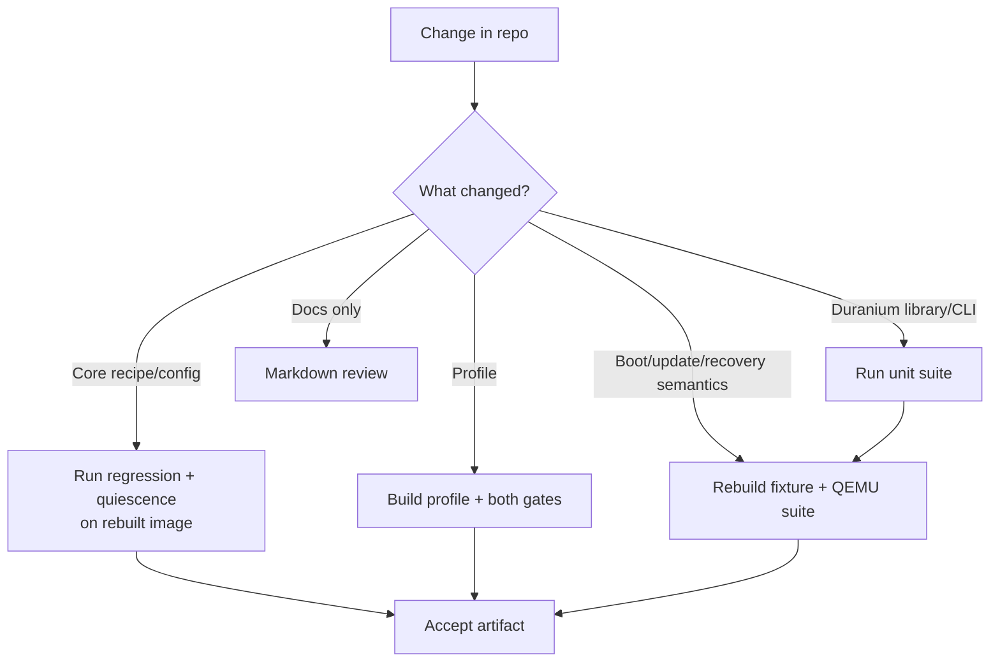
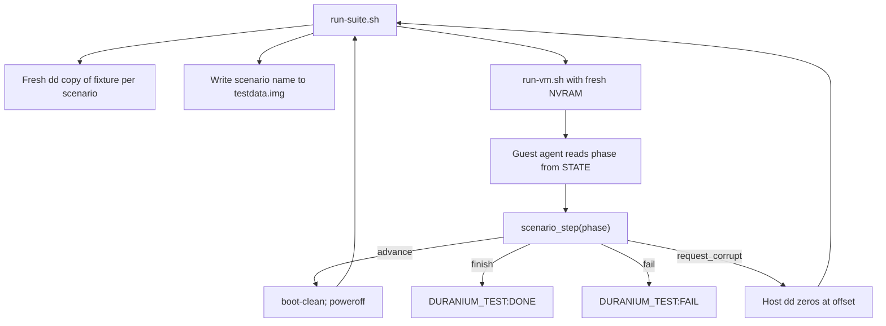

# 09 — Testing and gates

[Back to docs index](README.md)

The repository uses three layers of verification:

1. **Gates** for OS images (functional integrity + idle behavior).
2. **Unit tests** for Duranium logic without QEMU.
3. **QEMU integration scenarios** for real boot/update/recovery behavior.

There is no CI workflow; all of these run locally.

---

## 1. Test inventory

| Layer | Command | Needs | Result at last record |
| --- | --- | --- | --- |
| Core regression | `alloy/regression-test.sh IMG PROFILE` | QEMU/HVF, pinned host key | 1001: ALL PASS |
| Core quiescence | `alloy/quiescence-test.sh IMG PROFILE` | QEMU/HVF, pinned host key | 1001: ALL PASS |
| Duranium unit | `tests/run-unit.sh` | Linux or Docker | 9/9 scripts, 167 checks |
| Duranium QEMU | `tests/qemu/run-suite.sh` | Docker, QEMU, EDK2, fixture | 6/6 scenarios, 176 assertions, 23 boots |
| Syntax | `make syntax` | `sh` | every shell file parses |
| Legacy/unit gates | profile builds | frozen 0007 artifact | dev/prod/lab ALL PASS (recorded) |



---

## 2. The two image gates

### Regression gate

Purpose: **the image still does its job.**

```sh
devices/kukui-krane/alloy/regression-test.sh  <profile>
```

Profiles: `core`, `core-nura`, `dev`, `lab`, `prod`.

It boots the image on a throwaway overlay, waits for root SSH, and runs
checks over SSH.

| Group | Assertions |
| --- | --- |
| Keep-list | 20 packages |
| File | `panfrost_dri.so` |
| SSH policy | forwarding `no` for core/prod, `yes` for dev/lab |
| Kernel cmdline | `psi=0`, `transparent_hugepage=madvise` |
| Sysctls | `compaction_proactiveness=0`, `stat_interval=10` |
| Journal | cap drop-in exists |
| Runtime | zero failed units |
| Services | 8 critical units active |
| Swap | zram and swapfile both present |
| Modules | ≤700 files, ≤30 MB |
| Listeners | exactly 4 (`:22` v4+v6, `:53` ×2), no `:5355` |
| Input | at least one `ID_INPUT=1` device, read via `udevadm --export-db` |
| Profile extras | dev toolchain, prod SSH/journal/nftables, lab `/opt/alloy` |

Implementation notes worth knowing:

- SSH uses `ControlMaster` multiplexing. Forty sequential connections
  otherwise throttle themselves.
- Listener parsing checks the address column, not the line tail.
- `sshd -T` output is matched case-insensitively.
- Input classification reads the udev database directly; `udevadm info`
  intermittently omits tags on this build.
- A failed gate powers off its VM and cleans its temp directory.

### Quiescence gate

Purpose: **the image is actually idle.**

```sh
devices/kukui-krane/alloy/quiescence-test.sh  <profile>
```

The test boots, measures boot-to-SSH, waits **120 s**, then samples a **60 s**
window.

| Profile | Services | Processes | Boot RAM | IRQ/s | CPU | Writes/60 s |
| --- | --- | --- | --- | --- | --- | --- |
| `core`, `prod` | exactly 12 | ≤115 | ≤140 MiB | ≤12 | ≤1% | ≤2 MB |
| `core-nura` | ≤14 | ≤120 | ≤140 MiB | ≤12 | ≤1% | ≤2 MB |
| `dev` | ≤16 | ≤150 | ≤500 MiB | ≤15 | ≤1% | ≤2 MB |
| `lab` | ≤16 | ≤150 | ≤350 MiB | ≤15 | ≤1% | ≤2 MB |

Common assertions: boot ≤35 s, zero failed units, exactly four TCP
listeners.

The measured idle IRQ on Core is ~7.6/s and on 1001 ~8.4/s, comfortably under
the 12/s gate.

---

## 3. Duranium unit suite

```sh
cd pkgs/duranium
./tests/run-unit.sh
```

Runs on the `dir` backend with temporary directories. No root, no QEMU.

| Script | Focus | Checks |
| --- | --- | --- |
| `01-metadata` | strict parsing, persistence, redundancy, corruption | 17 |
| `02-boot-selection` | GOOD/pending/BAD/fallback, attempt counting | 17 |
| `03-manifest` | canonical manifest, SHA-256, Ed25519, tamper, compatibility | 14 |
| `04-mark-good` | explicit confirmation, boot ID, health | 18 |
| `05-update` | inactive-only write, read-back, failure injection, power loss | 35 |
| `06-state` | schema, migration, rollback, irreversible rejection | 27 |
| `07-recovery` | inspect, repair, reinstall, factory reset | 24 |
| `08-profiles` | dev/lab/prod, arch, hardware | 12 |
| `09-policy` | no live APK/network mutation in runtime; crypto usage | 3 |

Shared helpers live in `tests/unit/lib.sh`.

### Test-only hooks

These exist so failure paths can be tested deterministically:

| Variable | Effect |
| --- | --- |
| `DURANIUM_TEST_MODE=1` | Relaxes root checks; enables fake boot IDs and fixture semantics |
| `DURANIUM_TEST_BOOT_ID` | Simulates distinct boots |
| `DURANIUM_TEST_PARTIAL_WRITE_BYTES` | Writes only N bytes |
| `DURANIUM_TEST_POWER_LOSS=1` | Exits mid-write like a power cut |
| `DURANIUM_TEST_FAIL_AT=write\|readback\|metadata\|state-format` | Injects failures |
| `DURANIUM_TEST_SKIP_HEALTH` | Bypasses health for specific tests |
| `DURANIUM_TEST_ACCEPT_IRREVERSIBLE` | Allows testing an otherwise rejected migration |
| `DURANIUM_HEALTH_EXTRA_MARKER` | Adds a marker check |

---

## 4. Duranium QEMU suite

```sh
cd pkgs/duranium
./qemu/build-fixture.sh
./tests/qemu/run-suite.sh
```

or via the facade:

```sh
./scripts/setup.sh duranium-test
```

### Harness design



Why phase-driven: an unbootable slot never reaches the agent, so the host
simply boots again and the phase stays put. This makes "three attempts then
fall back" testable without guest cooperation on the broken slot.

### Scenario matrix

| Scenario | Destructive setup | What it proves |
| --- | --- | --- |
| `acceptance` | none | Full happy path + two failure/rollback paths |
| `failures` | none (guest injects) | Rejection of tampered/invalid artifacts; power-loss recovery |
| `recovery-both` | A and B zeroed before boot | Recovery boots and reinstalls without deleting STATE |
| `recovery-a` | A zeroed; B `UNKNOWN` | Recovery with one destroyed slot |
| `recovery-mixed` | B broken; A boots; host later destroys A | Recovery after both normal paths fail |
| `corrupt-boot` | Guest corrupts B's kernel | systemd-boot counting falls back to A |

### Acceptance scenario in detail

The scenario has six guest phases and takes nine boots because three of them
deliberately fail on a corrupted slot.

| Phase | What happens |
| --- | --- |
| 0 | A is GOOD, root is read-only, STATE is mounted; write user state; install B; verify A's device hash unchanged; B is PENDING |
| 1 | Boot B PENDING (attempts 2); STATE survives; ephemeral data is gone |
| 2 | Boot B PENDING (attempts 1); explicitly mark B GOOD; active B, fallback A |
| 3 | Boot B GOOD; install A-v3 into inactive A; verify B's device hash unchanged |
| 4 | Boot A PENDING; mark A GOOD; install B-v2; destroy B's root superblock; advance |
| 5 | After three failed B boots, A boots GOOD with B BAD, pending cleared, counters gone, and STATE intact |

Boots 6–8 never reach the guest agent: B's kernel loads but the corrupted
root fails verification/mount, each failure consumes an attempt, and after the
third the slot is marked BAD. Boot 9 runs phase 5 on A.

### Corrupting slots

The host writes zeros at known offsets derived from `fixture.env`:

```
A_OFFSET_MB=257
B_OFFSET_MB=385
STATE_OFFSET_MB=513
```

This destroys the filesystem superblock/start without needing guest tools.

### Recorded results

| Metric | Value |
| --- | --- |
| Run date | 2026-11-17 (with later reruns in `qemu/out/runs/`) |
| Unit scripts | 9 passed, 0 failed |
| QEMU scenarios | 6 passed, 0 failed |
| Guest assertions | 176 |
| Real boots | 23 |
| Environment | macOS arm64, QEMU HVF 11.1.3, Alpine 3.20 aarch64 container |

Marker log: `pkgs/duranium/docs/11-QEMU-MARKERS.txt`. Per-boot serial logs are
in `qemu/out/runs/<timestamp>/<scenario>/` and are gitignored.

---

## 5. What is *not* tested

| Area | Status |
| --- | --- |
| Real Alloy Core systemd userland under Duranium | Not in the green suite |
| Sign-in gate under a real desktop | Stub; no caller |
| Real hardware / Krane | Not part of V1 |
| Linux KVM/TCG recorded results | Implemented, not recorded |
| Secure Boot / signed boot metadata | Not implemented |
| GUI update or recovery | Not implemented |
| Network update service | Not implemented |
| Production signing keys | Test keys are ephemeral |
| Package management runtime | Explicitly excluded by policy test |

The fixture proves the **storage, boot, transaction, state, and recovery
semantics** against real UEFI, systemd-boot, GPT, FAT32, ext4, read-only
mounts, bind mounts, and tmpfs. It does not prove a complete desktop OS.

---

## 6. Adding a new Core gate check

1. Add the assertion to `devices/kukui-krane/alloy/regression-test.sh` under
   the right group.
2. Use `G` for SSH commands; it retries and filters warnings.
3. Use `P $? "description"` to record PASS/FAIL.
4. Keep checks profile-aware with the existing `case "$PROFILE"` blocks.
5. Run against the Core and each profile before trusting the change.

## 7. Adding a new quiescence threshold

1. Add a profile case at the top of `quiescence-test.sh`:
   `SVC_MODE`, `SVC`, `PROC`, `RAM`, `IRQ`, `CPU_PCT`, `WRT_MB`.
2. Justify the numbers from a measured baseline, not a guess.
3. Remember the 120 s settle: first-boot journald/DHCP noise must be gone.

## 8. Adding a Duranium unit test

1. Create `tests/unit/NN-name.sh`.
2. Source `tests/unit/lib.sh`.
3. Use the dir backend and temporary roots; never touch the host.
4. Print one line per check and return non-zero on failure.
5. The runner discovers files numerically.

## 9. Adding a Duranium QEMU scenario

1. Add `tests/qemu/scenarios/name.sh` with `scenario_step()`.
2. Every step must end with `advance`, `finish`, `fail`, or
   `request_corrupt`.
3. Register it in `run_one()` in `tests/qemu/run-suite.sh` with a boot budget.
4. Rebuild the fixture so the scenario is copied into the test-data disk.
5. Use the helpers: `expect_eq`, `expect_slot_status`, `expect_active`,
   `expect_pending`, `expect_contains`, `run_or_fail`, `expect_fail`,
   `seed_state_files`, `check_user_state`.

---

## 10. Test artifacts and cleanup

| Path | Tracked? | Notes |
| --- | --- | --- |
| `devices/kukui-krane/alloy/build/logs/` | No | Stage/profile logs |
| `pkgs/duranium/qemu/out/` | No (`out/` ignored) | ~17 GB of fixtures, runs, keys |
| `pkgs/duranium/tests/.tmp/` | No | Unit-test scratch |
| `docs/11-QEMU-MARKERS.txt` | Yes | Committed marker extract |
| Baseline `out/` metrics | Some | 1001 performance evidence is committed |

`make clean` in `pkgs/duranium` removes `qemu/out` and `tests/.tmp`.

---

## 11. Interpreting a failure

| Failure | Meaning | First check |
| --- | --- | --- |
| `image never booted` | Guest did not reach SSH | Serial log; port conflict; host key path depth |
| `modules regrew` | Kernel package replaced pruned modules | Re-run `06-modprune.sh`; `apk fix` restores them |
| `listeners` mismatch | Extra socket appeared | `ss -tlnp` in guest; LLMNR or proxy |
| `services != 12` | A new service is running | `systemctl list-units --state=running` |
| `idle IRQ` too high | A timer/daemon woke up | `/proc/interrupts` deltas; recently changed config |
| `boot RAM` too high | Cache/service growth | `free -m`; top RSS |
| `DURANIUM_TEST:FAIL` | One named guest assertion failed | The line names the expectation and actual value |
| Suite times out with no DONE | Scenario phase never advanced | Serial logs under `runs/<timestamp>/`; STATE phase |
| `pending slot … BAD` unexpectedly | Orphan rule or entry mismatch | `duranium status`, entry filenames, `bootlog` |

The gates are intentionally strict. Raising a threshold is a product decision
that must be justified by a measured baseline, not by a red test.
