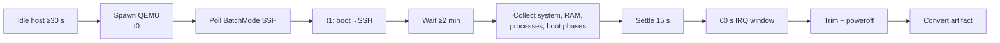
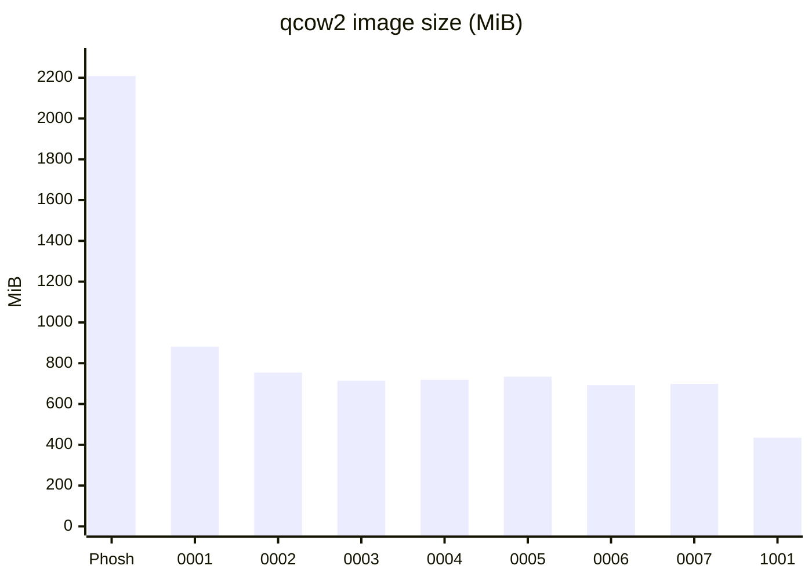
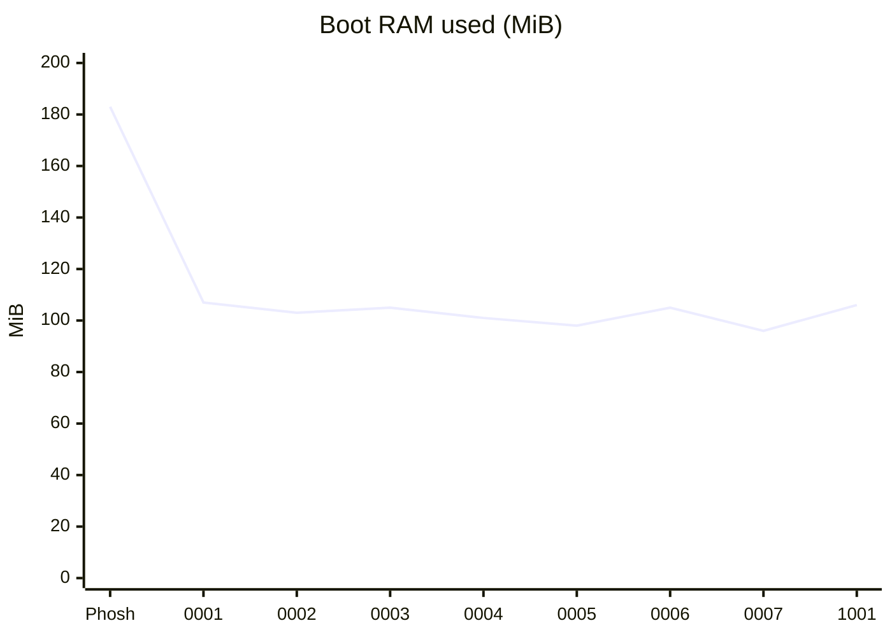
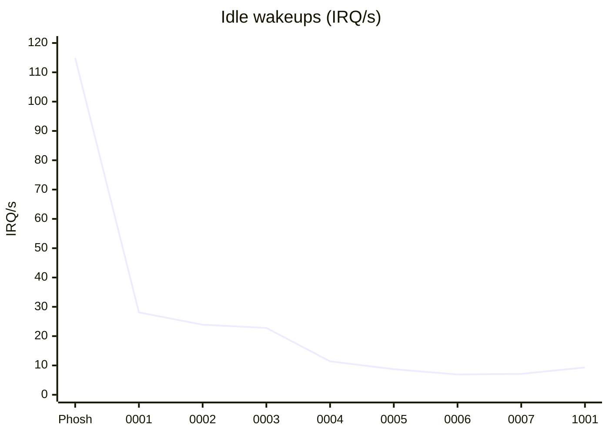
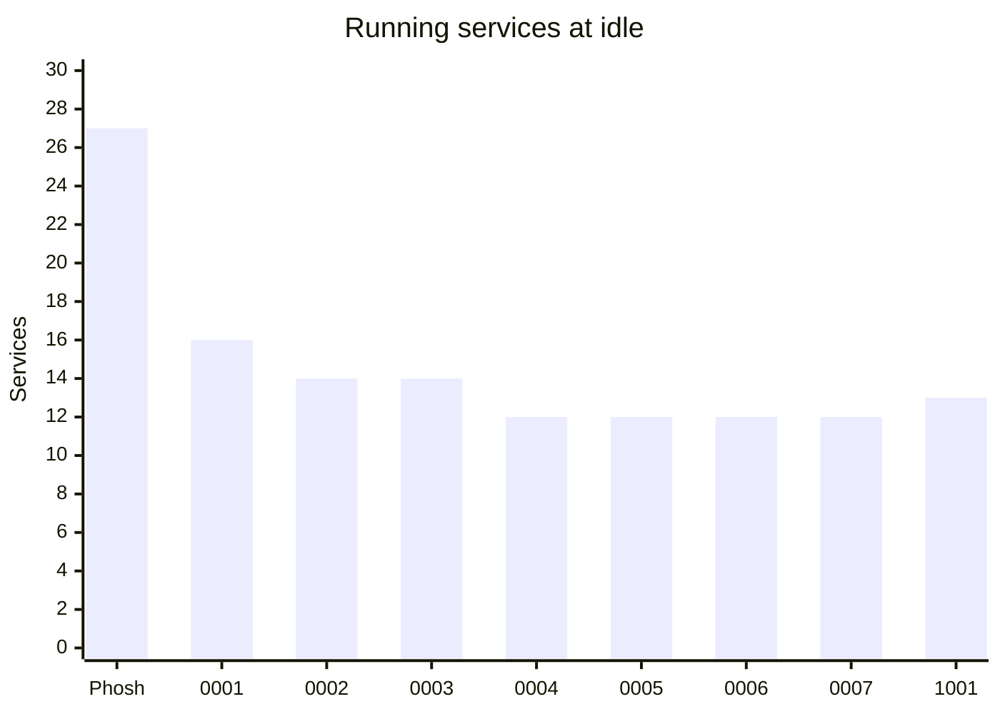
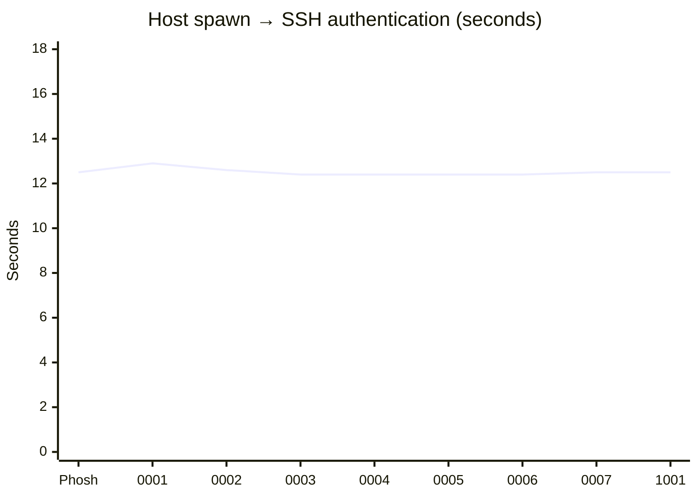
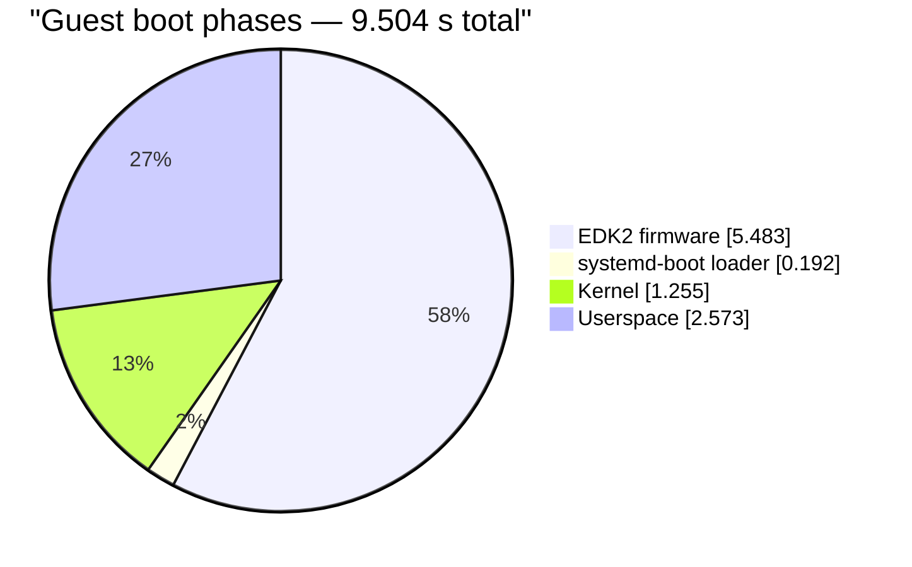
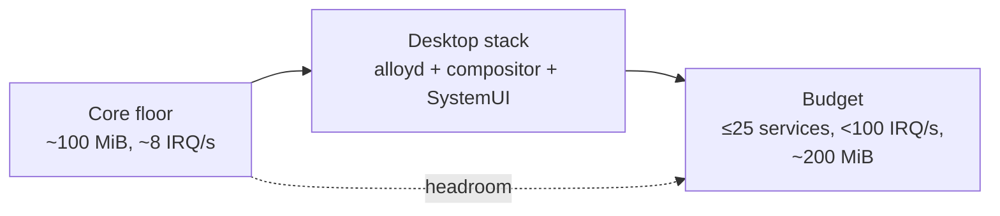

# 10 — Measurements and performance

[Back to docs index](README.md)

This document collects the measured performance story of the project: how
measurements are taken, how the floor evolved, what the current floor costs,
and where the remaining headroom is.

All numbers below were recorded on the documented Apple Silicon host and are
reproduced from the repository's own evidence files.

---

## 1. Measurement methodology

The project treats methodology as part of the result. The rules that survived
contact:

1. **Fixed geometry** for every comparable run:
   `-M virt,highmem=on -accel hvf -cpu host -smp 4 -m 4096`, virtio-blk
   (`discard=unmap`), virtio-net NAT with loopback SSH, xhci + usb-kbd/tablet,
   no display, serial to logfile, EDK2 pflash + per-run NVRAM.
2. **Idle the host ≥30 s** before timed boots. APFS settling after a large
   convert once faked a 20 s boot; the same image measured 12.6 s later.
3. **Median of 3** boot timings.
4. **Collect metrics ≥2 min after boot.** An earlier collector hung racing
   first-boot journald.
5. **Measure wakeups in the guest**: settle 15 s, then delta
   `/proc/interrupts` over 60 s.
6. **Trim both filesystems** before converting: `fstrim -v /` and
   `fstrim -v /boot` (vfat needs its own).
7. **Count processes via `/proc/[0-9]*`**; `ps` is BusyBox-limited and
   `ps | grep -c` counts the grep.
8. **Attribute per-process work** with `/proc/*/{stat,status,io}` deltas
   joined host-side, not with in-guest sampling that changes the workload.



---

## 2. The floor's evolution

### Image size



| State | Image (MiB) | Packages | Boot RAM (MiB) | Processes | Services | IRQ/s |
| --- | --- | --- | --- | --- | --- | --- |
| Phosh source | 2208 | 1187 | 183 | 130 | 27 | 114.9 |
| 0001 strip | 881 | 267 | 107 | 105 | 16 | 28.1 |
| 0002 file cuts | 754 | 267 | 103 | 103 | 14 | 23.9 |
| 0003 hwdb diet | 714 | 267 | 105 | 105 | 14 | 22.8 |
| 0004 runtime tuning | 719 | 267 | 101 | 99 | 12 | 11.4 |
| 0005 IRQ + swap | 734 | 267 | 98 | 100 | 12 | 8.73 |
| 0006 module diet | 692 | 267 | 105 | 100 | 12 | 6.92 |
| 0007 config sweep | 698 | 267 | 96 | 100 | 12 | 7.13 |
| 1001 new base | 435 | 361 at source* | 106–113 | 102–103 | 13 | 8.7–10.5 |

Notes:

- \*1001 started from 361 packages on the console base; the floor's final
  package count is not separately recorded (the keep-list recipe is the same).
- 0005 is larger than 0004 because of the 2 GiB swapfile's sparse metadata and
  swap/journal churn.
- 0006/0007 wobble by a few MiB is journal/config churn between compactions.
- 1001 is compressed, which is why 435 MiB is not directly comparable to the
  uncompressed 0007 lineage.

### Boot RAM



### Idle interrupts



The 1001 value shown is one recorded 60 s window (9.32/s); the documented band
is 8.7–10.5/s. The 0007 lineage reached 6.92/s at 0006 and settled at 7.13/s
after the configuration sweep.

### Services



### Boot to SSH



Boot time is firmware-bound throughout. The 0001 range 12.9–15.9 s includes a
noisy first measurement era; median-of-3 was adopted at 0003. The 1001 gate
run once recorded 15.9 s; the formal performance record reports a median of
12.5 s. Both are kept as recorded.

---

## 3. Where boot time goes (1001)



| Phase | Time | Share |
| --- | --- | --- |
| Firmware (EDK2) | 5.483 s | 58% |
| Loader (systemd-boot) | 0.192 s | 2% |
| Kernel | 1.255 s | 13% |
| Userspace | 2.573 s | 27% |

Userspace is only about a quarter of guest boot. A direct-kernel lab boot
would remove firmware time but is explicitly not comparable to a real device
and is not used for claims.

Slowest userspace units (1001):

```
387 ms  dev-vda2.device
267 ms  dev-zram0.device
259 ms  systemd-udev-trigger.service
112 ms  NetworkManager.service
104 ms  nftables.service
 93 ms  user@0.service
 60 ms  postmarketos-zram-swap.service
 52 ms  systemd-udevd.service
 50 ms  systemd-fsck@dev-vda1.service
 50 ms  systemd-journald.service
```

---

## 4. Interrupt composition

### 0007 lineage

| Source | Rate |
| --- | --- |
| `arch_timer` (HVF host tick floor) | ~5.8–7.3/s |
| Function-call IPIs | ~1.0–1.4/s |
| virtio (blk + net) | ~0.4–0.7/s |
| Rescheduling | ~0.05/s |
| **Total** | **6.9–7.1/s** |

### 1001

| Source | Rate |
| --- | --- |
| `GICv3 Level arch_timer` | 7.33/s |
| Function-call IPIs | 1.28/s |
| virtio0 queues | 0.42 + 0.12/s |
| virtio1 input/output | 0.05 + 0.07/s |
| Rescheduling | 0.05/s |
| **Total** | **9.32/s** |

The remaining floor is dominated by the hypervisor timer under HVF. Going
lower requires tickless/timer configuration work or different hardware; it is
not guest busywork.

---

## 5. Idle CPU and I/O

The 0003 per-process profile found:

- **Userland CPU: 0.000 s across 95 processes in 60 s.**
- **Disk writes at idle: 0 KB from every process.**

That is the definition of a quiet floor: nothing is computing, nothing is
writing. Later changes (journal caps, `noatime`, disabled probes) reduce
potential churn rather than measured idle work.

Top remaining wakers in the profile era were kcompactd (THP/compaction),
kworkers (vmstat interval), and PSI monitors. Each was addressed by a
specific knob:

| Waker | Cause | Fix |
| --- | --- | --- |
| kcompactd 2.0/s | `compaction_proactiveness=20` timer | set `0` |
| kworkers 4.3/s | `vm.stat_interval=1` | set `10` |
| psimon ×5 0.4/s | PSI enabled by default | explicit `psi=0` |
| khugepaged scan | THP `[always]` | `transparent_hugepage=madvise` |
| wpa_supplicant | no WiFi device | disable; D-Bus reactivates |
| rtkit-daemon | no audio session | disable; D-Bus reactivates |

A failed experiment is recorded too: `kernel.watchdog=0` had no effect because
this kernel has no `/proc/sys/kernel/watchdog`, and `stat_interval=100` showed
no measurable difference from 10.

---

## 6. Memory behavior under pressure

The 0005 work measured the zram → disk hierarchy, not just idle RAM.

| Demand (tmpfs on ~3.9 GiB) | Behavior |
| --- | --- |
| ≤3.5 GiB | No swap used; watermark not crossed |
| ~3.9 GiB crossing supply | kswapd evicted ~740 MB; zram absorbed it (382 MB logical → 200 KB stored for zero pages); latency flat |
| ~3.9 GiB with zram disarmed | Disk swapfile absorbed 632 MB; latency flat |
| ~3.6 GiB incompressible (`urandom`) | OOM → kernel panic (`panic_on_oom` semantics); clean fast-fail and reboot |

Usability probes (apk, DNS, SSH) stayed at 0.26–0.29 s across the
compressible states.

The design conclusion: compression handles realistic spikes; an
incompressible working set near 100% of RAM fast-fails rather than thrashing.
This is a deliberate tablet-like behavior, not an accident.

---

## 7. Storage footprint (1001)

| Item | Value |
| --- | --- |
| Artifact | 435 MiB compressed qcow2 (virtual 4.1 GiB) |
| Root filesystem used | 2.7 GB total including the 2 GiB swapfile |
| Live data excluding swapfile | ~700 MB |
| `/usr` | 457 MB |
| `/var` | 121 MB |
| `/etc` | 3 MB |
| Kernel modules | 638 files / 21.4 MB |
| Modules loaded at runtime | 17 (including nftables stack, i2c_dev, virtiofs, fuse, evdev, hid_generic, uhid, libcomposite from initramfs) |

---

## 8. Host-side cost

| Measure | 1001 |
| --- | --- |
| QEMU process CPU at idle | 0.0% |
| QEMU RSS | ~139 MiB |
| Sandbox overlay growth over a session | ~12 MiB (journal/config churn) |

The lab is cheap to leave running at idle; most cost is during builds.

---

## 9. Performance goals vs. current floor

From the project README:

| Goal for finished desktop | Current floor |
| --- | --- |
| ≤25 running services at idle | 12–13 |
| <100 interrupts/s at idle | 7–10 |
| Low sustained idle CPU | ~0% |
| ~200 MiB RAM at idle (stretch) | ~96–113 MiB |

The floor already beats the stated desktop goals because it has **no desktop
yet**. As compositor, daemon, shell, and app runtimes are added, these numbers
will rise; the gates exist to make that rise visible and intentional.

The revised roadmap deliberately creates two measurement boundaries:

- after the native diagnostic shell (Phase 4): **what Alloy costs**;
- after the SystemUI MVP on stock Chromium (Phase 8): **what the real
  Chromium workload costs**.

Only then is Chromium optimized. See
[Roadmap and glossary](13-roadmap-and-glossary.md).



---

## 10. Comparing 0007 and 1001

| Metric | 0007 (7.2.4) | 1001 (7.3.4) | Reading |
| --- | --- | --- | --- |
| Boot median | 12.4 s | 12.5 s | firmware-bound, identical |
| Userspace boot | 2.4 s | 2.573 s | newer systemd + console kit |
| Boot RAM | 96–105 MiB | 106–113 MiB | newer base carries more |
| Processes | ~100 | 102–103 | small growth |
| Services | 12 | 13 | console plumbing + routewrangler |
| Idle IRQ | 6.9–7.1/s | 8.7–10.5/s | arch_timer higher on 7.3.4/HVF |
| Modules | 625 / 23.3 MB | 638 / 21.4 MB | similar |
| Artifact | 698 MiB (uncompressed) | 435 MiB (compressed) | packaging differs |

Conclusion recorded by the project: the recipe transfers; the small deltas are
base differences, not recipe regressions.

---

## 11. Remaining headroom (structural)

| Opportunity | Estimated effect | Blocker |
| --- | --- | --- |
| LLVM-free Mesa (Panfrost-only) | −~168 MB | Requires pmaports rebuild |
| Initramfs feature trim | −~15 MB | mkinitfs feature work, boot verification |
| Tickless / `nohz_full` | lower than ~7 IRQ/s | Kernel config track; HVF floor partly host-side |
| Compressed vs uncompressed packaging | ~100 MiB | Trade-off documented; per-stage flattening makes uncompressed viable |

These are queued as measured steps, not assumptions.

---

## 12. Evidence locations

| Evidence | Path |
| --- | --- |
| Step packet | `devices/kukui-krane/docs/ALLOY-PACKET-0000-to-0007.md` |
| Per-step records | `devices/kukui-krane/docs/ALLOY-BASELINE-000{1..7}.md` |
| 1001 record | `devices/kukui-krane/docs/ALLOY-BASELINE-1000-1001.md` |
| 1001 performance | `devices/kukui-krane/docs/ALLOY-PERF-1001.md` |
| Raw 1001 metrics | `devices/kukui-krane/baselines/1000/out/perf-1001.*` |
| Gate results | `devices/kukui-krane/baselines/1000/out/gates-1001.txt` |
| Runtime profile | `devices/kukui-krane/docs/ALLOY-PROFILE-0004-RUNTIME.md` |
| Duranium results | `pkgs/duranium/docs/11-TEST-RESULTS.md` |

---

## 13. Caveats

- All numbers are QEMU/HVF on Apple Silicon, not real Krane hardware. Absolute
  timer behavior will differ on MT8183.
- The VM has 4 GiB RAM and no real GPU/WiFi/audio hardware; some services are
  present but dormant.
- Boot time is dominated by firmware and is not a proxy for device boot time.
- Sample bands exist: RAM ±9 MiB, IRQ ±1/s between windows. Single-run numbers
  are not treated as precise.
- The 1001 gate's 15.9 s boot is a single run; the median is 12.5 s. Both are
  preserved rather than smoothing the record.
