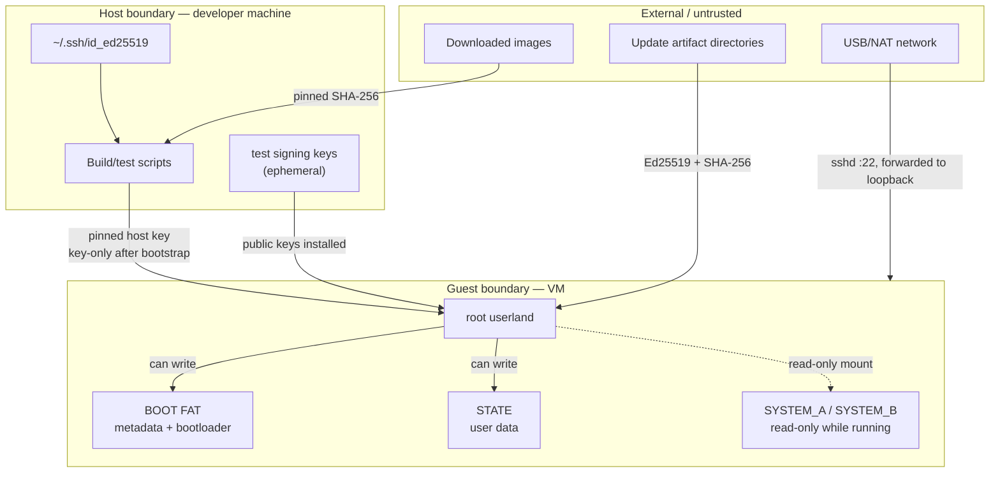
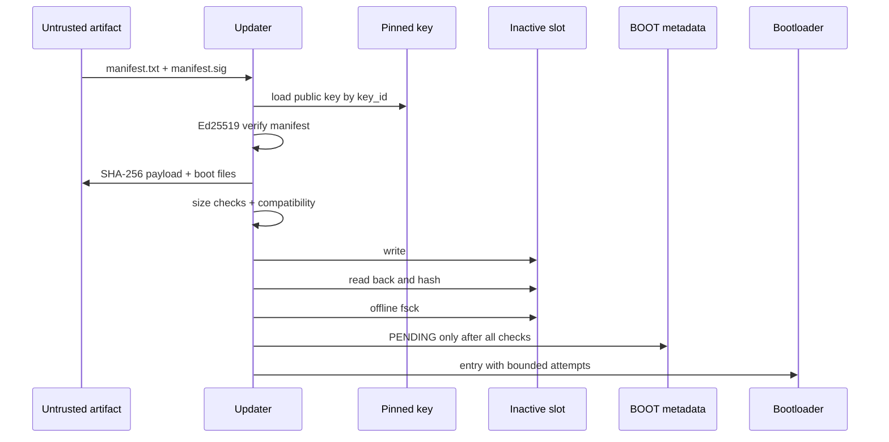

# 11 — Security model

[Back to docs index](README.md)

This document describes what the repository trusts, what it verifies, what it
explicitly does **not** protect against, and the remediation record from the
two audits.

---

## 1. Trust boundaries



### Trusted

- The local host and its SSH private key.
- BOOT as boot-critical storage.
- Image-owned configuration under `/etc/duranium/`.
- Pinned APK public keys and pinned SSH host keys committed to the repo.
- The signed manifest, after verification with a pinned Ed25519 public key.

### Untrusted or semi-trusted

- Update artifacts before verification.
- STATE contents (validated, but not a security boundary).
- Downloaded VM images (verified by SHA-256, but checksums and images often
  come from the same channel).
- Network peers (SSH is loopback-forwarded only).
- Anything running as root on the booted system (can alter BOOT metadata).

---

## 2. Cryptographic mechanisms

### Update artifacts

| Property | Mechanism |
| --- | --- |
| Manifest authenticity | Ed25519 over the exact bytes of `manifest.txt` |
| Payload integrity | SHA-256 over the uncompressed `system.img` |
| Boot artifact integrity | SHA-256 over kernel and initramfs |
| Trust anchor | `/etc/duranium/keys/<key_id>.pub` |
| Encoding | Base64 raw signature in `manifest.sig` |
| Implementation | OpenSSL `pkeyutl -sign/-verify -rawin` |

No custom cryptography is implemented. `manifest.sig` is decoded to a temp
file, verified, and removed.

### Boot-time verification

- Slot metadata checksums (SHA-256) catch corruption and accidental edits.
- Kernel and initramfs hashes are verified by the initramfs before
  `switch_root`.
- Root image hashing is optional at boot
  (`DURANIUM_VERIFY_ROOT_ON_BOOT=0` by default) and always performed by
  `mark-good`.

### Image downloads

`download-kukui.sh` pins the expected Krane image digest:

```
3165c349cfb1f7eea0aabf98203826d282dd727c43511dab50ced76452304bdf
```

It uses `curl --proto '=https' --tlsv1.2 -f`, and deletes the file on
mismatch. Residual risk: the checksum is fetched from the same server for
informational comparison; the pinned value is the actual anchor.

### Build/test SSH

- TOFU pin: the first keyscan is displayed as fingerprints and written
  atomically to `alloy/known_hosts`.
- All later automation uses `StrictHostKeyChecking=yes` with that file.
- The guest password is passed only via `PMOS_PASS` in the environment to the
  expect helper; it is never in argv or a pipe.
- After stage 00, access is key-only.

---

## 3. The update security model



Security properties:

1. An attacker who can modify an artifact but not sign it cannot get it
   activated.
2. An attacker cannot make the updater overwrite the active slot.
3. A failed or interrupted write cannot silently become bootable; it ends
   `BAD` or `UNKNOWN`.
4. A slot only becomes `GOOD` after explicit confirmation, hash verification,
   and health checks.
5. Rollback is always available as long as one `GOOD` slot exists.
6. Recovery does not require trusting either system slot.

### What this does **not** protect against

- An attacker with root on the running system: can modify BOOT metadata and
  boot selection. Metadata checksums are integrity checks, not signatures.
- A compromised bootloader: `systemd-boot` is a single, unsigned copy on BOOT.
- A compromised kernel: no Secure Boot or signed boot metadata in V1.
- A malicious update that is correctly signed by a trusted-but-compromised
  key.
- Physical access to the disk.
- STATE confidentiality: STATE is not encrypted.
- Rollback attacks on artifacts: a validly signed older artifact can be
  installed (schema downgrade rules limit this, but it is not anti-rollback
  hardware).

---

## 4. Policy: APK is a build input, not an updater

The production model is:

```
packages → image build → immutable image → signed artifact
        → inactive slot → verify → PENDING → mark-good
```

Not:

```
apk upgrade on the live root
```

Enforcement in V1:

- No `apk add/upgrade/del` calls in the runtime updater, recovery, or
  initramfs.
- No network download path in the updater.
- `tests/unit/09-policy.sh` fails if APK mutation or `curl`/`wget` appears in
  runtime code.

This preserves the core invariant — the running system is never modified in
place — and keeps rollback meaningful.

---

## 5. Host and build isolation

### Reproducible Core build

- No Docker.
- The build runs QEMU on the host and talks to the guest over loopback SSH.
- The guest is disposable; only flattened artifacts leave the build.
- Pinned host key and key-only root access after bootstrap.

### Legacy pmbootstrap build

- Docker on Ubuntu 24.04, pinned pmbootstrap v3.11.1.
- Uses `--cap-add SYS_ADMIN` and loop devices, not `--privileged`.
- Scoped sudoers for `apk`, `chroot`, `losetup`, `mount`, `umount`,
  `mkfs.*`, `mknod`, `mkinitfs`.
- Explicitly documented as the **untrusted-legacy** path. The reproducible
  Core build avoids it.

Residual risk: `SYS_ADMIN` plus mount/umount remains a meaningful privilege
set if a build step is compromised. It is accepted for pmbootstrap parity and
documented.

### Duranium fixture build

- Docker runs Alpine aarch64 to construct ext4/FAT/GPT images.
- The fixture is a test artifact, not a production image.
- Test signing keys are ephemeral and generated during the build.

---

## 6. Network exposure

| Service | Exposure | Notes |
| --- | --- | --- |
| Guest sshd | `127.0.0.1:2222` on host | Loopback only; never `0.0.0.0` |
| QEMU serial | `127.0.0.1:4445` | Loopback only |
| Guest listeners | `:22`, `:53` only | Verified by both gates; LLMNR `:5355` removed |
| Duranium fixture | No network forward | Driven over serial |

The guest's only listeners are SSH and the systemd-resolved stub. Network
Manager connectivity probes and LLMNR are disabled.

---

## 7. Secrets and credentials in the repository

| Item | Classification | Notes |
| --- | --- | --- |
| `user` / `147147` | Non-secret lab credential | Documented default of the pmbootstrap image; loopback-only VM; rotate for any shared use |
| `alloy/keys/*.pub` | Public keys | 19 APK trust anchors; provenance and fingerprints in its README |
| `alloy/known_hosts` | Public host keys | TOFU-pinned; fingerprints recorded |
| `pkgs/duranium/qemu/out/keys/*` | Ephemeral test keys | Gitignored; not production |
| `~/.ssh/id_ed25519` | Developer private key | Never copied into the repo |

There are **no production signing private keys** in the repository.

---

## 8. Audit history

### Audit 1 — 2026-09-09

Summary: 0 critical, 3 high, 4 medium, 3 low, 3 informational.

| ID | Finding | Remediation |
| --- | --- | --- |
| HIGH-1 | SSH forwarded on all interfaces | Loopback-only `hostfwd`; positional QEMU args |
| HIGH-2 | Host-key verification disabled; password piping | Pinned `known_hosts`; `StrictHostKeyChecking=yes`; password only via env to expect; sudo prompt in-session |
| HIGH-3 | `docker --privileged` | Narrowed to `SYS_ADMIN` + loop devices |
| MED-1 | Download not auto-verified | Automatic `shasum -c`, delete on mismatch |
| MED-2 | Swapfile created with bare `fallocate` | `dd` zeros before `mkswap`; artifact re-zeroed |
| MED-3 | Unquoted QEMU arg variables | Positional `set --` |
| MED-4 | Password piped to sudo | Removed |
| LOW-1 | Sudoers `NOPASSWD:ALL` | Scoped command set |
| LOW-2 | 4-char mktemp suffix | 8 characters |
| LOW-3 | Deprecated runner executable | Deprecation banner + hardening |
| INFO-1 | APK keys committed | Provenance/fingerprints documented |
| INFO-2 | Pubkey read without existence check | Explicit guard |
| INFO-3 | Python heredoc interpolation | Sanitized numeric inputs / argv |

### Audit 2 — 2026-09-09 15:54 UTC

Summary: 0 critical, 1 high, 5 medium, 6 low, 3 informational.

| ID | Finding | Remediation |
| --- | --- | --- |
| HIGH-1 | Hardcoded default password | `PMOS_PASS` required with no fallback; README treats `147147` as a lab default, with rotation guidance |
| MED-1 | Insecure SSH fallback on failure path | Cleanup uses pidfile kill only |
| MED-2 | Blind `ssh-keyscan` append | Fingerprint display + atomic replacement |
| MED-3 | Profile path traversal | Allowlist `dev|prod|lab` |
| MED-4 | Metrics prefix traversal | Regex validation |
| MED-5 | Same-channel checksum | Pinned digest + HTTPS protocol restrictions |
| LOW-1 | SSH forwarding into prod | Core/prod ship `no`; dev/lab enable |
| LOW-2 | QEMU netdev injection via port | Numeric + range validation |
| LOW-3 | Pubkey shell interpolation | Base64 transfer + remote decode |
| LOW-4 | Boot-time Python interpolation | Sanitized numeric input |
| LOW-5 | `xargs rm` splitting | `while IFS= read -r` |
| LOW-6 | Container residual privileges | Documented as untrusted-legacy path |
| INFO-1 | Vendored keys | Add-only rotation documented |
| INFO-2 | Implicit TOFU ceremony | Fingerprints + re-pinning ceremony |
| INFO-3 | Unpinned supply chain | pmbootstrap pinned to v3.11.1 |

Post-fix validation recorded: Core and prod gates pass with forwarding off;
dev passes with forwarding on.

The full reports and remediation tables live at:

- `devices/kukui-krane/SECURITY_AUDIT_2026-09-09.md`
- `devices/kukui-krane/SECURITY_AUDIT_2026-09-09_1554.md`

---

## 9. Security-relevant design choices

| Choice | Rationale | Cost |
| --- | --- | --- |
| Root SSH is key-only | Eliminates password brute force | Console password still exists |
| BOOT metadata is checksummed, not signed | Simpler V1; root already trusted | Root can alter selection |
| Single bootloader copy | Simplicity | Bootloader is a single point of failure |
| STATE not encrypted | Scope | No confidentiality at rest |
| No live APK updates | Preserves immutability and rollback | Full image per update |
| Metadata parser is closed-schema | Deterministic parsing on FAT | Format changes need code changes |
| Recovery is CLI-only | Small trusted base | Requires serial/console |
| Test keys are ephemeral | No key material in git | Not a production signing story |

---

## 10. Recommended next security work

1. **A/B or redundant bootloader** on BOOT, or a minimal fallback loader.
2. **Signed boot metadata** and, eventually, verified boot.
3. **Production key management**: offline signing, key IDs, rotation,
   revocation, and anti-rollback policy.
4. **Encrypted STATE** with a clear recovery/key-loss story.
5. **Watchdog and crash-loop policy** integrated with Duranium rather than
   journal evidence alone.
6. **Scoped container builds** or a dedicated Linux build host for
   pmbootstrap, removing `SYS_ADMIN` from developer machines.
7. **CI** that runs the syntax check, unit suite, and at least a smoke boot
   on every change.
8. **Threat model for the desktop**: per-app identity, permissions, and IPC
   are prerequisites for the app model.

These are roadmap items; see [13-roadmap-and-glossary.md](13-roadmap-and-glossary.md).
