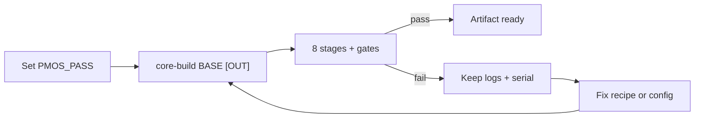

# 12 — Operations runbook

[Back to docs index](README.md)

Day-2 procedures: build, boot, inspect, update, recover, troubleshoot, and
clean up. Commands run from the repository root unless stated otherwise.

---

## 1. Prerequisites checklist

| Requirement | Check |
| --- | --- |
| Apple Silicon macOS for Core/QEMU paths | `uname -sm` → `Darwin arm64` |
| QEMU + `qemu-img` | `qemu-system-aarch64 --version` |
| EDK2 firmware | `ls /opt/homebrew/share/qemu/edk2-aarch64-code.fd` |
| Python 3 | `python3 --version` |
| Expect | `command -v expect` |
| OpenSSH tools | `ssh -V`, `ssh-keyscan`, `scp` |
| Ed25519 key | `ls ~/.ssh/id_ed25519.pub` |
| Docker (Duranium only) | `docker info` |
| Loopback ports 2222/4445 free | `lsof -nP -iTCP:2222 -sTCP:LISTEN` |
| A bootable pmOS qcow2 | outside git; path known |
| Baseline for Duranium | `devices/kukui-krane/baselines/1000/alloy-1001-floor.qcow2` |

---

## 2. Build and boot Core

### Build

```sh
export PMOS_PASS='the-base-image-user-password'
BASE=console ./scripts/setup.sh core-build /path/to/alloy-1000-base.qcow2
unset PMOS_PASS
```

- Default `BASE=phosh`; use `console` for the Nura base.
- The output defaults to
  `devices/kukui-krane/alloy/core/alloy-core.qcow2`.
- The builder refuses to overwrite an existing output.
- Logs: `devices/kukui-krane/alloy/build/logs/`.
- Gates run automatically and print PASS/FAIL.



### Boot

```sh
./scripts/setup.sh core-run
# or
./scripts/setup.sh core-run /path/to/image.qcow2
```

- Creates a throwaway qcow2 overlay; guest writes do not touch the source.
- Serial console appears in the terminal (`run-pmos-vm.sh serial`).
- Log in as `user` with the image password.
- Power off from the guest with `sudo poweroff`, or exit QEMU with
  **Ctrl+A, then X**.
- SSH forward defaults to `localhost:2222`; set `PMOS_SSH_PORT=off` for
  serial-only.

### Inspect inside Core

```sh
systemctl --failed
systemctl list-units --type=service --state=running
free -m
cat /proc/swaps
sshd -T | grep -i allowtcpforwarding
sysctl vm.stat_interval vm.compaction_proactiveness
cat /proc/cmdline
```

### Boot the shipped 1001 floor visually

```sh
cd devices/kukui-krane
qemu-img create -f qcow2 -F qcow2 \
  -b baselines/1000/alloy-1001-floor.qcow2 /tmp/krane-sandbox.qcow2
./scripts/run-alloy-gui.sh /tmp/krane-sandbox.qcow2
```

Login: `user` / `147147` (lab default). The frozen file itself cannot be
opened read-write because of the macOS immutable flag; always derive an
overlay.

---

## 3. Run the gates on any image

```sh
cd devices/kukui-krane
./alloy/regression-test.sh /path/to/image.qcow2 core
./alloy/quiescence-test.sh /path/to/image.qcow2 core
```

- `core` for the 0007 lineage; `core-nura` for the 1001 lineage.
- Both boot their own throwaway overlay, so frozen inputs are legal.
- Quiescence takes several minutes (120 s settle + 60 s window).
- A gate failure leaves logs in its temp directory until cleanup; capture the
  output before it exits if you need to debug.

---

## 4. Duranium: test and shell

### Full test run

```sh
./scripts/setup.sh duranium-test
```

or:

```sh
cd pkgs/duranium
./tests/run-unit.sh
./tests/qemu/run-suite.sh --rebuild
```

### Interactive fixture shell

```sh
./scripts/setup.sh duranium-shell
```

At the guest prompt:

```sh
duranium status
duranium slot show A
duranium health report
duranium state schema
duranium bootloader list
poweroff -f
```

### Single boot

```sh
cd pkgs/duranium
./qemu/run-vm.sh \
  --disk qemu/out/duranium-fixture.img \
  --testdata qemu/out/testdata.img \
  --log /tmp/duranium-boot.log \
  --timeout 75
```

### Run selected scenarios

```sh
DURANIUM_QEMU_SCENARIOS="recovery-mixed corrupt-boot" \
  ./tests/qemu/run-suite.sh
```

Logs land in `qemu/out/runs/<timestamp>/<scenario>/boot-N.log`.

---

## 5. Duranium command reference

### Normal system

| Command | Purpose |
| --- | --- |
| `duranium status` | Booted slot, active/pending/fallback, global generation |
| `duranium slot list` | Summary for A and B |
| `duranium slot show A\|B` | Metadata summary for one slot |
| `duranium health check\|report` | Run or display health gates |
| `duranium update verify DIR` | Verify artifact and compatibility |
| `duranium update install DIR [--reboot]` | Install into inactive slot |
| `duranium update show DIR` | Print manifest fields |
| `duranium mark-good [A\|B]` | Explicitly confirm the booted pending slot |
| `duranium mark-bad [A\|B]` | Mark a slot unusable |
| `duranium slot select A\|B` | Select a GOOD slot |
| `duranium state schema` | Print current STATE schema |
| `duranium state migrate A\|B` | Run migrations for a slot |
| `duranium boot-record A\|B` | Record the boot (initramfs/early init) |
| `duranium boot-confirm` | Confirm the OS finished booting |
| `duranium session-confirm` | Confirm the user session (sign-in gate) |
| `duranium session-crash [reason]` | Report an environment crash |
| `duranium boot-clean` | Record a clean shutdown |
| `duranium boot-reconcile` | Reconcile counters and metadata |
| `duranium boot-verify A\|B` | Verify kernel/initramfs (and root if enabled) |
| `duranium boot-fail A\|B [reason]` | Record a boot failure |
| `duranium bootloader list` | List entries and sort keys |
| `duranium bootloader sync` | Rewrite entries from metadata |

### Manifest tooling

| Command | Purpose |
| --- | --- |
| `duranium manifest keygen DIR KEY_ID` | Generate an Ed25519 test key |
| `duranium manifest install-key PUB KEY_ID` | Install a trusted public key |
| `duranium manifest sign DIR PRIVATE_KEY` | Sign `manifest.txt` |
| `duranium manifest verify DIR` | Verify signature, payload, compatibility |
| `duranium manifest show DIR` | Print manifest |

### Recovery

| Command | Purpose |
| --- | --- |
| `duranium recovery status` | Metadata, entries, STATE |
| `duranium recovery inspect` | Device/boot hashes and entry state |
| `duranium recovery select A\|B [--force]` | Select or re-arm |
| `duranium recovery mark-good A\|B` | Force a GOOD transition |
| `duranium recovery mark-bad A\|B` | Mark unusable |
| `duranium recovery reinstall --slot A\|B --artifact DIR` | Verified reinstall |
| `duranium recovery repair-boot` | Restore metadata and entries |
| `duranium recovery mount-state` / `umount-state` | STATE access |
| `duranium recovery factory-reset --mode os\|state\|full --yes` | Explicit reset |

---

## 6. Creating and signing an update artifact

The artifact directory shape:

```
artifact/
  manifest.txt
  manifest.sig
  system.img
  boot/vmlinuz
  boot/initramfs
```

Steps:

1. Build or obtain an ext4 system image that fits the target slot.
2. Compute size and SHA-256:

   ```sh
   stat -f%z system.img        # macOS
   shasum -a 256 system.img
   shasum -a 256 boot/vmlinuz boot/initramfs
   ```

3. Write `manifest.txt` with the exact fields in the documented order.
4. Sign:

   ```sh
   duranium manifest sign ./artifact ./keys/test-key.priv.pem
   ```

5. Verify and install:

   ```sh
   duranium manifest verify ./artifact
   duranium update install ./artifact
   duranium mark-good
   ```

The filename and byte order matter. A manifest that is not canonical is
rejected before signature verification.

---

## 7. Safe operating rules

### Core

- Always work in an overlay of the artifact you intend to change.
- Never boot a frozen (`uchg`) artifact directly; derive an overlay.
- Run both gates after any change.
- Use drop-in config files (`NN-alloy.conf`), not vendor file edits.
- Snapshot before upgrades: `qemu-img snapshot -c NAME disk.qcow2`.
- Trim both filesystems before converting:
  `fstrim -v / && fstrim -v /boot`.

### Things not to do

| Don't | Why |
| --- | --- |
| `apk upgrade` on a production root | Violates the immutable update model |
| `swapoff -a` | Kills pmOS zram; it re-arms as the next free zram device |
| `udevadm trigger --action=change` on input | Empties the udev DB; no self-heal |
| `rm -rf` a mountpoint | Deletes the directory; next tmpfs mount fails silently |
| Convert an overlay to its own backing file | Deadlocks; convert to temp then `mv` |
| Blind `ssh-keyscan >> known_hosts` | Accumulates stale/attacker keys; follow the re-pin ceremony |
| Edit a vendor config | Breaks verification/revert discipline |

---

## 8. SSH and host keys

Normal access:

```sh
ssh -p 2222 user@localhost
```

Root access in lab images is key-only after provisioning.

### Re-pinning ceremony (new image lineage)

1. Boot the image.
2. `ssh-keyscan -p 2222 -T 10 127.0.0.1 > /tmp/ks.raw`
3. Review: `ssh-keygen -l -f /tmp/ks.raw`
4. Atomically replace the `[127.0.0.1]:2222` entries in
   `devices/kukui-krane/alloy/known_hosts`; do not blind-append.
5. Commit with a note.

A host-key mismatch after re-imaging is expected and must be handled
deliberately; a mismatch without re-imaging is worth stopping for.

---

## 9. Recovery walkthrough

When a normal boot fails and recovery starts:

```sh
duranium recovery status
duranium recovery inspect
duranium recovery repair-boot
```

Choose one:

```sh
# Reinstall a slot from a signed artifact:
duranium recovery reinstall --slot A --artifact /path/to/artifact

# Give a pending slot another chance:
duranium recovery select B --force

# Keep user data, wipe OS slots:
duranium recovery factory-reset --mode os --yes

# Wipe STATE only:
duranium recovery factory-reset --mode state --yes
```

After a reinstall, boot the slot, let migrations run, then:

```sh
duranium boot-confirm
duranium mark-good
```

Recovery requires BOOT to be readable. If BOOT itself is destroyed, V1 cannot
recover automatically.

---

## 10. STATE operations

```sh
duranium state schema
duranium state migrate A
mount /dev/disk/by-partlabel/duranium-state /state   # host/manual inspection
```

STATE layout:

```
/state/home
/state/etc/alloy
/state/var/lib/alloy
/state/var/cache
/state/var/log
/state/duranium/{schema,bootlog,backups,boot,*.log}
```

Do not put a swapfile or boot artifacts in a system slot's persistent area;
STATE is the intended place for a swapfile.

---

## 11. Troubleshooting

### Core / lab

| Symptom | Cause | Fix |
| --- | --- | --- |
| UEFI shell | Stale/corrupt NVRAM | Delete vars file; it is recreated |
| postmarketOS debug shell | initramfs mount failure | `cat /pmOS_init.log`; check labels and fstab |
| SSH refused | VM not up, QEMU dead, port busy | `pgrep -fl qemu-system-aarch64`, `nc -z localhost 2222` |
| SSH password rejected | Wrong user/password | `user` + image password; re-image resets it |
| GUI black | Phosh session still starting / NVRAM | Try `headless`; check serial; reset vars |
| Clock/TLS errors | timesyncd not converged | Wait; `systemctl restart systemd-timesyncd` |
| Disk full | 3.5 GiB root + 2 GiB swapfile | Clean caches; enlarge overlay/partition |
| `qemu-img convert` write-lock | Target is source's backing | Convert to temp, then `mv` |
| Input tags missing | udev race / change-trigger | Check `udevadm info --export-db`; reboot |
| Drive image stalls | Cloud-only file | Mark available offline or copy local |

### Duranium

| Symptom | Meaning | Action |
| --- | --- | --- |
| `update: a pending update already exists` | Only one pending transaction allowed | Boot/mark the pending slot, or reconcile |
| `update: running slot X is not the active GOOD slot Y` | Wrong boot state | Boot the active slot |
| `profile mismatch` | Artifact identity differs | Use matching artifact or dev override correctly |
| `hardware target mismatch` | Artifact for another board | Use the right artifact |
| `state downgrade rejected` | Artifact requires older schema on a normal update | Use recovery reinstall if intentional |
| `manifest signature verification failed` | Tampered or wrong key | Re-sign with a trusted key |
| `root image hash mismatch` | Slot changed after install | Treat as compromised/corrupt; reinstall |
| `health: systemd is still starting` | Too early / boot incomplete | Wait for `running`; check failed units |
| `mark-good: boot ID does not match` | Stale pending record | Reboot the pending slot and confirm again |
| `mark-good: OS has not confirmed this boot` | `boot-confirm` did not run | Check units and `/run/duranium/boot.env` |
| Pending slot became `BAD` | Attempts exhausted, crash, state migration, or verification failure | Inspect logs; reinstall or re-arm from recovery |
| Recovery not selectable | No normal slot and missing BOOT entry | `repair-boot`; verify BOOT and RECOVERY |
| Fixture reports `NO_SCENARIO` | `testdata.img` not attached/readable | Check `--testdata` and mount |

---

## 12. Logs and evidence

| Log | Location |
| --- | --- |
| Core stage logs | `devices/kukui-krane/alloy/build/logs/*.log` |
| QEMU serial | Path passed to `run-qemu-headless.sh`; `/tmp/pmos-serial.log` for `run-pmos-vm.sh headless` |
| Duranium per-boot | `pkgs/duranium/qemu/out/runs/<timestamp>/<scenario>/boot-N.log` |
| Duranium unit output | stdout of `tests/run-unit.sh` |
| Guest bootlog | `/state/duranium/bootlog` |
| Slot transitions | `/state/duranium/duranium.log` |
| Update history | `/state/duranium/updates.log` |
| Migration history | `/state/duranium/migrations.log` |
| initramfs failure detail | `/pmOS_init.log` (pmOS debug shell) |

---

## 13. Cleanup

```sh
# Duranium build outputs and test scratch:
cd pkgs/duranium && make clean

# Core build scratch (logs are useful; overlays are not):
rm -f devices/kukui-krane/alloy/build/s*.qcow2
rm -f devices/kukui-krane/alloy/build/stage*.qcow2

# Old fixture runs (large):
du -sh pkgs/duranium/qemu/out/runs/*
rm -rf pkgs/duranium/qemu/out/runs/<old-timestamp>
```

`pkgs/duranium/qemu/out/` can grow to tens of gigabytes; it holds per-scenario
disk copies and NVRAM files.

---

## 14. Rebuilding the floor from scratch

High level:

```sh
# 1. Build or obtain a pristine qemu-aarch64 postmarketOS image.
# 2. Run the reproducible Core build:
BASE=console PMOS_PASS='…' ./scripts/setup.sh core-build /path/base.qcow2
# 3. Gate the result (the build does this automatically).
# 4. Optionally derive a profile (requires the frozen 0007 artifact):
cd devices/kukui-krane && ./alloy/build-profile.sh dev
```

For the original pmbootstrap construction path (including Docker loop-device
workarounds and the fstab injection), see
`devices/kukui-krane/README.md` §12–13.

---

## 15. Getting help

- Reproduce with logs. Most failures are visible in a serial log or a named
  gate assertion.
- Include the artifact hash, kernel version, profile, and whether the run was
  headless or interactive.
- Do not raise a gate threshold to make a failure disappear; decide whether the
  new behavior is acceptable and record it.
