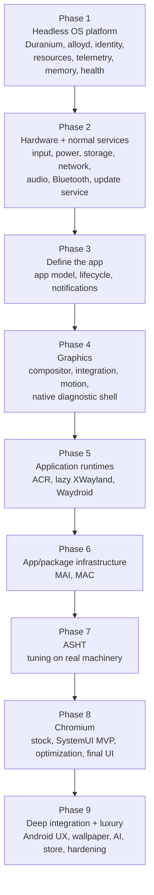
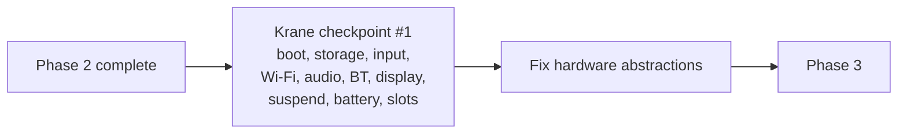
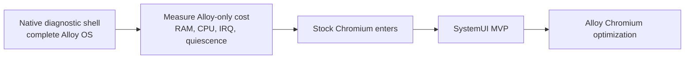
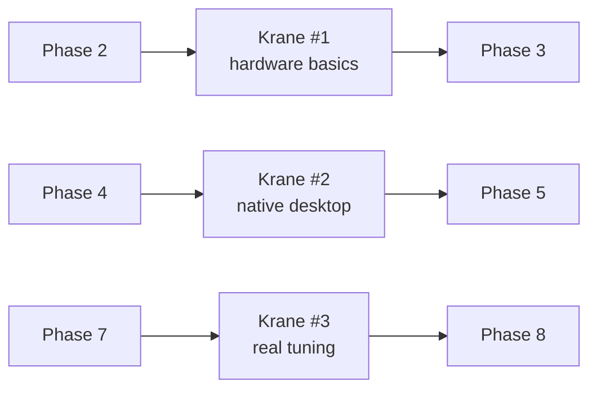

# 13 — Roadmap, status, and glossary

[Back to docs index](README.md)

> **Planning note.** This chapter records the revised roadmap supplied by the
> project owner on 2026-11-18. It is a planning document, not an
> implementation claim and not a set of instructions to execute. It
> supersedes the ordering in `README.md` for sequencing decisions; the README
> remains the public summary until it is updated to match.

---

## 1. Why the order changed

The previous list had three structural dependency errors:

| Old ordering problem | Why it was wrong | New placement |
| --- | --- | --- |
| **ACR / XWayland before a compositor** | Native Wayland apps and XWayland need a Wayland compositor to attach to. Building the runtime first creates a target that does not exist. | Phase 5, after the compositor and diagnostic shell |
| **ASHT before hardware-facing subsystems** | A tuning system with no real input, power, storage, audio, Bluetooth, or memory-pressure machinery has nothing meaningful to tune. | Phase 7, after Phase 1 telemetry and Phase 2 hardware services |
| **Alloy Chromium before a real SystemUI workload** | Optimizing Chromium against a guessed workload is not measurable. The workload must exist first. | Phase 8, after stock Chromium and a SystemUI MVP |

Two more ordering principles follow from the same reasoning:

- **Identity comes early**, because every later `alloyd` API has to know who
  is asking.
- **The app model comes before the compositor**, because windows need app
  identities; the compositor should not invent them retroactively.

---

## 2. Where the project is now

| Area | Repository state | Roadmap state |
| --- | --- | --- |
| Core floor | Working recipe, gates, shipped 1001 artifact | Substrate complete |
| Duranium V1 mechanism | POSIX-shell implementation; 9/9 unit scripts, 6/6 QEMU scenarios | **Current step**; real-Core adapter and hardware validation still open |
| `alloyd` | Does not exist | Next major build |
| Identity / sessions / permissions | Does not exist | Phase 1 |
| Resource / lifecycle / telemetry / memory / health | Does not exist | Phase 1 |
| Hardware services | Only the Core plumbing exists | Phase 2 |
| App model, compositor, desktop | Does not exist | Phases 3–4 |
| App runtimes, packaging, ASHT, Chromium | Does not exist | Phases 5–9 |

Duranium is the current step in the program even though a working V1
implementation and green fixture suite already exist: the mechanism is
proven, but the real Alloy Core integration and physical-device validation
are not.

---

## 3. Phase overview



The phases are ordered by dependency, not by user-visible excitement. Each
phase should end with a usable, measurable system rather than a half-built
layer that only becomes testable much later.

---

## 4. The dependency spine

```text
CORE
 ↓
DURANIUM
 ↓
ALLOYD
 ↓
RESOURCE / IDENTITY / HEALTH
 ↓
HARDWARE SERVICES
 ↓
APP MODEL
 ↓
COMPOSITOR
 ↓
DIAGNOSTIC DESKTOP
 ↓
APP RUNTIMES
 ↓
MAI / MAC
 ↓
ASHT
 ↓
STOCK CHROMIUM
 ↓
SYSTEMUI MVP
 ↓
ALLOY CHROMIUM
 ↓
FINAL SYSTEMUI
 ↓
ANDROID POLISH / WALLPAPER / AI
```

The single most important architectural line in the roadmap is:

> **Before Chromium enters the system, Alloy should already be a fully usable
> graphical OS driven by the temporary native diagnostic shell.**

That gives a clean measurement boundary between **what Alloy costs** and
**what Chromium costs**, and it leaves a working native shell underneath if
Chromium misbehaves during UI development.

---

## 5. Phase 1 — Make Alloy a real headless operating-system platform

Exit condition: a very capable Alloy machine that still has **no desktop**.
Alloy should understand:

```text
who is running
what is running
how important it is
how many resources it uses
whether the system is healthy
```

That is the operating-system brain.

### 1. Duranium V1 — current step

Already scoped by the implementation:

- immutable A/B Core;
- STATE;
- recovery;
- signed images;
- rollback;
- migrations;
- `mark-good`.

Remaining work for this step on the roadmap:

- integrate with the real Alloy Core systemd userland (the documented adapter,
  not just the fixture);
- validate on physical hardware;
- turn the offline mechanism into the update **service** in Phase 2, step 14.

### 2. `alloyd` foundation

- Rust daemon.
- Versioned IPC.
- Event subscriptions.
- Service registry.
- Privilege separation.
- No UI assumptions.

`alloyd` is deliberately headless and must not embed desktop policy. It is
the control plane that later layers talk to.

### 3. Identity / sessions / permissions / secrets foundation

- Users and sessions.
- Privileged caller identification.
- App identity hooks.
- Credential store.
- Permission model.
- Portals and capability groundwork.

This must happen early because every later `alloyd` API needs to know **who is
asking**. Retrofitting caller identity after the APIs exist would be a
security and compatibility rewrite.

### 4. Resource + lifecycle manager

- States: foreground, visible, background, frozen, discardable, stopped.
- cgroups.
- CPU and I/O priority.
- Ownership and accounting.

This is the mechanism the compositor will later drive through visibility and
focus, and the mechanism memory policy will use to reclaim safely.

### 5. Telemetry + observability foundation

- RAM / PSS.
- CPU time.
- IRQ attribution.
- Disk writes.
- Optional PSI instrumentation.
- Per-service and per-app resource accounting.
- Time-to-quiescence.
- Structured performance logs.

This is **not ASHT**. It is the data source ASHT will consume much later.
Building ASHT first would mean tuning without trustworthy measurements.

### 6. Memory-pressure manager

- ZRAM.
- Swap overflow.
- Reclaim policy.
- Cache shedding.
- Freezing.
- Discard hierarchy.
- OOM handling.
- Foreground protection.

The Core floor already measured the zram → disk-swap behavior and the
incompressible-OOM boundary. This phase turns that knowledge into policy
driven by app identity and lifecycle state.

### 7. System health / fault containment

- Crash loops.
- Restart budgets.
- Degraded service states.
- Watchdog relationships.
- Dependency failures.
- Health reporting.
- Recovery hooks.

Duranium already defines boot health and rollback; this phase extends the
concept to services and apps running on a healthy boot.

---

## 6. Phase 2 — Hardware and normal Linux services

Now give `alloyd` actual things to control.

### 8. Device / input foundation

- udev discovery.
- Device hotplug.
- libinput.
- Keyboard, mouse, touchscreen, touchpad.
- Device identity.

This is a standalone item because the compositor cannot be correct without it.
The Core floor keeps input plumbing but has no device-management service.

### 9. Power + display abstraction

- Display state.
- Brightness.
- Suspend and wake.
- Inhibitors.
- Lid state.
- Battery and power-source APIs.
- Thermal / DVFS hooks for later.

### 10. Storage manager

- Mounts.
- Removable devices.
- STATE.
- User and app data.
- Cache classes.
- Disk-pressure handling.
- Encryption hooks.

### 11. Networking

- NetworkManager.
- Wi-Fi and Ethernet.
- DNS.
- Airplane mode.
- Reachability.
- Captive portal.
- Event-driven state.

### 12. Audio

- PipeWire and WirePlumber.
- Volume and mute.
- Devices.
- Per-app streams.
- Microphone permissions.
- Idle suspension.

### 13. Bluetooth

- BlueZ.
- Pairing and trust.
- Audio.
- Lazy activation.
- Idle shutdown.

### 14. Duranium update service

Duranium V1 gave the **mechanism**. This step gives Alloy the service:

```text
check
→ verify
→ stage
→ request reboot
→ report status
→ mark healthy
→ rollback / report failure
```

Still no GUI required.

### Krane checkpoint #1

Test actual hardware now, not after a desktop exists. Prove the architecture
is not becoming QEMU-only:

```text
boot
storage
input
Wi-Fi
audio
Bluetooth
display
suspend
battery visibility
Duranium slots
```

Fix hardware-abstraction problems here, before a compositor and app model are
built on top of them.



---

## 7. Phase 3 — Define what an "app" actually is

Do this **before** the window manager, because windows need identities.

### 15. Unified Alloy App Model

Define:

```text
AppID
backend
metadata
icon
launch intent
permissions
resource class
lifecycle state
windows
notifications
storage
```

Backends:

```text
Web / PWA
Native Wayland
Flatpak
X11
Android
eventually Wine / Proton
```

### 16. Application / lifecycle service

- Discovery.
- Launch.
- Terminate.
- Freeze.
- Resume.
- Resource ownership.
- AppID ↔ process mapping.
- AppID ↔ window mapping.

### 17. Notification service

- AppID ownership.
- Priorities.
- Actions.
- Grouping.
- Persistence.
- Do Not Disturb.
- Permissions.

The compositor then consumes a model that already has identity, lifecycle, and
notification semantics instead of inventing them later.

---

## 8. Phase 4 — Graphics

Only now is the actual desktop infrastructure built.

### 18. Alloy compositor V1

- Wayland.
- DRM/KMS.
- Outputs.
- libinput.
- Surfaces.
- Focus.
- Window management.
- Damage tracking.
- DMA-BUF.
- Frame scheduling.
- Fullscreen.
- Basic snapping.
- Quiescent idle.

### 19. Window / app integration

- AppID association.
- Lifecycle integration.
- Resource accounting.
- Surface visibility state.
- Foreground/background transitions.

### 20. Global motion / state engine

- Shared animation clock.
- Physics.
- Gestures.
- Transforms.
- Opacity and clips.
- Overview primitives.
- **The animation clock stops when idle.**

### 21. Temporary native diagnostic shell

Deliberately ugly and simple. It must be able to:

```text
launch app
switch windows
Wi-Fi
Bluetooth
volume
brightness
notifications
power
resource monitor
update status
```

No Chromium.

### Major milestone — a complete Alloy OS without Chromium

At this point Alloy is a functioning graphical operating system with a native
shell. This creates the measurement boundary:

```text
Alloy itself costs X MB.
Anything Chromium adds later is Chromium's fault.
```



### Krane checkpoint #2

Put this version on the Duet. Test:

- actual touch gestures;
- frame pacing;
- Mali / Panfrost;
- display;
- rotation;
- suspend/resume;
- audio;
- thermals;
- input latency.

This checkpoint is more valuable than waiting for the whole OS to be finished,
because it validates the native desktop before Chromium complexity is added.

---

## 9. Phase 5 — Application runtimes

The previous list had this backwards: **native apps require Wayland, so the
compositor must come first.**

### 22. ACR — Alloy Compatibility Runtime

- Native Wayland apps.
- Portals.
- PipeWire.
- Fonts.
- Runtime GTK/Qt.
- Flatpak/container support.
- Optional glibc compatibility.

### 23. Lazy XWayland

- Zero XWayland at boot.
- An X11 app requests it.
- Spawn XWayland on demand.
- Attach windows to AppIDs.
- Kill it after inactivity.

### 24. Waydroid runtime integration V1

- Enumerate Android apps.
- Android AppID mapping.
- Lifecycle.
- Windows.
- Intents.
- Audio.
- Notifications.
- Resources.
- Freeze/stop the runtime.

No polished Android UI integration yet; the goal is that Android apps behave
like Alloy apps.

---

## 10. Phase 6 — App/package infrastructure

### 25. MAI

- Install applications.
- Dependency ownership.
- Garbage collection.
- Runtime vs install-only dependencies.
- Shared dependencies.
- `mai why`.
- `mai unused`.
- Cache cleanup.

### 26. MAC

- Build minimal packages.
- Feature splitting.
- Locales.
- Debug/dev separation.
- Architecture specialization.
- LTO/section GC where useful.
- Generated dependency and hardware closures.

MAC comes after ACR because by then the application runtime requirements are
known. Optimizing toward an imaginary runtime would be wasted work.

---

## 11. Phase 7 — ASHT

ASHT finally has enough real machinery to tune.

### 27. ASHT V1

- Benchmark runner.
- Device profile database.
- Confidence scoring.
- Safe rollback.
- Policy selection.
- Modular retraining.

Possible knobs:

```text
CPU scheduling
GPU policy
memory reclaim
ZRAM
swap
THP
compaction
writeback
background lifecycle
display effects
Waydroid timeout
```

ASHT consumes the telemetry system built in Phase 1. Monitoring is not bolted
on afterward.

### Krane checkpoint #3

This is where real Krane hardware becomes essential. QEMU cannot meaningfully
train:

```text
MT8183 thermals
Mali GPU behavior
battery
cpuidle
DVFS
real memory bandwidth
eMMC behavior
```

So:

- **ASHT framework** = QEMU-testable.
- **ASHT tuning** = real hardware.

---

## 12. Phase 8 — Chromium comes in

Do **not** immediately fork or modify Chromium.

### 28. Stock Chromium integration

- Ozone/Wayland.
- Normal browser windows.
- PWA support.
- AppID integration.
- Lifecycle-manager integration.

Measure:

```text
PSS
renderer processes
GPU memory
DMA-BUF
IRQ/s
CPU
timers
idle writes
frame times
time-to-quiescence
```

### 29. Build SystemUI MVP on stock Chromium

This is the dependency the old order missed. Build enough real HTML/CSS/JS
desktop to establish the actual Chromium workload:

```text
Shelf
Launcher
Quick Settings
basic Settings
Overview
Notifications
Lock
```

It does not need to look perfect. It needs to be the real workload.

### 30. Alloy Chromium optimization

Now optimize against measured behavior:

```text
background timers
renderer retention
process strategy
cache behavior
SystemUI process isolation
tab freezing
resource-manager hooks
copies
Ozone/Wayland
GPU paths
startup
quiescence
```

### 31. Final Alloy SystemUI

- Polished Shelf.
- Launcher.
- Overview.
- Quick Settings.
- Settings.
- Notifications.
- Files.
- Login.
- Lock.
- OOBE.
- Accessibility.
- Gestures.

At this point the product is essentially Alloy OS.

---

## 13. Phase 9 — Deep integration and luxury features

### 32. Polished Waydroid UX

- Seamless Android launching.
- Android notifications.
- Permission UI.
- Android settings integration.
- Lifecycle UX.
- No visible "Waydroid environment".

### 33. Animated wallpaper / media engine

- Hardware decoding.
- DMA-BUF.
- Caching.
- Freeze when obscured.
- Zero work when the screen is off.
- ASHT-controlled quality/FPS.

### 34. Local micro-AI

- Semantic launcher.
- Settings search.
- Clipboard transforms.
- Summaries.
- Diagnostics.
- Structured Alloy tools.
- Lazy-loaded model.

AI goes last because it should consume stable Alloy APIs rather than become
part of the architecture.

### 35. Store / software UX

- MAI frontend.
- Unified PWA/native/Android presentation.
- Permissions.
- Install/remove/update UX.

### 36. Final appliance hardening

- Production Duranium.
- Verified boot and signatures.
- Secure recovery.
- Production profiles.
- Secrets lifecycle.
- Update-key rotation.
- Factory reset.
- Accessibility.
- Localization.
- Developer mode.
- Diagnostics.
- Documentation.

---

## 14. Checkpoints

| Checkpoint | After | Purpose | What must work |
| --- | --- | --- | --- |
| **Krane #1** | Phase 2 | Prove hardware abstraction early | Boot, storage, input, Wi-Fi, audio, Bluetooth, display, suspend, battery visibility, Duranium slots |
| **Krane #2** | Phase 4 | Validate the native graphical OS before Chromium | Touch, frame pacing, Mali/Panfrost, display, rotation, suspend/resume, audio, thermals, input latency |
| **Krane #3** | Phase 7 | Make ASHT meaningful | Real thermals, GPU behavior, battery, cpuidle, DVFS, memory bandwidth, eMMC |



---

## 15. What changed from the old ordering

| Change | Old position | New position | Reason |
| --- | --- | --- | --- |
| Identity / permissions | Later | Phase 1, item 3 | Every `alloyd` API needs caller identity |
| Device/input | Implicit in hardware work | Standalone Phase 2, item 8 | The compositor depends on it |
| ACR / XWayland | Before compositor | Phase 5, after compositor and native shell | Native apps need a Wayland compositor |
| App model | Around app lifecycle later | Phase 3, before compositor | Windows need app identities |
| MAI / MAC | Mixed with compatibility | Phase 6, after ACR | Packaging needs a known runtime |
| ASHT | Before hardware reality | Phase 7, after telemetry + hardware + runtime | Tuning needs data and knobs |
| Chromium optimization | Early, before SystemUI | Phase 8, after stock integration + SystemUI MVP | Optimize a real workload |
| Local AI | Mixed into product work | Phase 9, last | Consume stable APIs |
| Waydroid polish | Early integration | Phase 9, after runtime V1 | UX after behavior |

The new roadmap is also stricter about **measurement boundaries**:

- Phase 1 produces the telemetry that ASHT later consumes.
- Phase 4 produces the "Alloy without Chromium" baseline.
- Phase 8 produces the "SystemUI with stock Chromium" baseline before any
  Chromium modification.

---

## 16. Status mapping

| Roadmap item | Repository status |
| --- | --- |
| 1. Duranium V1 | Mechanism implemented and fixture-tested; real-Core adapter + hardware validation open |
| 2. `alloyd` | Not started; Rust is the stated intent, not an implemented choice |
| 3. Identity / sessions / permissions | Not started |
| 4. Resource / lifecycle | Not started |
| 5. Telemetry | Not started; Core measurement harnesses exist for lab use |
| 6. Memory-pressure manager | Not started; Core swap behavior measured |
| 7. System health | Partial concepts in Duranium (`mark-good`, health hooks), no general service |
| 8–13. Hardware services | Only Core plumbing; no control-plane services |
| 14. Duranium update service | Mechanism only; no check/stage/reboot service |
| 15–17. App model / lifecycle / notifications | Not started |
| 18–21. Compositor / integration / motion / native shell | Not started |
| 22–24. ACR / XWayland / Waydroid | Not started |
| 25–26. MAI / MAC | Not started; `alloy-core` APKBUILD is an empty placeholder |
| 27. ASHT | Not started |
| 28–31. Chromium / SystemUI | Not started |
| 32–36. Android polish / wallpaper / AI / store / hardening | Not started |

---

## 17. Open decisions

| Decision | Current state | What would settle it |
| --- | --- | --- |
| `alloyd` IPC mechanism | Unspecified | Versioned protocol design + compatibility rules |
| Privilege-separation model | Unspecified | Threat model + portal/capability design |
| Compositor implementation | Unspecified | Prototype + frame-pacing/idle measurements |
| App model storage | Unspecified | Manifest format and AppID registry |
| XWayland spawn policy | Unspecified | Lazy activation and kill-after-idle behavior |
| Waydroid integration depth | Unspecified | App enumeration, windows, lifecycle, audio |
| MAI/MAC relationship to APK/Flatpak | Unspecified | Packaging architecture decision |
| ASHT data/rollback policy | Unspecified | Benchmark protocol + safe-revert design |
| Chromium fork strategy | Deferred until Phase 8 measurements | Measured bottlenecks from the stock SystemUI workload |
| Secure boot / key rotation | Deferred to Phase 9 | Production key lifecycle and verified-boot design |
| Real-Core Duranium integration | Adapter documented, not green | Systemd smoke test on a real Core image |
| Physical Krane bring-up | Not started | Hardware checkpoint #1 |

---

## 18. Near-term execution order

1. **Finish Duranium as a product step:** run the documented Core adapter on a
   real Core systemd image; add it to the test suite; validate on hardware when
   available.
2. **Write the `alloyd` interface specification:** IPC, events, service
   registry, privilege boundaries, versioning.
3. **Define identity and permission objects** before implementing APIs that
   take a caller.
4. **Implement resource/lifecycle tracking** with cgroups and accounting.
5. **Implement telemetry** and establish the structured performance-log
   format.
6. **Implement memory-pressure policy** using lifecycle and identity.
7. **Implement system health** and recovery hooks.
8. Only then start Phase 2 hardware services.

The Core floor and Duranium give this work a stable, measured base. The risk to
avoid is starting the desktop before the platform can answer "who is running,
what is running, and what does it cost?"

---

## 19. Glossary

| Term | Meaning |
| --- | --- |
| **Alloy Core** | Headless stripped postmarketOS base built by the lab |
| **ALLOY-GUI-0000** | Frozen Phosh ancestor image |
| **0007 lineage** | Core frozen at `baselines/0007/` (kernel 7.2.4) |
| **1001 lineage** | Newer floor at `baselines/1000/` (kernel 7.3.4) |
| **A/B slots** | Two system partitions; one active, one update target |
| **ACR** | Alloy Compatibility Runtime (native Linux app environment) |
| **alloyd** | Planned Alloy system daemon (IPC, services, resources) |
| **APK** | Alpine package manager; build input, not production updater |
| **ASHT** | Alloy System Hardware Tuning |
| **BOOT** | FAT32 ESP holding systemd-boot, kernels, metadata |
| **Boot counting** | systemd-boot's `+N` filename attempt counter |
| **Core** | See Alloy Core |
| **Duranium** | Immutable A/B update and recovery system |
| **EDK2** | UEFI firmware used by QEMU |
| **Fixture** | Deterministic QEMU disk for Duranium tests |
| **HVF** | Apple Hypervisor.framework acceleration |
| **Krane** | Lenovo IdeaPad Duet Chromebook (MT8183) |
| **Kukui** | Google baseboard family containing Krane |
| **MAC** | Alloy package builder |
| **MAI** | Alloy package installer/dependency manager |
| **mark-good** | Explicit transition of a pending slot to GOOD |
| **PENDING** | Installed, verified, not yet confirmed slot |
| **pmbootstrap** | postmarketOS image build tool |
| **RECOVERY** | Independent recovery userland partition |
| **Slot metadata** | Strict record describing a system slot |
| **STATE** | Persistent data partition with an explicit allowlist |
| **systemd-boot** | UEFI boot manager used in V1 |
| **TOFU** | Trust on first use (SSH host-key pinning) |
| **uchg** | macOS immutable file flag |
| **Wakeups / IRQ rate** | Interrupts per second at idle; a quietness metric |
| **ZRAM** | Compressed RAM block device used as primary swap |

---

## 20. Contributing without breaking invariants

1. **Read the invariant list** in [Architecture](02-architecture.md) §6.
2. **For Core changes:** work in an overlay, keep changes reversible, run both
   gates, and record the measurement.
3. **For Duranium changes:** run the syntax check, the unit suite, and the
   affected QEMU scenarios. Never weaken a rejection path to make a test pass.
4. **For docs:** link to evidence files, not just conclusions.
5. **For placeholders:** either implement and wire them, or remove them. Do not
   leave a path that implies a feature exists.
6. **For roadmap changes:** update this chapter and the visual atlas together,
   and state what dependency changed.

```sh
# Minimum pre-merge checks
cd pkgs/duranium && make syntax && ./tests/run-unit.sh
cd devices/kukui-krane && ./alloy/regression-test.sh  core
cd devices/kukui-krane && ./alloy/quiescence-test.sh  core
```

---

## 21. Where to go next

- Back to the [documentation index](README.md).
- The public project summary: [README](../README.md).
- Deep subsystem docs:
  [Core build program](../devices/kukui-krane/alloy/README.md),
  [Duranium architecture](../pkgs/duranium/docs/00-ARCHITECTURE.md),
  [Duranium test results](../pkgs/duranium/docs/11-TEST-RESULTS.md).
- History and trade-offs:
  [ALLOY packet](../devices/kukui-krane/docs/ALLOY-PACKET-0000-to-0007.md),
  [history and sacrifices](../devices/kukui-krane/docs/ALLOY-HISTORY-AND-SACRIFICES.md).
