# 14 — Visual atlas

[Back to docs index](README.md)

A single-page set of charts and maps for orientation. Detailed explanations
are in the linked chapters; this page is for seeing the shape of the system
quickly.

---

## 1. Project timeline

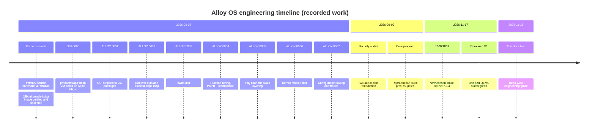

---

## 2. Component maturity

```mermaid
flowchart LR
    subgraph M4["Tested end to end"]
        Core["Core floor"]
        Gates["Regression + quiescence"]
        Dur["Duranium V1"]
        Rec["Recovery"]
        Lab["QEMU lab"]
    end
    subgraph M3["Implemented, partially integrated"]
        Profiles["dev/lab/prod"]
        Adapter["Duranium Core adapter"]
        Legacy["pmbootstrap path"]
    end
    subgraph M2["Placeholder files"]
        Brand["Plymouth / Fastfetch / KSM / Waydroid / Plasma"]
        Pkg["alloy-core APKBUILD"]
    end
    subgraph M1["Planned"]
        Alloyd["alloyd"]
        Comp["Compositor"]
        UI["SystemUI"]
        Eco["MAI / MAC / ACR / Android / ASHT"]
    end
    M4 --> M3 --> M2 --> M1
```

---

## 3. Repository dependency map

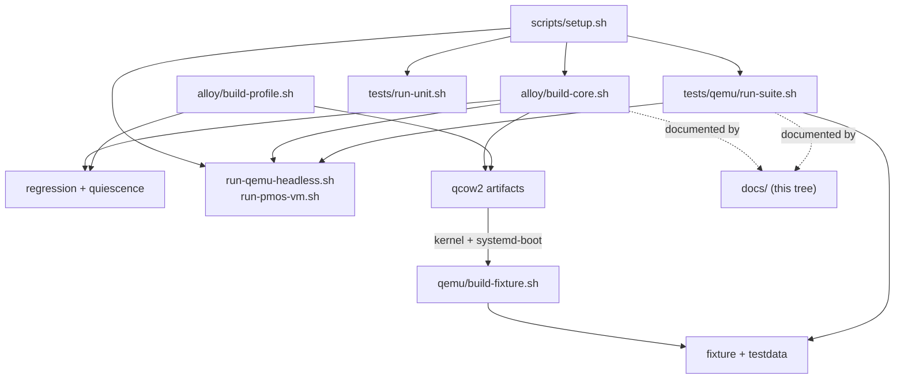

---

## 4. Layer stack

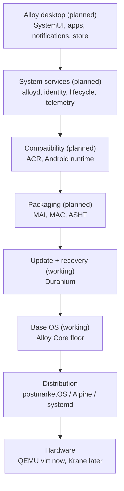

Only layers 1–4 are implemented to any degree; 5–8 are roadmap.

---

## 5. Floor metrics dashboard

### Image size (MiB)

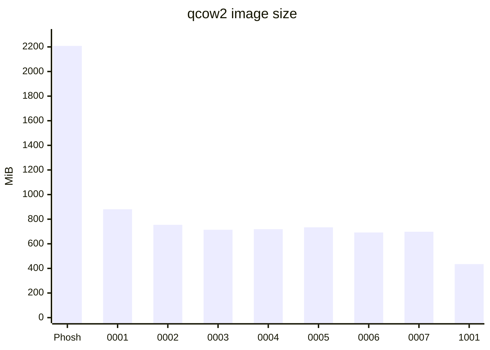

### Boot RAM (MiB)

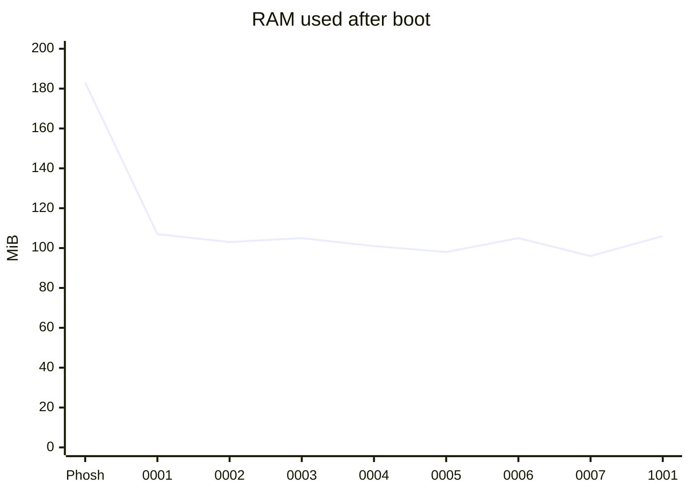

### Idle wakeups (IRQ/s)

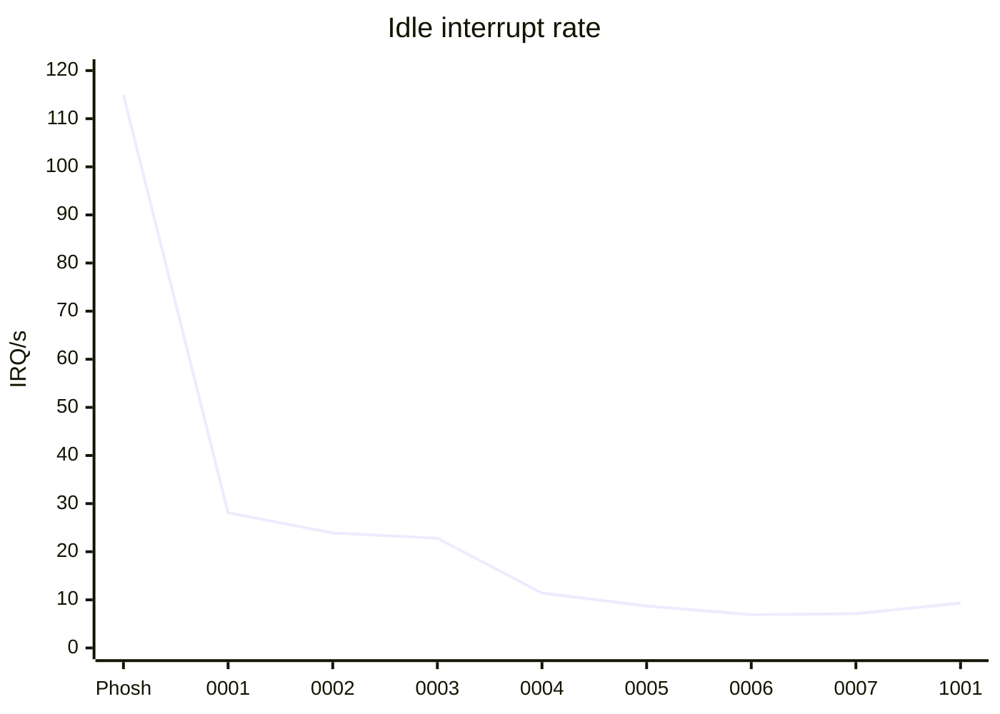

### Services and boot time

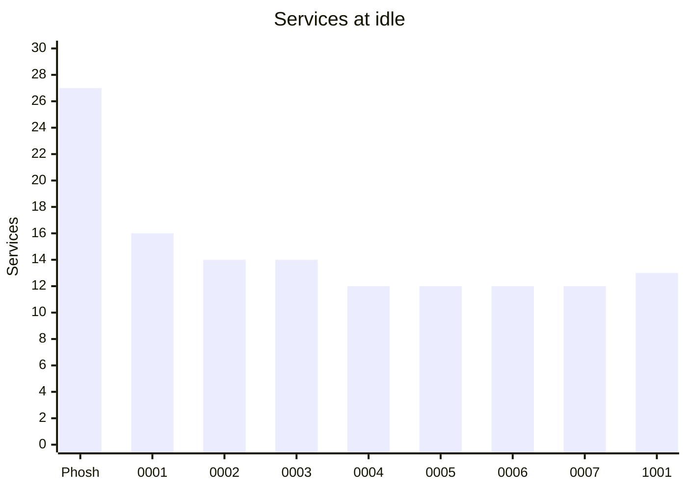

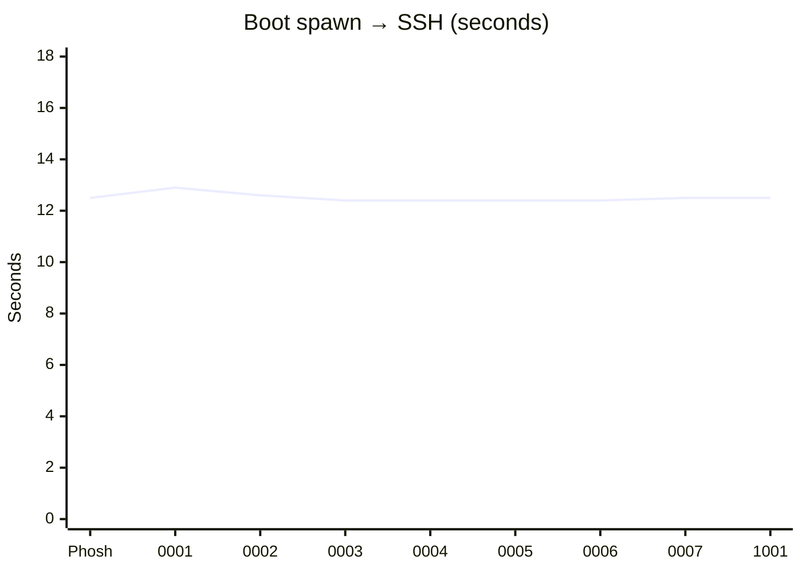

---

## 6. Where boot time goes

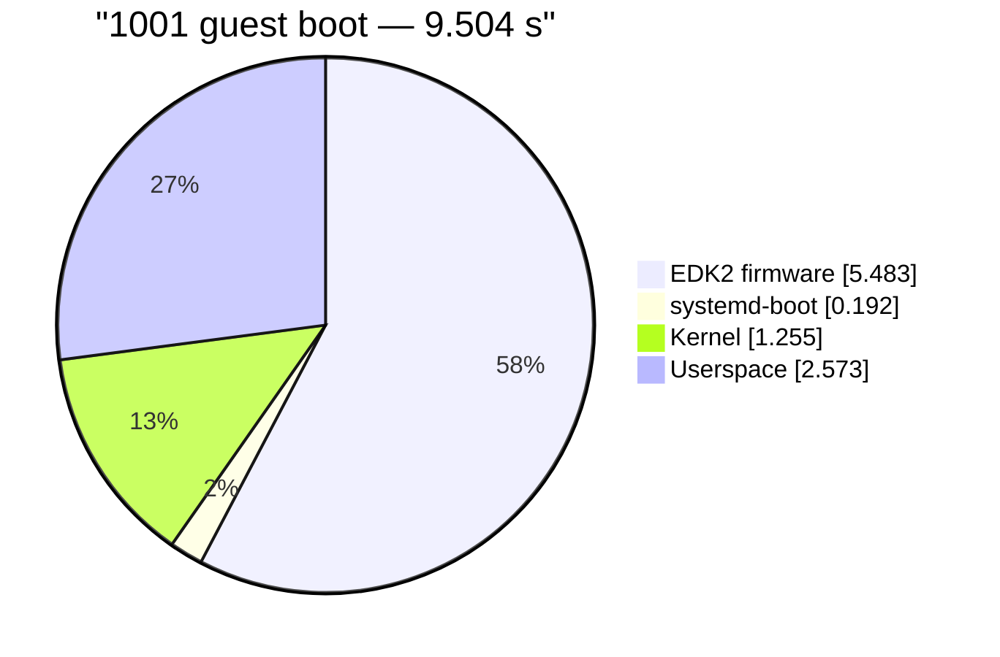

---

## 7. Duranium test coverage

### Unit checks by area (167 total)

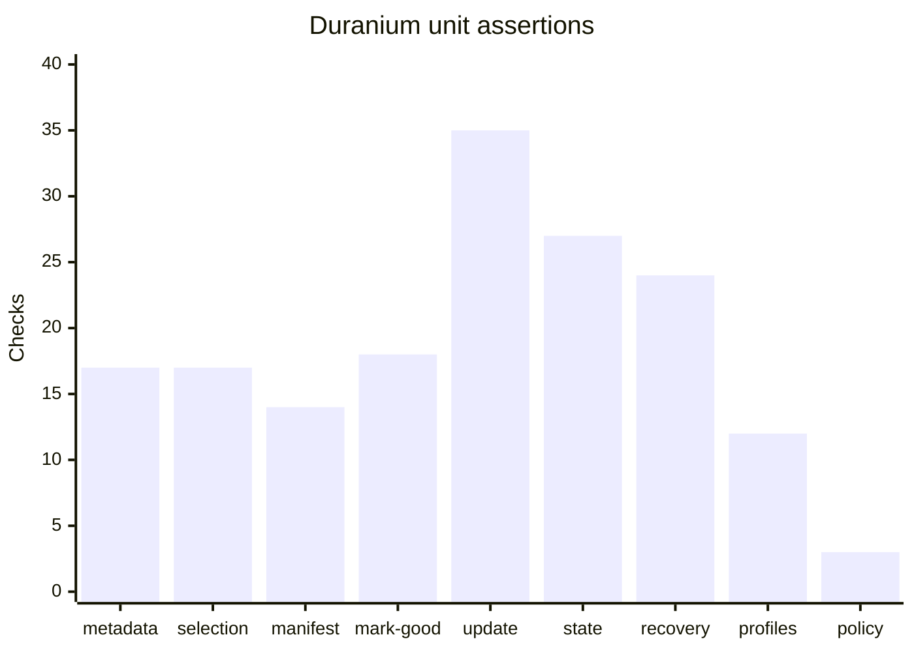

### QEMU assertions by scenario (176 total)

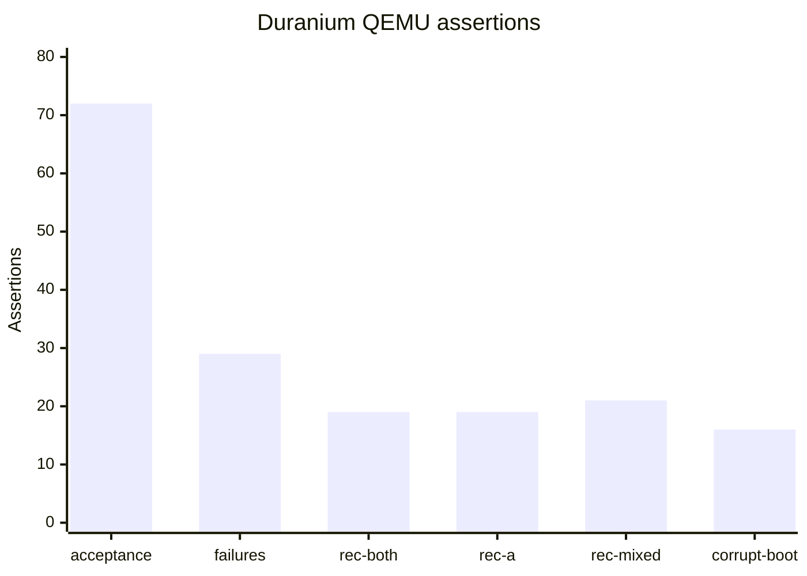

| Scenario | Boots |
| --- | --- |
| acceptance | 9 |
| failures | 2 |
| recovery-both | 2 |
| recovery-a | 2 |
| recovery-mixed | 3 |
| corrupt-boot | 5 |
| **Total** | **23** |

---

## 8. Data ownership at a glance

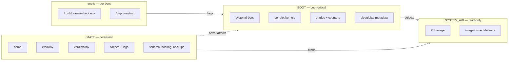

---

## 9. Roadmap phases

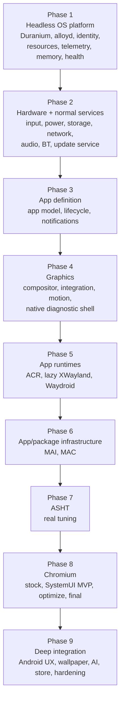

### Krane checkpoints

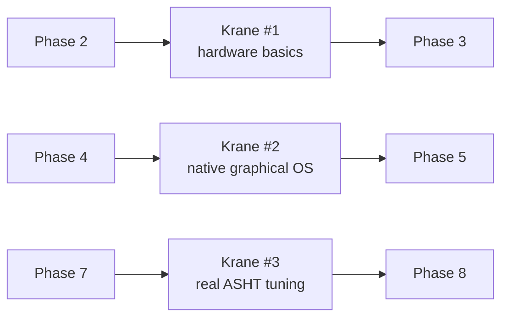

### The measurement boundary

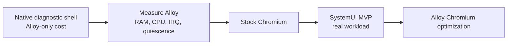

This is the central sequencing rule: **no Chromium until Alloy is already a
usable graphical OS, and no Chromium optimization until the SystemUI workload
exists to measure.**

---

## 10. The one-screen mental model

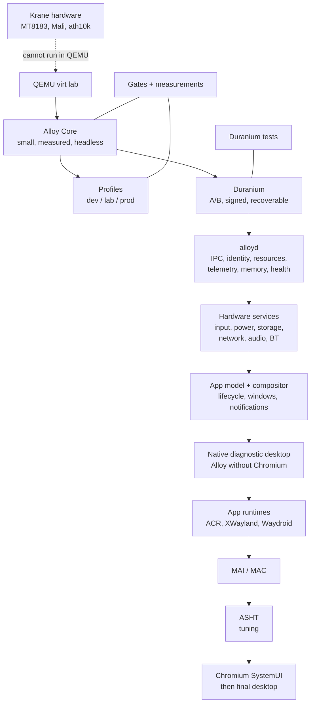

The repository today is the lower-left portion of this picture plus the
measurement rig. Everything from `alloyd` upward is the roadmap.
