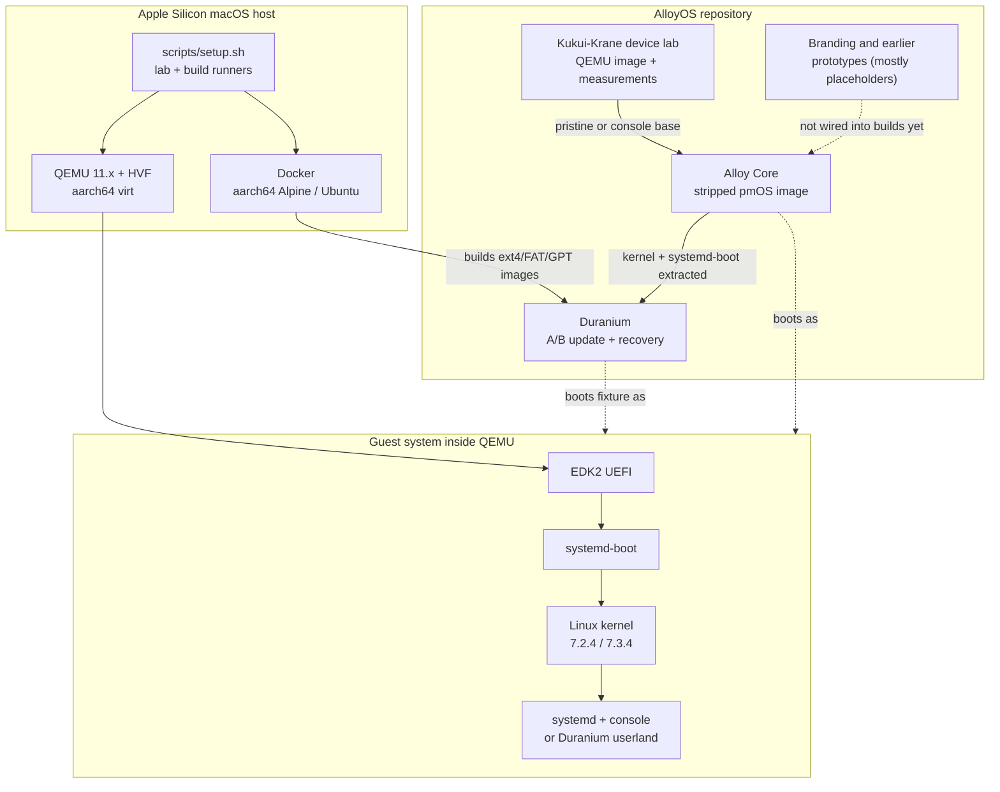

# Alloy OS — Engineering Documentation

This `docs/` tree is a full, repo-wide engineering guide to **Alloy OS**
(codename *Classic Prime Market*): what exists in this checkout, how each
piece is built, how the pieces connect, what is proven, and what is still a
placeholder.

It is written from a complete read of the repository on **2026-11-18**
(commit `ee45447` plus the working-tree changes present that day). Upstream
project docs remain authoritative for their own subsystems; this tree is the
map and the wiring diagram that ties them together.

---

## Start here

| If you want to… | Read |
| --- | --- |
| Understand the project in five minutes | [Project overview](01-project-overview.md) |
| See the system architecture and wiring | [Architecture](02-architecture.md) |
| Find a file or directory | [Repository map](03-repository-map.md) |
| Build or boot something | [Build and tooling](04-build-and-tooling.md) |
| Understand the stripped postmarketOS floor | [Alloy Core image](05-alloy-core-image.md) |
| Understand signed A/B updates and recovery | [Duranium update system](06-duranium-update-system.md) |
| Follow a boot from firmware to shell | [Boot flows](07-boot-flows.md) |
| See update/install/migration sequences | [Data flows](08-data-flows.md) |
| Run the test suites and gates | [Testing and gates](09-testing-and-gates.md) |
| See the measured performance story | [Measurements and performance](10-measurements-and-performance.md) |
| Review trust boundaries and audits | [Security model](11-security-model.md) |
| Operate, debug, and recover a system | [Operations runbook](12-operations-runbook.md) |
| Check status and the revised nine-phase roadmap | [Roadmap and glossary](13-roadmap-and-glossary.md) |
| See every chart in one place | [Visual atlas](14-visual-atlas.md) |

---

## The whole system on one page



### What is actually implemented

| Area | State in this checkout |
| --- | --- |
| Measured postmarketOS floor (Core) | Working recipe, gates, and one frozen QEMU artifact |
| Reproducible Core build | Working shell pipeline (8 gated stages) |
| Dev / lab / prod profiles | Working build scripts and gate thresholds |
| Duranium V1 | Working POSIX-shell implementation, unit tests, QEMU integration suite |
| Cryptographic update artifacts | Working Ed25519 + SHA-256 verification |
| Recovery environment | Working CLI recovery in the QEMU fixture |
| QEMU device lab | Working, documented, measured |
| Plymouth theme, Fastfetch, KSM, Waydroid, Plasma theme | **Empty placeholder files** |
| `alloy-core` package recipe | **Empty APKBUILD placeholder** |
| `alloyd`, compositor, SystemUI, MAI, MAC, ACR, ASHT | Roadmap only |

---

## Documentation conventions

- **"Core"** means the headless, stripped postmarketOS image built by
  `devices/kukui-krane/alloy/`.
- **"Fixture"** means the small deterministic Alpine/BusyBox disk built by
  `pkgs/duranium/qemu/build-fixture.sh` to exercise Duranium.
- **"0007 lineage"** means the kernel-7.2.4 stripped image frozen at
  `baselines/0007/`.
- **"1001 lineage"** means the newer kernel-7.3.4 floor shipped at
  `baselines/1000/alloy-1001-floor.qcow2`.
- Commands are shown from the repository root unless stated otherwise.
- Diagrams use Mermaid; they render on GitHub and in most Markdown viewers.

---

## Documentation map

```
docs/
├── README.md                     this index and one-page system map
├── 01-project-overview.md        goals, status, glossary-level orientation
├── 02-architecture.md            layers, components, dependency wiring
├── 03-repository-map.md          every top-level area and what lives there
├── 04-build-and-tooling.md       setup.sh, Core build, profiles, QEMU runners
├── 05-alloy-core-image.md        the measured floor, keep-list, gates
├── 06-duranium-update-system.md  metadata, A/B boot, state, recovery, tests
├── 07-boot-flows.md              firmware → kernel → userland, all variants
├── 08-data-flows.md              sequence diagrams for every major operation
├── 09-testing-and-gates.md       unit suite, QEMU scenarios, regression/quiescence
├── 10-measurements-and-performance.md  charts and methodology
├── 11-security-model.md          trust boundaries, audits, cryptographic checks
├── 12-operations-runbook.md      day-2 operation and troubleshooting
├── 13-roadmap-and-glossary.md    revised nine-phase roadmap, status, glossary
└── 14-visual-atlas.md            consolidated charts and maps
```

### Existing subsystem documentation

These files predate this tree and stay authoritative:

- [Repository README](../README.md) and [installation guide](../INSTALL.md)
- [Kukui-Krane lab](../devices/kukui-krane/README.md) and
  [index](../devices/kukui-krane/INDEX.md)
- [ALLOY packet 0000–0007](../devices/kukui-krane/docs/ALLOY-PACKET-0000-to-0007.md)
- [ALLOY history and sacrifices](../devices/kukui-krane/docs/ALLOY-HISTORY-AND-SACRIFICES.md)
- [ALLOY operations manual](../devices/kukui-krane/docs/ALLOY-OPERATIONS.md)
- [Core build program](../devices/kukui-krane/alloy/README.md)
- [Duranium README](../pkgs/duranium/README.md) and
  [architecture](../pkgs/duranium/docs/00-ARCHITECTURE.md)
- [Duranium test results](../pkgs/duranium/docs/11-TEST-RESULTS.md)
